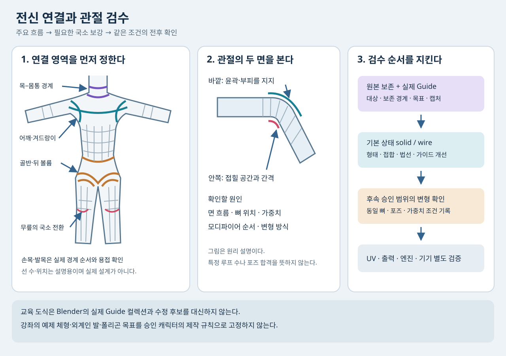

# 전신 캐릭터 제작 · 세 강좌 연결 매뉴얼

2026-10-31 · 교육용. 세 강좌의 시작부터 끝까지 개요와 주요 제작 구간의 상세 표본 화면, 공개 자동 자막 정리문을 대조했다. 모든 프레임·음성을 연속 검토하거나 실제 앱에서 재현한 결과는 아니다. [검토 기록](../reports/VideoLearning/20261031_BODY_COURSES_REVIEW.md) · [검증 JSON](../reports/VideoLearning/20261031_BODY_COURSES_VERIFICATION.json).

## 읽는 순서

| 순서 | 매뉴얼 | 원 강좌와 역할 |
|---|---|---|
| 1 | [몸통·팔다리 리토폴로지](BODY_RETOPOLOGY.md) | Dikko, [ULTIMATE Character Modelling Part 7](https://www.youtube.com/watch?v=3WnW_ZFXudk). 기존 조각 위에 주요 루프를 놓고 몸·두피·목을 연결 |
| 2 | [관절 볼륨 보강](BODY_JOINT_VOLUME.md) | Dikko, [Modeling for Animation 03](https://www.youtube.com/watch?v=GxMz4HylQfU). 어깨·엉덩이·팔꿈치·무릎 보강과 영상 속 동작 비교 |
| 3 | [게임용 베이스 메시](BODY_GAME_BASE_MESH.md) | Ironbark Games Studio, [Game Character Tutorial #1](https://www.youtube.com/watch?v=TJZ2TutkYnA). 기획·대칭 블록아웃·손발 접합·관절 국소 흐름 |

첫 강좌는 이미 조각이 있는 경우, 세 번째는 단순한 형체에서 시작하는 경우에 유용하다. 두 강좌의 몸을 서로 덮어씌우는 순서는 아니다. 손가락 세부 제작과 리깅은 [기존 손 교육](HAND_FINGER_WORKFLOW.md)을 연결해서 읽는다. 얼굴 경계는 [기본 얼굴 루프](FACE_RETOPOLOGY_BASIC_LOOPS.md), 텍스처 준비는 [Painter 작업 흐름](PAINTER_CHARACTER_WORKFLOW.md)을 참고한다.

## 제작 전에 고정할 것

승인된 기준 이미지와 최신 저장 파일을 실제로 확인한다. 옷이 가리는 부위를 강좌의 성인 체형으로 추정하지 않는다. 강좌 예제의 가슴·허리·골반 비율, 외계인의 두 갈래 발과 지느러미는 루미 디자인 기준이 아니다. 이미 별도 제작한 머리는 보존 경계로 취급하며 전신 교육 때문에 재설계하지 않는다.

실제 변경을 시작하기 전에는 원본을 보존하고 Blender의 별도 **Guide 컬렉션**에 다음 항목을 표시한다. 이 문서와 아래 SVG는 교육 도식이며 실제 Guide 파일을 대신하지 않는다.

1. 수정할 오브젝트·영역, 유지할 정점/면·연결 경계와 이름.
2. 어깨끝·겨드랑이·목둘레·골반·팔꿈치·무릎·손목·발목 등 해당 작업의 랜드마크.
3. 원하는 면 흐름과 접합 위치. 형태 변경이 포함되면 목표 윤곽, 이동 방향·범위와 보존할 실루엣.
4. 정면·사선·측면 캡처, 영역 좌표와 필요한 정점/면 인덱스.
5. 가이드 파일과 실제 수정 후보 파일의 구분, 구체적인 완료 기준.

가이드 제작자의 점유를 해제한 후 수정 담당이 단독으로 작업한다. 결과는 같은 카메라·표시 조건의 실제 solid/wire 전후 화면으로 비교한다. 교육 자료를 읽은 사실만으로 캐릭터 수정을 실행하거나 리깅·움직임까지 확대하지 않는다.

## 부위별로 확보한 근거

| 부위 | 실제 관찰한 내용 | 별도로 확인해야 할 것 |
|---|---|---|
| 어깨·겨드랑이·쇄골 | Part7의 어깨 둘레와 흉곽 연결, Volume의 Bevel 후 간격 정리 | 팔 들기 시 겨드랑이 끼임·가중치·쇄골 움직임 |
| 가슴·등·허리 | 몸통 격자와 국소 방향 전환, 가슴 추가 볼륨, 등에서 밀도 정리 | 승인 체형 유지, 옷 아래 실제 필요한 표면 |
| 골반·사타구니·엉덩이 | 골반 둘레·다리 시작·뒤쪽 볼륨을 연결하는 흐름, Volume의 동작 비교 | 깊은 굽힘·벌림에서 충돌과 가중치 영향 |
| 팔꿈치 | Part7의 링, Volume의 국소 Inset/정리, Ironbark의 Rip/재연결 | 굽힘 안쪽 압축·바깥 돌출과 실제 리그 조건 |
| 전완 비틀림 | Part7에서 향후 twist joint 가능성을 설명 | 트위스트 뼈 수·분배·손목 가중치·엔진 일치 모두 미검증 |
| 무릎 | Volume의 앞쪽 볼륨과 시연, Ironbark의 국소 흐름 | 슬개골 전용 구조나 정확한 뼈 운동은 입증되지 않음 |
| 발목·발 | Part7은 발목까지만 제작. Ironbark는 별도 발을 만들어 접합 | 사람 발가락 해부·발목 변형·발바닥 접지·신발 충돌 |
| 목–몸통 | Part7의 뒤통수·턱 아래–쇄골 밀도 전환 | 별도 머리의 실제 접합 경계·법선·UV·리그 계약 |
| 손목 | Ironbark의 손 경계 수 조절과 몸통에 Join 후 Bridge | 내부 면·겹친 정점·접합 뒤 실제 굽힘/비틀림 |

## 단계별 완료 기준

| 단계 | 작업 | 넘어갈 조건 |
|---|---|---|
| 기준·가이드 | 승인 원본, 보존 영역, 목표 흐름 기록 | 변경 영역과 제외 영역을 같은 파일에서 식별할 수 있음 |
| 대형 형태 | 정면·측면·위쪽에서 길이·폭·깊이 배치 | 승인 실루엣 유지, 정면만 맞춘 납작한 몸이 아님 |
| 주요 연결 | 어깨/골반 둘레를 몸통과 연결 | 연결 방향·경계 순서가 맞고 가늘고 긴 면 집중이 없음 |
| 팔다리 | 목표 단면과 관절 위치에 맞춰 진행 | 원치 않는 나선·단면 찌그러짐·앞뒤 밀도 급변을 확인 |
| 목·손·발 접합 | 필요한 경계만 조절해 연결 | 의도하지 않은 구멍·내부 면·중복 면·비용접 틈 없음 |
| 기본 상태 검수 | solid/wire와 법선·경계 검사 | 수치 검사와 함께 가이드 부위의 시각 개선이 확인됨 |
| 변형 검수 계획 | 필요한 동작과 조건 기록 | 실제 리깅 작업이 승인되었을 때만 실행 |
| 게임 검수 계획 | 삼각화·재질·LOD·압축·엔진 조건 기록 | 실제 엔진과 대상 기기에서 확인하기 전에는 미검증 |

루프 수나 사각면 비율 하나로 완료를 판정하지 않는다. 관절의 위치·압축 여유·윤곽과 주변 면 연결이 목적이다. Subdivision을 켠 예쁜 미리보기와 원본 케이지의 건전성은 함께 확인한다.

## 이후 변형 검수의 조건

아래는 강좌에서 모두 실행한 결과가 아니라 실제 제작 시 사용할 **검수 계획**이다. 보류 중인 리깅·움직임을 지금 실행하라는 지시가 아니다.

| 동작 | 볼 곳 | 함께 고정할 조건 |
|---|---|---|
| 팔 내리기·들기·앞으로 뻗기 | 어깨 캡, 겨드랑이, 쇄골·등 당김 | 같은 골격·포즈·카메라·가중치 기준 |
| 팔꿈치 굽히기 | 바깥 부피, 안쪽 접힘, 비틀린 면 | 골축 위치, 가중치, 모디파이어 순서 |
| 전완 돌리기·손목 굽히기 | 사탕 포장처럼 꼬임, 접합 틈 | twist 분배·안정된 손목 경계 |
| 다리 들기·벌리기·앉기 | 사타구니, 엉덩이 아래, 허벅지 부피 | 좌우 대응과 몸통 변형의 영향 |
| 무릎 굽히기 | 무릎 앞 윤곽·뒤쪽 압축 | 기본 상태의 무릎 위치·같은 뼈/가중치 |
| 발목 굽히기·접지 | 뒤꿈치·발등·발바닥, 신발 간섭 | 발 리그·접지 조건·실제 신발 |
| 목 돌리기·숙이기 | 머리 접합, 쇄골·어깨 당김 | 별도 머리 경계·목 뼈·가중치 |

작은 각도부터 필요한 실제 동작 범위까지 단계적으로 확인하고 사용 각도를 기록한다. 교육 예제의 각도를 보편적인 합격 수치로 만들지 않는다. 모바일 폴리곤 예산, 뼈 수·영향 수, LOD, UV 여백, 노멀 베이크와 엔진 성능은 별도 사양·측정 대상이다.

## 확인 범위

첫 강좌는 손·발 제작과 동작 시험이 빠져 있다. 두 번째 강좌는 Mixamo를 거친 두 모델의 시연을 보여 주지만 동일 가중치의 통제 실험은 확인하지 못했다. 세 번째 강좌의 제목과 도입에 언급된 UV·Painter·리깅·게임 엔진은 이 편에서 수행하지 않는다. 이번에는 Blender live·Claude·Painter를 조회하거나 조작하지 않았으며 기존 제작 상태를 변경하지 않았다.
