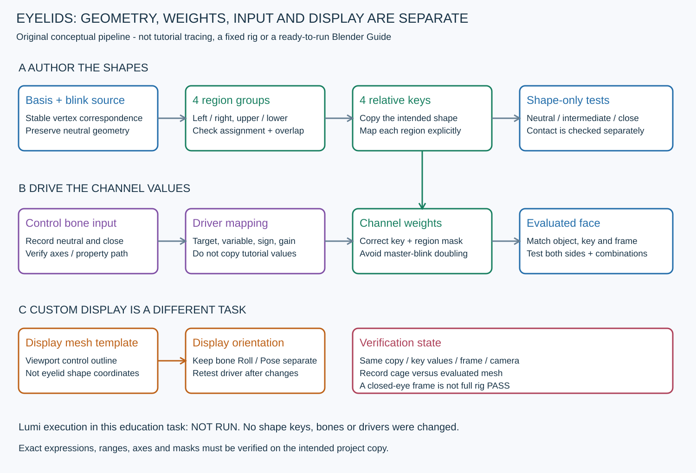

# 3번 영상 정식 분석 — 눈꺼풀 셰이프키·그룹·드라이버 매뉴얼

2026-10-31 · Level Pixel Level 학습 자료 · 루미 실제 리깅 작업 아님

**기본 형태(Basis)를 보존하고 닫힘 모양을 만든 뒤, 좌우·위아래 채널을 구분해 그룹과 드라이버를 연결한다.** 메시 모양, 키의 영향 범위, 제어 본의 입력, 조작기 표시 모양은 서로 다른 데이터다. 닫힌 눈 한 장이나 보라색 값 필드만으로 접촉·리그 품질을 통과시키지 않는다.

대상은 [Eyelid Rig - Shape Keys | Blender Rigging For Animation](https://www.youtube.com/watch?v=XleNIUWoydY),14:07이다. ‘3번 영상의 첫 정식 분석’이며1번 Dikko 재분석이 아니다. 기존 여섯 표본을 재사용하고 전체 흐름과 핵심 단계를 추가로 읽었다. 고유103장 중 이전6장·신규97장, 전체 교육 누적386장이다. 정지 표본 기반이며 연속 영상·음성/자막 전체를 분석했다고 주장하지 않는다. [실제 표본·AI 검증 기록](../reports/VideoLearning/20261031_LPL_SHAPE_KEYS_REVIEW.md).

## 1. 실제 화면의 단계 지도

| 원본 시각 | 직접 확인한 화면 | 해석의 한계 |
|---|---|---|
| 00:00~00:30 | 시작 화면, 얼굴 일부·안구·조작기가 보이는 준비 장면 | 준비된 장면의 전체 제작 이력은 미확인 |
| 00:40~01:00 | Shape Keys 패널과 `Basis`/`blink`, 이후 메시 편집 화면 | 모든 버튼 입력을 연속 복원하지 않음 |
| 01:10~02:40 | X 대칭 관련 옵션과 눈꺼풀 정점 이동, X-ray/solid 전환 | 정면 이동만으로 안구를 따르는 전체 경로를 검증한 것은 아님 |
| 02:40~03:50 | 닫힘 모양·모서리·인접 줄 정리.03:00~03:10에는 밝은 틈/조각이 남는 단계가 보임 | 밝은 영역의 정확한 원인을 단일 화면으로 확정하지 않음 |
| 03:54~04:20 | 닫힌 눈의 음영 상태와 전체 보기 | 중간 닫힘·모든 시점에서의 무관통 PASS 아님 |
| 04:25~05:30 | Armature 준비, 본 배치·대칭 관련 옵션과 여러 제어 본 | 본별 최종 축·연결 관계 전체는 미확인 |
| 05:36~06:20 | `New Shape From Mix` 메뉴, 복사된 키와 이름 정리 | 활성 키 복제와 현재 Mix 복제를 구분해야 함 |
| 06:30~08:10 | `top_left/top_right/bot_left/bot_right` 그룹, 영역 선택·할당·가중치 표시 | 모든 정점·가중치가 적절하다는 데이터 검증은 아님 |
| 08:20~08:30 | 분리 키 테스트/설정.08:30에는 `top_left` 키의 Vertex Group이 `top_left`로 보임 | 네 키의 최종 전체 매핑을 한 화면으로 확정하지 않음 |
| 08:40~10:40 | 드라이버 추가·편집·복사, Driver Editor와 경로 수정 | 편집 중 값과 최종 리그 설정은 다름 |
| 10:44~11:10 | 본을 움직이는 화면, 본 축 표시와 Roll 편집 | 모션 전 구간·회전된 상위 리그에서의 동작 품질은 미확인 |
| 11:20~13:10 | Custom Object 항목, 별도 `face.002` 메시의 표시 모양 편집·정렬 | 셰이프키 좌표 수정과 구분되는 조작기 표시 작업 |
| 13:30~14:06 | 복잡한 얼굴 리그 예시와 종료 화면 | 마지막 리그 전체를 이14분에서 제작했다고 주장하지 않음 |

전체 흐름은30초 간격+14:06의30장, 핵심은 대체로10초 간격과 지정 전환 표본이다. 정확한 모든 전환 프레임·강사의 발언은 미확인이다. 초반 파일명 `eye_method_1_begin.blend`와 후반 `eye_method_1_end.blend`가 달라지는 화면도 있어 모든 데이터가 한 번의 연속 작업으로 만들어졌다고 단정하지 않는다.

## 2. 화면에서 읽힌 값은 그 시점의 증거다

| 직접 읽은 시점 | 확인 내용 | 재사용할 때 주의 |
|---|---|---|
| 09:10 | `ERROR: Invalid Python expression`가 표시됨 | 편집 중 오류의 정확한 단일 원인은 미확인. 변수·경로·식·대상을 함께 점검 |
| 09:20 | 다음 표본에는 위 오류 문구가 보이지 않고 식/경로를 편집함 | 문구가 사라졌다는 것만으로 전체 드라이버 검증 완료 아님 |
| 10:40 | `Value(bot_right)`, `Scripted Expression`, 식 `-var*25`, RNA 경로 끝 `.location.z` | 영상의 한 편집 상태다. 계수25·부호·본 이름을 루미 기본값으로 복사하지 않음 |
| 11:10 | 본 Edit Mode의 Roll에70°와 로컬 축이 표시됨 | 해당 본·그 시점의 값이며 모든 본의 정답 아님 |
| 12:00/12:30 | 별도 메시 `face.002` 편집, 이후 본의 Custom Object 항목 | 본 Roll, 본 Pose 변환, custom display 모양, 실제 키 변형을 구분 |

이 강좌의 드라이버 화면에는 Armature 속성에 대한 RNA 경로가 보인다. Transform Channel의 Space 드롭다운을 설정했다고 임의 설명하지 않는다. 정확한 네 경로·계수·최종 제약·모든 축 방향은 확인하지 못했다.

## 3. 2.81 화면과5.2 기준을 구분한다

영상 하단 버전은 **2.81.16**이다. 프로젝트의 Blender 기준은5.2.2 LTS 기록이지만 이번에는 앱을 열거나5.2에서 동작을 재현하지 않았다.

공식5.2 패널 문서는 현재 평가된 모양에서 만드는 기능을 `New Combined`, 활성 키 사본을 `Duplicate`로 구분한다. 영상의 `New Shape From Mix`와 단순 `+`/활성 키 복제를 같은 동작으로 취급하지 않는다. Vertex Group은 키의 영향 영역을 제한한다. [Blender5.2 Shape Keys 패널](https://docs.blender.org/manual/id/5.2/animation/shape_keys/shape_keys_panel.html).

Basis·키 생성·현재 Mix의 차이는 [공식 워크플로 설명](https://docs.blender.org/manual/en/5.0/animation/shape_keys/workflow.html)을 참고한다. 드라이버의 속성 경로와 Transform Channel·좌표계 선택은 [공식 Drivers 패널](https://docs.blender.org/manual/nl/5.0/animation/drivers/drivers_panel.html), 본 표시용 Custom Object의 별도 변환은 [공식 Viewport Display](https://docs.blender.org/manual/sl/5.0/animation/armatures/bones/properties/display.html)를 참고한다. 뒤 세 링크는5.0 문서의 개념 근거이며5.2 앱 실검증으로 표시하지 않는다. 실제 작업 전 현재 버전의 메뉴·대상·값을 읽어야 한다.

## 4. 데이터 흐름과 작업 순서 — 자체 지침

직접 만든 개념도다. 강좌 tracing·실측 루미 설계·실행 가능한 native Guide가 아니며, 아래 절차는 영상 관찰과 프로젝트 보존 원칙을 합친 자체 작업 지침이다. 이번에 실행한 제작 단계가 아니다.

1. **원본·작업 복사본을 고정한다.** 최신 live checkpoint, 원본/Basis 좌표, 정점 순서·연결, 안구·UV/weight·기존 키/driver/리그와 스택을 기록한다. 다른 복사본·활성 키·프레임을 같은 상태로 비교하지 않는다. 원본을 덮어쓰지 않는 교육/제작 복사본을 구분한다.
2. **기본 토폴로지를 먼저 안정시킨다.** opening, 가장자리 두께·안쪽 벽·두 모서리·접힘·주변 피부 연결을 [볼륨 매뉴얼](FACE_EYELID_VOLUME.md) 기준으로 준비한다. 키는 기존 정점 위치의 대응을 사용하므로 리토폴로지 중간 상태를 완성된 키 기반으로 취급하지 않는다. 루미의 형태 변경 Guide·랜드마크·허용 범위와 인덱스를 먼저 만들고 점유 인계 원칙을 따른다.
3. **Basis를 보존해 닫힘 모양을 만든다.** 현재 키·값·Relative To와 다른 키의 영향 상태를 확인하고, 복사본의 목적 키에서만 눈꺼풀을 다룬다. X 대칭 옵션은 실제 메시 기준을 읽고 사용하며 비대칭 원본을 자동 대칭화하지 않는다. 가장자리만 평면으로 내리지 말고 안구를 따르는 중간 경로·두께·안쪽 벽·인접 피부를 여러 시점에서 확인한다.
4. **닫힘 모양을 먼저 검수한다.** 열린 상태·중간·완전 닫힘에서 X-ray/solid·사선/측면을 나눠 읽는다. 틈·밝은 조각·관통 의심을 실제 안구 표시/숨김과 형상으로 진단한다. 모서리나 벽이 따로 움직여 접히지 않게 Guide 범위 안에서 정리한다. 닫힌 음영 한 장만으로 완료 처리하지 않는다.
5. **좌우·위아래 네 채널을 분리한다.** 강좌 이름은 `top_left/top_right/bot_left/bot_right`다. 루미의 오브젝트 이름·X 부호·해부학적 좌우와 화면 좌우를 먼저 대응시킨다. 전체 blink 좌표를 복사하는 작업과 각 채널의 마스크 지정은 별개다. 현재 Mix에서 복제할 때 다른 키의 중복 영향을 포함하지 않았는지 확인한다.
6. **정점 그룹과 키를 연결한다.** 각 영역의 선택·할당·가중치를 확인하고 대응 키의 Vertex Group을 명시한다. 키 이름과 그룹 이름이 같다는 사실만으로 연결됐다고 판단하지 않는다. 그룹별 단독 작동, 경계의 겹침/빈 곳과 반대쪽으로 새는 영향도 확인한다. 이 정점 그룹은 키 마스크 용도이며 자동으로 본 스키닝 가중치가 완료됐다는 뜻은 아니다.
7. **채널별 제어 본과 드라이버를 준비한다.** 대상 Armature·본 이름·입력 속성/축·좌표 기준·열린/닫힌 위치를 기록한다. 중립값과 닫힘 이동량으로 부호·감도를 정하고 허용 범위를 설계한다. 영상의 `-var*25`를 가져오지 않는다. 원래 전체 blink와 분리 키가 동시에 중복 적용되지 않는 기준 상태를 만든다.
8. **복사 후 반드시 다시 매핑한다.** Copy Driver는 대응 채널에 필요한 설정의 시작일 뿐이다. Driven Property, 변수의 대상/경로, 본 접미사·좌우·상하, 식의 부호/계수와 범위를 각각 확인한다. 보라색 필드·오류 문구 비표시만으로 올바른 영향이라고 판정하지 않는다.
9. **본 축과 조작기 표시를 따로 검수한다.** Edit Mode Roll, Pose 값, custom display 오브젝트를 구분해 기록한다. 조작기 모양을 돌려 보기에 맞춘 것과 드라이버 입력 축을 바꾼 것은 다르다. 표시 수정 뒤에도 기존 경로·부호·중립/닫힘 동작을 다시 시험한다. Roll70°나 특정 위젯 모양을 기본 규칙으로 쓰지 않는다.
10. **조합·보존·저장 결과를 검증한다.** 아래 시험표와 동일 조건 캡처·변경 데이터/보존 비교를 남긴다. 새 후보와 원본/Guide를 구분해 저장·재읽기하고 정상 점유 해제한다. 이번 교육은 문서만 만들었으며 이 제작·검증 절차를 루미에서 실행하지 않았다.

## 5. 후속 제작 시 시험 조합

아래 수치0/중간/1은 자체 시험 설계의 예시이며 강좌의 모든 검사 목록이 아니다. 실제 채널 범위·제약과 함께 정한다. **이번 루미 시험 상태는 전부 NOT RUN**이다.

| 시험 | 확인할 결과 |
|---|---|
| 모든 시험 키0, 제어 중립 | Basis/기준 중립과 일치, 기존 저장 키·리그 보존 |
| 좌/우·위/아래 각 채널 단독 | 지정 영역만 영향, 반대쪽·모서리·코/볼에 의도치 않은 이동 없음 |
| 양쪽 blink의 중간/완전 닫힘 | 경로 전체의 안구 관통·접촉·두께·모서리 압축 확인 |
| 한쪽 닫힘+반대쪽 중립 | 좌우 독립성과 중앙/내안각 영향 확인 |
| 위/아래 채널 동시+기존 표정 조합 | 그룹 경계·중복 영향·접힘과 코/볼 당김 확인 |
| 제어 루트 이동/회전, 필요한 스케일 조건 | 입력 기준이 의도대로 유지되는지, 잘못된 전역값 참조가 없는지 |
| driver/표시 수정 후·파일 재읽기 후 | 경로/대상·부호·리셋·중립과 동일 테스트 결과 재확인 |

## 6. 실패와 다음 확인

| 현상 | 먼저 확인 |
|---|---|
| Basis 자체가 달라짐 | 활성 키·Relative To·현재 Mix·복사본을 확인하고 checkpoint와 대조. 임의 Make Basis/Apply All로 덮지 않음 |
| 키를 켜도 한 영역이 안 움직임 | 마스크 그룹의 실제 할당·가중치·키의 Vertex Group/범위·드라이버 대상 확인 |
| 다른 눈·위아래가 같이 움직임 | 복사된 경로·본 접미사, 좌우 대응, 그룹 겹침과 전체 blink의 중복 영향 확인 |
| Invalid Python expression/값 미응답 | 식·변수 정의·대상 ID·속성 경로·타입을 함께 읽음. 영상 오류의 원인을 단일 항목으로 단정하지 않음 |
| 반대로 움직이거나 과하게 닫힘 | 제어 기준 위치·본 축·부호·감도·범위 확인; 영상 계수25를 정답으로 반복하지 않음 |
| 닫힘 틈·밝은 조각·관통 | 중간 상태, rim/벽/주변 피부, 실제 안구와 여러 시점으로 원인을 좁힘 |
| custom shape가 옆으로 눕거나 크기가 이상함 | 표시 오브젝트·본 표시 변환·축을 확인. 표시만 고쳤다면 driver 입력도 여전히 맞는지 재시험 |

## 7. 루미에 적용하기 전의 완료 조건

- [ ] 원본/Basis·정점 대응·안구·UV/weight·기존 키/driver/리그와 최신 checkpoint를 보존했다.
- [ ] 중립 기본 메시의 연결·곡률·두께·벽·원본 접속을 먼저 검수하고 Guide·허용 범위·인덱스를 저장했다.
- [ ] 좌우 이름/축·네 키·그룹 할당·마스크 매핑·중복 영향과 각 채널의 책임 범위를 기록했다.
- [ ] 네 driver의 대상·변수/경로·입력 기준·식/부호/범위, 본 Roll/Pose와 custom display를 구분했다.
- [ ] 실제 실행한 조합에만 PASS/PARTIAL을 부여하고 미실행 항목은 NOT RUN으로 남겼다.
- [ ] 동일 조건 전후·보존 결과·새 저장 파일·재읽기와 정상 점유 해제를 기록했다.

현재 루미 v021의 원본 미용접·경계 전환·표면 이격 최대7.237mm의 **PARTIAL**은 그대로다. 기존 보관14키/13driver와32점·7고리 기록도 새 제작 완료나 표준 규격으로 바꾸지 않는다. 적용 준비 문서를 작성한 것과 루미의 애니메이션을 제작한 것은 다르다.

## 8. 미확인 범위

강좌의 네 driver 최종 전체 식/경로·좌표계·본 축·제약, 정확한 그룹별 모든 가중치, 모든 중간 모션의 관통·회전 보정 후 품질, 준비 파일 간 데이터 동일성, 음성상의 설명은 미확인이다. 화면에서 읽힌 특정 식·Roll·키/그룹 대응은 위 시간의 관찰로만 기록했다. [검증 JSON](../reports/VideoLearning/20261031_LPL_SHAPE_KEYS_VERIFICATION.json)에 표본·도구·버전 근거와 문서 검사를 남긴다. 원본 영상·음성·대량 캡처·AI payload는 Git에 게시하지 않는다.
