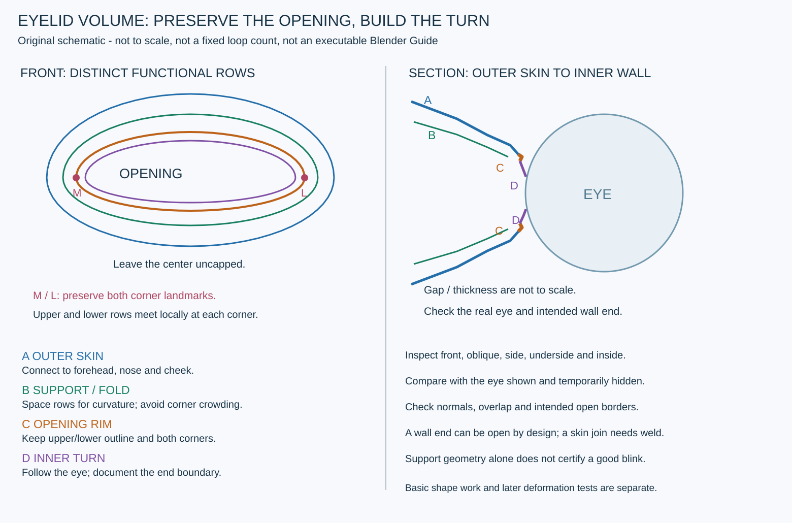

# 눈꺼풀 볼륨 제작 매뉴얼 — 가장자리·안쪽 벽·주변 피부 연결

2026-10-31 · 퍼즐 아일랜드 기본 메시 학습 자료

**눈 구멍을 둘러싼 선에 두께와 안쪽으로 돌아가는 면을 만들고, 이를 안구 주변의 위·아래 피부 볼륨과 연결한다.** 눈 opening의 윤곽, 가장자리 두께, 안쪽 벽, 바깥 피부의 접힘·지지 줄은 서로 다른 역할이다. 눈 전체를 면으로 막거나 가장자리 한 줄만 부풀려 해결하지 않는다.

이 문서는 [얼굴 기본 루프 매뉴얼](FACE_RETOPOLOGY_BASIC_LOOPS.md) 4절의 상세 보강이다. 아래 **영상 관찰**과 **자체 제작 절차**를 구분한다. 루미의 새 메시·리깅·blink를 제작하거나 검증한 보고서가 아니다.

## 1. 실제로 확인한 영상 범위

주자료는 Dikko [Modeling for Animation 06 - Retopologising the Face!](https://www.youtube.com/watch?v=SwM19PgSdCM&t=2428s)의40:28~41:45 전후다. 정지 표본에서 눈과 입으로 바뀌는 시점을 다시 확인했다.

| 원본 시각 | 직접 관찰 | 판단의 한계 |
|---|---|---|
| 40:10,40:20 | 머리 옆·전체와 이미 연결된 얼굴 메시를 본다 | 눈꺼풀 생성 단계의 전후로 취급하지 않는 직전 맥락 |
| 40:28~40:37 | 눈 opening과 위·아래의 여러 줄, 선택된 경계가 보인다 | 화면상의 검은 영역만으로 안구·막힌 면·완성 여부를 판정하지 않음 |
| 40:40~41:07 | 정면·사선·측면을 번갈아 보며 눈 경계의 깊이 방향과 주변 줄을 확인한다 | 줌·카메라 변화에서 눈이 계속 내려가거나 밀도가 증가했다고 단정하지 않음 |
| 41:10~41:16 | 안쪽을 보는 시점에서 opening을 둘러싸며 돌아가는 면 띠가 보인다 | 정확한 벽 깊이·종단·공유 정점·두께 수치는 미확인 |
| 41:19~41:31 | 가까운 사선·아래 시점에서 테두리와 안쪽 면을 확인한다.41:22에는 `Loop Cut and Slide` 패널도 보인다 | 모든 입력과 최종 엣지 수를 복원하지 않으며 특정 지지 줄 개수의 정답으로 사용하지 않음 |
| 41:34~41:43 | wire 없는 전체 음영과 안구가 보이는 상태를 확인한다.41:35.5 추가 표본에도 안구가 보인다 | 간격·관통·변형 품질이 수치 검증됐다는 뜻은 아님 |
| 41:45~41:50 | 얼굴 일부·내부를 보는 시점으로 바뀐다 | 이 전환 전체를 눈꺼풀 생성으로 묶지 않음 |
| 41:52,41:54~42:00 | 입의 안쪽/옆 시점, 선택된 입 경계가 보인다 | 입·구강 단계이며 눈꺼풀 학습의 근거에서 제외 |

단계 전환은 **41:52에 입 시점,41:54에 선택된 입 경계를 확인했다**고 기록한다. 정확히 어느 연속 프레임에서 조작이 바뀌었는지·강사의 발언은 확인하지 않았다. 챕터 표의41:45만으로42~45분을 눈꺼풀로 분류하지 않는다.

보조 자료인 Level Pixel Level [Eyelid Rig - Shape Keys](https://www.youtube.com/watch?v=XleNIUWoydY&t=90s)는 기존01:30/02:40/03:54 표본만 다시 읽었다. `blink` 키 편집 화면, 눈 주위 줄과 닫힌 눈 모양이 보인다. 이 표본은 후속 확인 항목을 설명하는 참고이며 루미의 blink 성공 증거가 아니다. [상세 학습·도구 오답 기록](../reports/VideoLearning/20261031_EYELID_VOLUME_REVIEW.md).

## 2. 네 구역을 따로 설계한다

자체 개념도이며 영상 tracing·루미 실측 좌표·완성 quad 배치·실행 가능한 Blender Guide가 아니다. 안구와의 간격, 두께, 줄 수를 그림에서 재지 않는다.

| 구역 | 역할 | 보존·검수 대상 |
|---|---|---|
| A 주변 피부·눈두덩 | 안구 주변의 바깥 볼륨을 코·이마·볼로 연결 | 정면 외형과 사선·측면 곡률, 기존 접속 경계 |
| B 지지·접힘 줄 | 가장자리 전환과 필요한 곡률을 유지 | 줄 간격, 면 압축, 눈꼬리와 접힘선의 꺾임 |
| C opening 가장자리(rim) | 승인된 위·아래 윤곽과 두 모서리, 가장자리 두께 | 개구 높이·폭·모서리 위치, 얇게 찢어진 실루엣 |
| D 안쪽으로 돌아가는 벽 | 가장자리 뒤를 잇는 면과 보이는 안쪽 깊이 | 안구와의 간격·관통, 면 방향, 종단 경계의 의도 |

안쪽 벽의 끝은 제작 방식에 따라 의도한 open boundary로 남을 수 있다. 모든 boundary를0으로 만들려고 눈 구멍을 cap하지 않는다. 반대로 주변 피부와 붙어야 할 곳의 열린 경계를 의도된 구멍으로 숨기지 않는다. 기대하는 경계를 구역별로 기록한다.

## 3. 제작 전에 보존 경계와 가이드를 만든다

1. 사용자 최신 live checkpoint, 원본 피부, 안구 오브젝트·변환·스케일, UV·가중치·보관 키와 리그를 기록한다. 오래된 저장본으로 현재 상태를 대체하지 않는다.
2. 눈 안쪽/바깥쪽 모서리, 위·아래 최고점, opening 윤곽, 코 쪽·이마 쪽·볼 쪽 접속 경계와 안쪽 벽의 목표 범위를 Blender 별도 Guide 컬렉션에 표시한다. 두 모서리를 날카로운 한 점으로 몰아 넣을 목표를 만들지 않는다.
3. 형태 변경이 필요하면 정면·사선·측면의 목표 윤곽과 이동 방향·허용 범위를 표시한다. 해당 위치의 오브젝트·정점/면 인덱스, 유지할 랜드마크와 연결 경계 순서·개수도 저장한다.
4. 두께와 간격은 현재 모델 단위·승인 형태·안구 크기·게임 화면 크기를 기준으로 정한다. 영상의 UI 숫자나 루미 v021의32점·7고리를 보편 규칙으로 쓰지 않는다.
5. 가이드 파일·원본 checkpoint와 실제 수정 후보 파일을 구분하고, 정면·사선·필요한 측면/아래 캡처를 저장한다. 가이드 제작만으로 피부를 수정하지 않으며, 정상 점유 해제 후 제작 담당이 단독 작업한다.

## 4. 작은 띠씩 볼륨을 만든다 — 자체 제작 절차

아래는 화면 관찰을 현재 프로젝트의 보존·검수 방식에 옮긴 자체 절차다. 영상의 모든 조작을 그대로 재현하는 설명이 아니다. Dikko 화면에서 RetopoFlow를 사용했다고 주장하지 않는다.

1. **opening을 먼저 확정한다.** C의 경계 순서를 따라 위·아래·두 모서리를 확인한다. 선택이 눈썹선·옆 피부 고리까지 번지지 않았는지 본다. 새 Target은 원본과 분리하고, 원본에 붙이는 작업인지 자체 내부 연결인지 기록한다.
2. **현재 두께를 진단한다.** 정면의 한 줄만 보지 말고 안구를 켠 사선·측면·아래 시점과 내부를 읽는 보조 시점을 함께 본다. C에서 D로 돌아가는 면이 이미 있으면 중복 띠를 겹쳐 만들지 않는다. 원본 피부 스냅만으로 D를 만들면 표면으로 되돌아갈 수 있으므로 안쪽 목표와 스냅 대상을 분리해 설계한다.
3. **가장자리에서 안쪽으로 면 띠를 잇는다.** Guide에 맞춰 C의 윤곽을 유지하면서 D로 이어지는 작은 면을 만든다. 선택 경계에서 짧은 구간을 먼저 시험하고 원치 않는 면 중복·닫힘·반전이 없는지 본다. 안구 표면을 관통하거나 개구부를 가로질러 막는 방향으로 밀지 않는다. 얼굴 전체에 균일한 두께를 적용했다는 사실만으로 국소 형태를 통과시키지 않는다.
4. **위·아래 바깥 볼륨을 같이 읽는다.** 위쪽은 눈두덩·이마 방향, 아래쪽은 안구 아래 곡면·볼 방향으로 부드럽게 이어지도록 A/B를 정리한다. 위아래를 같은 평면의 고리로 만들거나 rim 한 줄만 이동해 뒤의 벽과 옆 피부를 접지 않는다. 허용한 국소 연결 띠에 이동이 점진적으로 줄어들도록 한다.
5. **두 모서리를 잇는다.** 안쪽·바깥쪽에서 위·아래 rim과 D가 어떻게 이어지는지 wire로 확인한다. 인접 줄의 대응 순서가 꼬이거나 면이 서로 포개지지 않게 계획한다. 모서리 한 점을 줄이기 위해 opening을 바꾸거나 안구를 움직이지 않는다. 안쪽의 실제 틈·tear-duct 표현이 필요한지는 승인 형태를 따라 별도로 정하며 이 교육만으로 새 구조를 추가하지 않는다.
6. **필요한 지지 줄만 추가한다.** B와 C/D 전환에서 곡률이 꺾이거나 평가면이 무너지면 원인을 먼저 읽고 국소 분할·슬라이드를 계획한다. 줄을 너무 가깝게 모으면 원치 않는 날카로운 홈이 생길 수 있다. 모든 부위에 같은 줄 수를 추가하지 않으며, 폴·긴 얇은 면을 눈꼬리·가장자리·접힘에 몰지 않는다.
7. **기존 피부 경계와 접속한다.** 위쪽 A는 이마, 안쪽 A는 코, 아래·바깥 A는 볼의 경계와 연결한다. 양쪽 순서·점 수·방향을 먼저 맞추고, 차이가 있으면 허용 영역의 이웃 면과 함께 전환한다. opening의 점을 뭉쳐 숫자만 맞추지 않는다. 공유 정점·남은 경계로 실제 용접을 확인한다. 오브젝트 합치기나 겹쳐 보이는 선만으로 완료 처리하지 않는다.
8. **평가 상태를 나눠 확인한다.** 기본 cage와 Mirror/Subdivision 등 실제 평가 상태를 따로 본다. 미러 양쪽의 비대칭 원본·안구 간격을 확인한다. 매끄러운 음영·미리보기에서 문제가 가려졌다면 cage의 곡률·법선·접속을 먼저 해결한다.

기존 RetopoFlow 작업으로 옮길 때는 기본 매뉴얼의 Source/Target·PolyPen/Strokes 설명을 재사용한다. D처럼 원본 바깥 피부와 다른 목표를 가진 면의 스냅은 따로 검증한다. 내부 띠를 만드는 도구를 실행했다는 사실과 실제 올바른 면·공유 정점이 생겼다는 사실도 구분한다.

## 5. 흔한 실패와 확인 순서

| 보이는 문제 | 먼저 확인할 것 | 수정 방향 |
|---|---|---|
| 정면은 괜찮지만 측면이 종이처럼 얇음 | C 뒤의 D, 가장자리 단면·안구 앞 곡률 | 승인 윤곽을 유지하며 국소 안쪽 전환을 설계 |
| 검은 틈·안구 관통 | 실제 안구와 D의 거리, 법선, 의도하지 않은 boundary | 같은 카메라에서 안구 표시/숨김을 나눠 원인 확인; 안구 이동으로 숨기지 않음 |
| 눈꼬리에 뾰족한 노치·겹침 | 위·아래 rim의 대응, 주변 피부와 벽의 이동 차이 | 모서리 랜드마크를 유지하며 연결 띠·벽을 함께 정리 |
| 눈 위 홈이 지나치게 날카로움 | 지지 줄이 몰렸는지, 폴·긴 얇은 면, 평가 상태 | 줄 간격·국소 흐름 조정; 무조건 더 많은 줄 추가를 피함 |
| 벽이 원본 표면으로 되돌아감 | 안쪽 목표와 현재 Source/스냅 대상 | D의 목표를 따로 정하고 작은 구간으로 시험 |
| 안쪽 면이 뒤집히거나 두 겹임 | 면 방향·중복 면·extrusion의 중복 실행 | 실제 면·경계와 교차 의심 부위를 확인해 국소 수정 |
| 붙어 보여도 기존 피부에 틈이 남음 | 공유 정점·경계 순서·점 수 | 원본 접속을 별도 검증; 전역 용접으로 의도된 접촉점을 지우지 않음 |
| 닫힌 눈에서만 뭉침 | 후속 변형의 경로·접촉·면 압축 | 기본 형태 검사 뒤 별도 복사본에서 중간/완전 닫힘 검증; 현재 교육의 완료와 구분 |

## 6. 완료 기준과 인계

- [ ] 최신 checkpoint·원본·안구·UV/가중치·보관 키·리그를 보존했다.
- [ ] 현재 표면의 Guide와 구체적 보존 경계·허용 형태·접속 인덱스를 저장했다.
- [ ] C의 opening 윤곽·두 모서리·눈 크기가 승인 범위 안에 있다.
- [ ] A/B의 위·아래 볼륨과 C/D 전환을 정면·사선·측면·아래 및 필요한 내부 보조 시점에서 확인했다.
- [ ] 안구와의 간격·관통을 실제 형상으로 확인하고, 기본 cage와 평가 결과를 각각 검수했다.
- [ ] 영면적·반전·중복·교차 의심 면, 압축된 모서리·얇은 면을 검사했다. 교차 후보 검출만으로 완전 무교차를 주장하지 않았다.
- [ ] opening·벽 종단 등 의도된 경계와 피부 접속부의 비의도 경계를 구분했고, 공유 정점·경계 수·실제 용접을 기록했다.
- [ ] 이전과 같은 조건의 solid/wire 캡처, 실제 변경 정점·면과 보존 결과, 새 후보 파일·남은 문제를 저장하고 점유를 정상 해제했다.

위 항목은 **후속 제작의 완료 조건**이다. 이번 교육에서 실제 루미에 체크를 통과시킨 것이 아니다. 중립 기본 형태와 후속 blink 지원 구조를 구분한다. 눈꺼풀 두께와 줄이 있다는 사실만으로 잘 닫히는 눈이 보장되지 않는다. 후속 승인 범위의 전용 복사본에서 중립→중간→완전 닫힘의 접촉·관통·접힘 압축·코/볼 당김을 검사해야 한다. 이번에는 새 키·리그·움직임이나 그 테스트를 실행하지 않았다.

루미 v021의 원본 미용접, 기존 경계 전환과 표면 이격 최대7.237mm의 **PARTIAL** 판정은 유지한다.32점·7고리는 해당 시도의 구현값이며 눈꺼풀 볼륨의 표준이 아니다. 실제 루미 적용 전에는 최신 live 상태의 Guide와 원본 보존 기준으로 다시 좁힌 작업 범위를 만든다.

## 7. 여전히 확인하지 못한 것

영상 원본 메시의 정확한 두께·안쪽 벽 종단·엣지 수·폴 valence, 모든 공유 정점과 실제 용접, 전체 법선/자가교차와 안구 간격 수치, 모든 도구 입력·음성 설명은 미확인이다. 보이는 면 띠와 UI 패널은 관찰로 기록하되 전체 구조 건전성이나 후속 변형 성공으로 확대하지 않는다.

영상 원본·음성·대량 캡처·AI 이미지 payload는 Git에 게시하지 않는다. 자세한 표본·로컬 도구 실행·오답 교정은 [학습 기록](../reports/VideoLearning/20261031_EYELID_VOLUME_REVIEW.md)과 [검증 JSON](../reports/VideoLearning/20261031_EYELID_VOLUME_VERIFICATION.json)에 남긴다.

후속 [2번 Dikko 강좌 보강](FACE_RETOPOLOGY_SECOND_TUTORIAL.md)에서는41:00~52:00의 눈 위·이마 줄과50:00의 평가 스택,78분 이후 표정/키·wire/음영 예시를 추가 대조했다. 눈의 작은 면을 이마 전체로 같은 수만큼 늘리는 방식과 현재 평가 상태를 구분하는 근거를 보완했다. 해당 표본만으로 눈꺼풀 안쪽 벽의 정확한 깊이·종단이나 루미의 blink 성공을 확인으로 바꾸지는 않는다. 두 보기의 오브젝트·복사본, 선택 키/값·프레임과 cage/평가 상태를 맞추는 후속 검수 절차를 함께 사용한다.

[3번 LPL 셰이프키·리깅 교육](FACE_EYELID_SHAPE_KEYS.md)에는 Basis 보존, 닫힘 모양·네 영역 그룹과 키, driver 복사/경로·본 Roll/표시 모양 구분, 후속 시험 조합을 정리했다. 볼륨 준비를 실제 움직임 제작 완료로 바꾸지 않으며 이번 루미 키·리그·동작 시험은 전부 NOT RUN이다.
