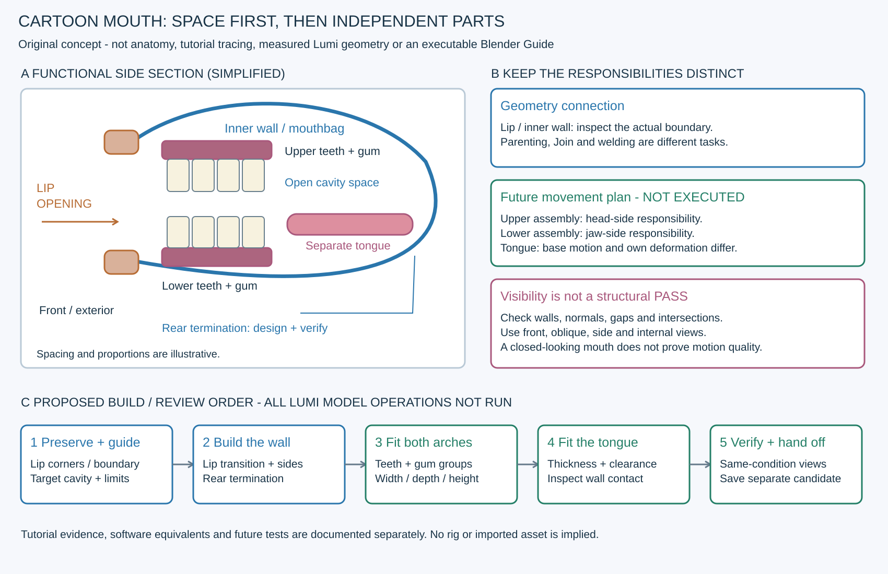

# 구강구조1번 학습 매뉴얼 — 구강벽·치열·잇몸·혀

2026-10-31 · Maya 강좌의 구조 학습과 Blender 제작 대응 · 루미 적용 미실행

**입술 안쪽에 구강 공간을 만들고, 그 안에 상하 치열·잇몸·혀를 배치한다.** 외형 연결이 필요한 피부/구강벽과 독립 배치할 치아를 구분하고, 입을 닫았을 때뿐 아니라 열린 상태의 내부 노출·관통까지 확인해야 한다. 이 문서는 단순화된 만화형 제작 지침이며 완전한 인체 해부학 모델의 정답이 아니다.

이번 ‘1번’은 Animator Artist Life의 [3D Teeth modelling and Tongue [CARTOON STYLE] - PART 06 of How to model a cartoon character in Maya](https://www.youtube.com/watch?v=zXQ53eA_-3U),29:55다. 예전1번 Dikko 얼굴 리토폴로지 강좌와 구분한다. Maya에서 실제 보인 작업, 소프트웨어 공통 구조 원리, Blender 대응 제안을 아래에 나눠 기록한다. **현재 Blender5.2에서 메뉴·모델링·임포트·리깅을 실행하거나 검증하지 않았다.**

전체 지도31장과 핵심100장 중9장 중복, 실제 보조 AI 입력20장을 합쳐 고유142장을 직접 읽었다. contact sheet29장과 원본 UI 확대10장을 열었으며 이전 교육까지 포함한 누적 고유 화면은528장이다. 연속29분 전체 시청·음성/자막 청취를 뜻하지 않는다. [실제 학습 범위·교정 기록](../reports/VideoLearning/20261031_ORAL_STRUCTURE_REVIEW.md).

## 1. 제작자 챕터와 실제 화면의 단계 지도

왼쪽 시각은 제작자 메타데이터의 챕터 시작이다. 오른쪽은 직접 읽은 표본으로, 정확한 전환 프레임이나 모든 클릭을 복원한 것은 아니다.

| 챕터 시작 | 실제 관찰한 작업 | 구조적으로 가져올 점·한계 |
|---|---|---|
| 00:00 내부 작업을 위한 면 숨김 | 00:45 Hair 표시 레이어,01:30 wireframe 전환,01:45/02:05 입 주변 일부만 표시된 장면 | 내부를 보이게 하는 표시 작업과 실제 면 삭제를 구분. 원본 데이터 보존 여부 전체는 영상만으로 검증하지 않음 |
| 02:09 mouthbag | 02:09~02:30 입 안쪽으로 뻗은 벽,02:30의 `polyExtrudeFace1`,03~04분 정점/줄 조정과 뒤쪽 형태 정리 | 입 구멍 뒤에 실제 벽/공간을 준비하는 흐름. 모든 경계의 공유 정점·끝 막힘·정확한 깊이는 미확인 |
| 05:12 잇몸 시작 | 05:25 직육면체,05:44 분할된 긴 띠,06:15 `Gums_lower` | 치아를 받칠 두께 있는 띠를 별도로 제작. 이 이름만으로 최종 해부학적 상하를 확정하지 않음 |
| 05:44 Bend 소개 | 06:30 `BEND` 표시,07:00~08:00 핸들과 Curvature로 띠를 굽히는 시연,08:15~08:49 다시 직선 띠를 편집 | 굽힘 핸들/축과 형상 분할의 관계. 초기 시연과 후속 전체 치열 굽힘은 서로 다른 단계 |
| 08:49 첫 치아 | 09분 새 큐브,09:50 둥근 단일 치아,10:35 복제,11분 여러 치아의 직선 배열,12:05~12:35 그룹 정리 | 먼저 단일 치아의 형태·간격을 정리한 뒤 반복. 화면의 치아 수·모양은 루미 표준 아님 |
| 같은 치아 챕터 후반 | 12:50~13:20 치아+잇몸 그룹의 Bend,13:35 `Center Pivot`,13:50 이후 입 안 배치,15~16분 재질,17~19분 별도 두 치열 조합 | 배열의 곡선화와 전체 배치를 구분. 두 그룹의 이름/수치가 최종 상하 매핑·턱 리그 완료를 증명하지 않음 |
| 19:40 혀 | 새 큐브를 길고 납작하게 분할,21:50 중앙 줄/둥근 윤곽,22~23분 두께·끝·폭 조정,24:10 분홍 표면,24:30 측면 배치 | 구강벽과 별도인 혀 메시. 정확한 뿌리 접속·길이·법선·리깅은 미확인 |
| 혀 챕터 후반 | 25:10~26:10 `BodyShape`의 구강벽 주변을 치열/혀와 함께 편집 | 혀 제작 뒤 공간을 재확인하는 단계. 혀를 구강벽에 용접했다는 뜻 아님 |
| 26:33 입 닫기 | 27:00 입술 주변 선택,27:22.5 Soft Selection 패널,27:37.5~28:20 입술 주변 이동,28:40 이후 축소된 얼굴 보기 | 기본 입 모양의 수동 조정. 턱 본·스키닝·발음 애니메이션 검증을 한 단계로 해석하지 않음 |

27:22.5 원본 UI에는 Soft Select 켜짐, Falloff mode `Surface`, Interpolation `None`이 보인다. 이는 그 시점의 설정이다. 보조 AI가 반환한 `Spline/Linear` 설정과 `mouth_wall_pmesh_grp` 이름은 원본 대조에서 근거가 없어 지침에서 제외했다.

## 2. 부품의 역할과 연결 관계 — 자체 구조 지침

직접 만든 개념도다. 영상 tracing·인체 해부도·루미 실측 도면·실행 가능한 Blender Guide가 아니다. 뒤쪽 경계와 접속은 제작 때 결정·검증할 대상으로 표시한다.

| 부위 | 역할·배치 원칙 | 연결/분리의 판단 |
|---|---|---|
| 입술 안쪽 전환·구강벽(mouthbag) | 입구에서 안쪽으로 이어지는 공간의 벽. 열린 입으로 머리 반대편이나 빈 배경이 보이지 않도록 설계 | 피부와 연속된 벽을 만들 경우 실제 공유 정점/면 흐름까지 검사. 별도 내벽이면 입술 뒤 겹침·틈·변형 시 노출을 별도 책임으로 기록 |
| 위 치열+위 잇몸 | 위쪽 치아의 지지체와 치열 곡선 | 움직임을 준비할 때 머리 쪽에 둘 책임 구분. 반드시 피부에 용접해야 하는 부품 아님 |
| 아래 치열+아래 잇몸 | 아래쪽 치아의 지지체와 치열 곡선 | 후속 턱 움직임에서 함께 움직일 단위를 구분. 이번 작업에서 본/부모/가중치를 만들지 않음 |
| 혀 | 아래 치열 안쪽의 구강 공간을 차지하는 독립된 부피 | 혀끝·가장자리·두께·뒤쪽 여유를 설계. 아래턱과의 기본 관계와 혀 자체 변형은 별도 문제 |
| 구강 뒤쪽 경계 | 의도하지 않은 구멍·빛/배경 노출을 막는 종료부 | 닫힌 단순 cavity 또는 별도 목구멍 표현 등 목적을 명시. 실제 목구멍·입천장 해부 구조는 이 강좌의 표본만으로 확정하지 않음 |

**오브젝트를 묶는 것, 같은 오브젝트로 합치는 것, 정점을 용접하는 것은 다른 작업이다.** 치아·잇몸·혀를 한 덩어리로 용접하면 이후 부품별 배치나 변형 책임을 오히려 확인하기 어려울 수 있다. 반대로 입술–내벽 경계의 틈을 단순히 같은 이름/그룹으로 묶었다고 해결한 것으로 처리하지 않는다.

## 3. Blender 제작으로 옮길 때의 순서 — 제안, 이번 실행0

### 3.1 기준과 Guide를 먼저 만든다

현재 사용자 원본/최신 checkpoint, 원점·축·단위, 입술 윤곽과 양 입꼬리, 입구 경계의 실제 정점 수·순서·인덱스, 기존 UV·가중치·키/driver·안구·스택을 기록한다. 영상의 남자 캐릭터를 루미 승인 외형으로 사용하지 않는다. 루미 외형 변경 전에 승인 기록과 실제 기준 이미지를 확인해야 한다.

별도 Guide 컬렉션에 보존할 입술 경계/입꼬리, 안쪽 전환선, 내벽의 목표 공간과 뒤쪽 종료, 상하 치열 곡선·높이·전후 위치, 혀의 허용 부피를 실제 표시한다. 형태 변경에는 이동 방향·범위와 유지할 랜드마크도 필요하다. 원본 보존 Guide 파일·정면/사선/측면·내부 캡처·해당 정점/면 인덱스와 완료 기준을 저장한 뒤 담당에게 인계한다. **이 교육의 SVG가 그 native Guide를 대신하지 않는다.**

### 3.2 내부를 보이게 하고 mouthbag을 만든다

1. 복사본에서 방해 부위를 숨기거나 따로 표시한다. 숨김과 삭제를 혼동하지 않고 표시 상태를 복원할 계획을 세운다.
2. 입술 안쪽 전환을 보존하며 안쪽 벽의 시작 경계를 정한다. 기존 경계에서 연장하는 방법과 새 벽을 접속하는 방법 중 Guide에 맞는 방식을 선택한다.
3. 경계에서 안쪽으로 면을 연장해 공간을 만든다. 입구 바로 뒤를 납작하게 막지 않고 치아·잇몸·혀가 들어갈 공간을 측면/위에서 확인한다. 수치는 현재 캐릭터에서 정하며 영상 길이를 복사하지 않는다.
4. 별도 벽을 접속한다면 대응 정점 수·순서·전환 밀도를 먼저 맞춘다. `Bridge Edge Loops`의 연결/비틀림 결과와 실제 용접 여부를 확인한다. 전체 얼굴에 큰 Merge 거리를 적용하지 않는다.
5. 뒤쪽·측벽·위/아래 벽을 확인하고 목적에 맞게 종료한다. 막힌 것처럼 보이는 음영이나 선택색만으로 구멍이0개라고 판정하지 않는다. 입술 경계, 숨겨진 작업 영역 경계, 의도적 cavity 입구를 서로 구분해 검사한다.

### 3.3 잇몸과 단일 치아를 만든다

두께 있는 잇몸 띠와 단일 치아를 별도로 준비한다. 영상은 직육면체 기반의 간단한 둥근 치아를 반복한다. Blender에서는 필요한 분할·모서리 조정·Subdivision/Bevel 등을 검토할 수 있지만, 실제 메뉴·스택 순서는 현재 버전과 에셋에서 확인해야 한다. 치아가 잇몸에 꽂히는 깊이와 노출 높이, 치아 사이의 간격, 양쪽 끝의 실루엣을 먼저 맞춘다.

만화형이라고 치아 전체를 무조건 같은 폭/높이로 만들 필요는 없다. 승인된 웃는 모습과 게임 화면에서 필요한 표현으로 결정한다. 영상의 치아 개수·잇몸 두께·곡률·Transform 값을 루미 규격으로 정하지 않는다.

### 3.4 반복 치열을 만들고 곡선화한다

단일 치아의 형태를 정리한 뒤 복제/반복 배열하고, 잇몸과 함께 치열 곡선을 만든다. 영상의 초반 잇몸 Bend는 기능 시연이고12:50 이후가 반복 치아를 포함한 후속 곡선화다. 휘는 메시에는 굽힘을 표현할 분할이 필요하고 치아가 함께 찌그러지는 정도도 확인해야 한다.

Blender 대응 후보는 Simple Deform의 Bend, Curve를 이용한 배치, 곡선을 따라 개별 치아를 배치하는 방식이다. 결과가 다르므로 치관을 단단하게 유지할지, 만화형 변형을 허용할지 먼저 정한다. 단일 메시를 굽히는 것과 개별 치아의 위치/회전만 배치하는 것을 혼동하지 않는다. 축·원점·스케일·범위·스택을 복사본에서 확인한 뒤 형태를 고정한다.

상하 치열을 별도 작업 단위로 나누고 정면/사선/측면/위에서 크기와 전후 관계를 맞춘다. 원본을 복제해 반대 치열을 만드는 경우 뒤집힌 법선·부호가 다른 스케일·잇몸 방향·이름·중앙 정렬을 다시 읽는다. 위아래 치아를 같은 자리에 포개거나 전체 잇몸을 입 밖으로 보이게 두지 않는다.

### 3.5 혀를 별도로 만들고 공간을 맞춘다

길고 납작한 덩어리에서 두께·둥근 끝·가장자리와 중앙 형태를 잡는 방식이 영상에서 보인다. 위에서 윤곽만 맞추지 말고 측면에서 두께와 높이를 확인한다. 치아/잇몸 안쪽에 들어가는 부피, 혀 아래/위 공간, 뒤쪽 내벽과의 관계를 확인한다. 이 강좌의 긴 혀와 중앙 줄을 실제 해부학적 길이·뿌리 접속의 정답으로 해석하지 않는다.

혀를 구강벽에 무조건 용접하지 않는다. 부품의 책임과 후속 변형 요구를 정한 뒤 유지할 분리/접속을 기록한다. 혀에 분홍 재질이 보인다는 사실은 UV·텍스처·뿌리·법선 검증 완료가 아니다. 강좌에서도 혀 뒤에 내벽 주변을 다시 정리하는 화면이 있으므로 조립 후 공간 재확인이 필요하다.

### 3.6 기본 입 모양과 후속 턱 준비를 구분한다

입술을 줄이거나 닫을 때 바깥 피부만 움직이고 내벽이 남아 접히는지 확인한다. 비례 편집/Soft Selection의 영향이 반대쪽 벽·치아·혀까지 새지 않게 선택·연결 범위를 확인한다. 입꼬리·코 밑·턱의 보존 랜드마크를 유지하고 승인 범위 밖 얼굴을 재설계하지 않는다.

후속 작업의 구조 책임 예시는 위 치열→머리, 아래 치열→턱, 혀→턱의 기본 이동과 혀 자체 변형, 내벽→위/아래 접속부를 따르는 변형이다. 이는 제작 준비 제안이며 이 강좌에서 해당 리그를 완성했다고 확인한 것이 아니다. `Center Pivot`으로 중앙을 잡는 작업도 해부학적 턱 회전축을 만든 증거가 아니다. **현재 움직임·리깅 보류 범위는 유지한다.**

## 4. Maya 작업과 Blender 대응의 차이

아래 대응은 기능 목적의 비교다. Maya의 단축키·수치·메뉴 위치를 Blender5.2에서 그대로 실행하는 지시가 아니며, 현재 앱 실검증은 전부 NOT RUN이다.

| Maya에서 관찰한 것 | Blender 대응 후보 | 실행 전에 확인할 차이 |
|---|---|---|
| 일부 면만 표시/Isolate, Hair 표시 레이어 | 선택/비선택 숨김·격리 보기·컬렉션 표시 | 표시 범위와 실제 삭제 여부, 작업 뒤 복원 |
| `polyExtrudeFace1`와 벽 정점 조정 | 경계/면 Extrude와 정점 편집 | 면을 밀어낸 결과의 내부 중복 면·실제 연결·현재 키 상태 |
| 복제 치아와 `Lower_teeth_grp` 등 그룹 | 별도 메시+부모 Empty/컬렉션 등 | 그룹/컬렉션은 용접이 아님. Join 뒤에도 접속 검사가 별도 필요 |
| Bend 핸들·Curvature·범위 | Simple Deform Bend 또는 Curve | Maya 핸들 축과 Blender 변형 축/좌표계는 동일하다고 가정하지 않음 |
| `Center Pivot`·부모 그룹 전체 배치 | 목적에 맞는 Origin/부모 기준 조정 | 보이는 메시 중심과 턱 회전 중심은 다른 요구 |
| 입술 Soft Selection | Proportional Editing 등의 제한된 영향 | Surface/연결 기준·반경·숨긴 정점/반대 벽 영향·미러 상태 |
| Hypershade와 치아/잇몸 색 할당 | 별도 재질 슬롯/부품 재질 | Maya Blinn/Lambert 설정을 Unity URP 재질 정답으로 복사하지 않음 |

공식 문서상 Simple Deform은 로컬 좌표와 원점/축·영향 범위를, Curve는 곡선에 대한 배치와 변형 축을 고려해야 한다. 이를 같은 수치의 Bend로 교환하지 않는다. [Simple Deform](https://docs.blender.org/manual/en/latest/modeling/modifiers/deform/simple_deform.html), [Curve](https://docs.blender.org/manual/en/latest/modeling/modifiers/deform/curve.html). 두 링크는 확인 당시5.2 LTS로 반환된 latest 문서이며 향후 버전이 달라질 수 있다.

연결은 [Blender5.2 Bridge Edge Loops](https://docs.blender.org/manual/id/5.2/modeling/meshes/editing/edge/bridge_edge_loops.html)와 [Merge](https://docs.blender.org/manual/en/5.2/modeling/meshes/editing/mesh/merge.html), 오브젝트 합치기는 [Join](https://docs.blender.org/manual/id/5.2/scene_layout/object/editing/join.html)을 구분한다. Merge는 선택과 거리의 영향을 확인하고 사용한다. 법선은 [Face Orientation/Normals](https://docs.blender.org/manual/id/5.2/modeling/meshes/editing/mesh/normals.html)로 실제 방향을 읽는다. 구강이 검게 보인다는 이유만으로 전체 Flip/Recalculate Inside를 적용하지 않는다.

Maya의 일반 Bend 핸들·Curvature·Low/High Bound 개념은 [Autodesk Bend Options](https://help.autodesk.com/cloudhelp/2027/ENU/Maya-Modeling/files/GUID-4011B59F-D1D7-4368-8E4C-BBBB14AF799F.htm)를 참고했다. 이 링크는2027 문서이며 강좌의 정확한 Maya 버전을 확인한 근거가 아니다. 검색 반환 공식 본문을 확인했으며 강사의 음성 설명을 인용한 것이 아니다.

## 5. 기보유 무료 치아 에셋의 활용 — 적용 제안만

로컬 `game_Assets/Characters/Lumi/Head/References/OralAssets/PolyOne_FreePack_Tooth/`의 기존 다운로드 기록과 원본 두 파일을 확인했다. [원본 출처](https://www.fab.com/listings/fb29d543-d7a1-42fc-8c74-c8caf9cc9f64)는 PolyOne Studio이며, 기존 기록에는 무료/Personal·Fab Standard License로 다운로드했다고 적혀 있다. 이번에 새 구매나 다운로드를 하지 않았다.

원본 `.blend`3,066,264B와 `.fbx`836,832B가 기존 기록의 해시와 일치하는지 확인하고 보존했다. **내부 메시·UV·치아 구분·스케일·리그 상태는 아직 열어 검사하지 않았고 루미에 import/적용하지 않았다.** 에셋이 이미 있다는 사실만으로 완성된 루미 구강이라고 보고하지 않는다.

활용할 때는 별도 검토 파일에서 상하 치열 분리, 실제 단위·축·원점, 치열 폭/깊이·치아 실루엣, 잇몸·혀 포함 여부, 면 밀도·법선·UV·재질·모디파이어/리그를 읽는다. 쓸 부분만 복사해 Guide의 치열 곡선·입술 경계·cavity에 맞추고 아래 검사를 통과시킨다. 그대로 쓸 수 있으면 단일 치아 제작 단계를 대체할 수 있지만 구강벽·조립·연결·검수 단계는 남는다. 원본은 로컬 보존하고 에셋 단독 파일을 Git에 재배포하지 않는다.

## 6. 조립 후 검사 계획 — 루미에서는 전부 NOT RUN

아래는 자체 검수 계획이며 영상에서 전부 실행된 시험 목록이 아니다. 향후 움직임 검사는 별도 승인된 단계에서 수행한다. 지금은 계획만 남긴다.

| 조건 | 실제로 확인할 것 |
|---|---|
| 중립, 정면/사선/측면·위/아래 | 치열 중앙·폭·깊이, 입술 실루엣, 잇몸 노출, 혀 높이·두께, 피부 관통 |
| 외부 피부/치열/혀를 각각 숨긴 내부 보기 | 뒤쪽·측벽·위/아래 벽의 구멍/중복 면, 의도한 종료, 입술 접속. 숨김 해제 뒤 표시 복원 |
| 기본 cage/최종 평가, solid/wire | 원본 경계 실제 용접, 순서·긴 면·중복 정점·퇴화/비다양체·뒤집힘·자기 교차, 스택에 의한 밀림 |
| Face Orientation·단면·실제 사용할 단면/양면 표시 | 카메라가 보는 구강 안쪽 면의 방향, 잘못된 법선/중복면. 양면 재질로 오류를 숨기지 않음 |
| 입 열림→중간→닫힘(후속 단계) | 상하 치아 충돌·잇몸/혀의 입술 뚫림, 내벽 접힘·당김·틈, 닫힌 입의 원치 않는 치아/잇몸 노출 |
| 후속 턱 회전·좌우/표정 조합 | 위 치열은 의도한 기준 유지, 아래 치열은 턱과 정합, 혀/내벽의 영향 분리·공간 유지. 한 프레임만 PASS로 세지 않음 |
| UV/재질과 게임 적용 전 | 부품별 UV·겹침 의도·색공간·경계 색, 채널/스케일·게임 카메라에서의 실루엣. 이번에 텍스처 제작/Unity 검사0 |
| 저장·재열기/재임포트(필요한 후속 단계) | 원본 보존, Guide와 실제 후보의 구분, 부품/경로·UV/재질·변형 데이터의 유지 |

‘오브젝트가 여러 개’와 ‘접속 실패’, ‘경계가 존재함’과 ‘의도하지 않은 구멍’을 동일하게 세지 않는다. 각 경계와 부품의 목적을 먼저 기록한 뒤 미용접·미종료·가려짐·미실행을 각각 보고한다.

## 7. 자주 생기는 실패와 확인 순서

| 현상 | 먼저 확인·수정할 것 |
|---|---|
| 열린 입으로 빈 머리/배경이 보임 | mouthbag의 실제 벽·뒤쪽 종료·옆 틈, 표시된 face 방향과 backface 표시를 분리해 확인 |
| 벽이 입구에서 주름지거나 입꼬리가 찢어짐 | 보존 경계·정점 대응·전환 밀도·중간 공간. 큰 Merge/Smooth로 전체 입술을 덮지 않음 |
| 치아가 입술을 뚫거나 한 줄의 판처럼 보임 | 치열 전후 위치·높이·곡선·폭, 치아 사이 실루엣/간격과 게임 카메라. 입술만 늘려 피하지 않음 |
| Bend가 안 먹거나 반대로 휘고 치아가 늘어남 | 원점·로컬 축·변형 범위·분할·스케일·스택·대상 그룹. 개별 치관을 유지할 배치 방식도 검토 |
| 위아래 치열이 함께 움직임 | 상하 작업 단위·이름·부모/가중치 책임. 그룹 이름에 lower가 있다고 동작을 확정하지 않음 |
| 혀가 잇몸 밖으로 나오거나 내벽에 박힘 | 측면 높이/두께·치열 안쪽 여유·뒤쪽 부피. 분홍 재질이나 위 윤곽만으로 정상 판정하지 않음 |
| 입을 닫으면 볼/코/반대 벽까지 끌림 | 선택·비례 편집 영향과 내벽 연결, 좌우/키 기준. 허용 Guide 범위 밖 변화는 되돌려 범위를 좁힘 |
| 정면은 괜찮지만 사선에 검은 조각이 생김 | 면 방향·겹침·틈·관통·cavity 깊이와 표시 모드를 각각 검사. 색만 칠해 원인을 감추지 않음 |

## 8. 실제 제작 인계 전에 남길 것

- [ ] 원본/작업 복사본·최신 checkpoint·기존 UV/weights/키/driver/안구 보존 상태.
- [ ] native Guide, 실제 오브젝트/부위·정점/면 인덱스, 입술/입꼬리 보존 경계와 목표 부피·이동 범위.
- [ ] 피부–내벽의 접속 전략, 종료 경계, 상하 치열/잇몸/혀의 분리·이름·각 책임.
- [ ] 에셋 원본과 적용 후보의 구분, 변형/임포트/재질/UV 검토 결과, 미검증 항목.
- [ ] 동일 조건 solid/wire 전후와 내부·측면 캡처, 실제 실행한 검사만의 판정.
- [ ] Guide 제작자 정상 점유 해제 후 단독 제작, 새 후보 저장·재읽기와 정상 해제 기록.

이번 산출물은 교육 문서·자체 구조도·표본 검증 기록이다. 실제 루미의 입천장·목구멍·구강 깊이·내벽 용접/뒤쪽 막힘·혀 뿌리 연결·전체 법선·변형 품질을 확인한 것이 아니다. 강좌의 정확한 Maya 버전·모든 작업 명령/수치·음성/자막도 미확인이다. 루미 v021의 원본 미용접·경계 전환·최대7.237mm 이격 **PARTIAL**, 기존 코E·눈꺼풀 지침과 움직임 보류는 유지한다. [검증 JSON](../reports/VideoLearning/20261031_ORAL_STRUCTURE_VERIFICATION.json).
