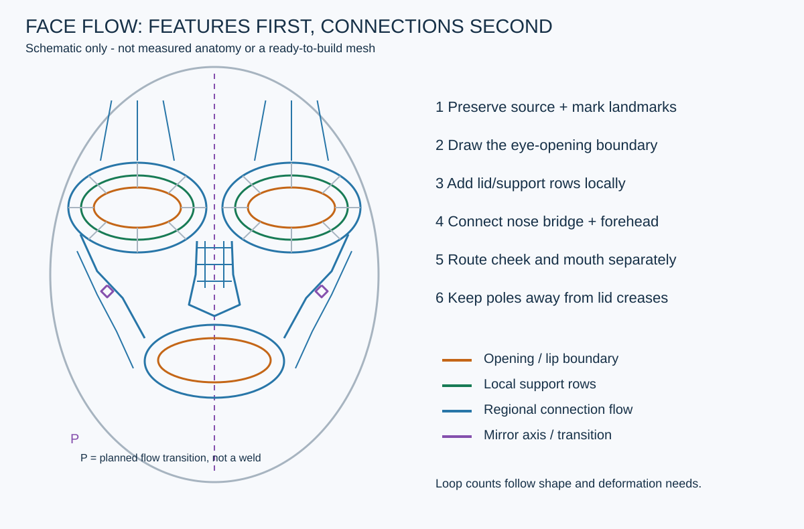
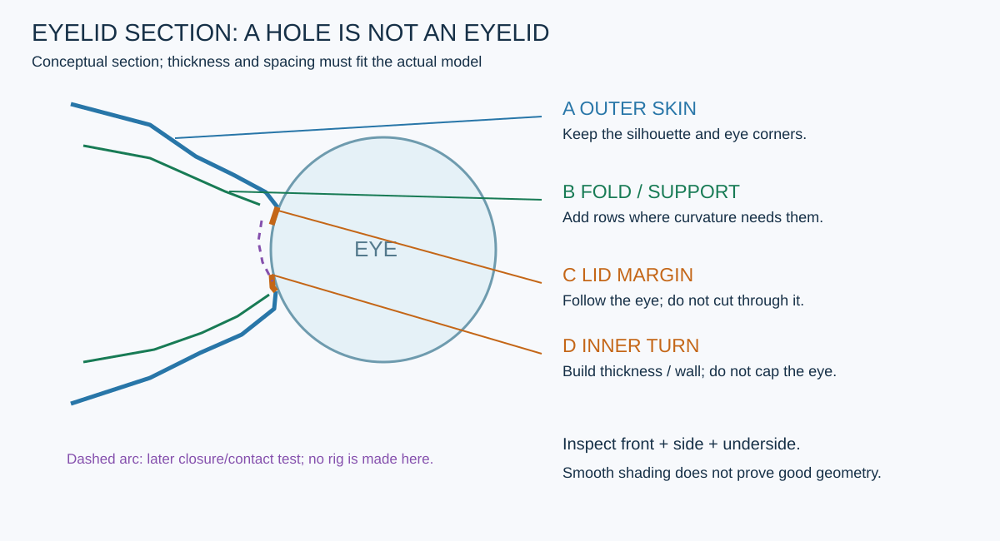
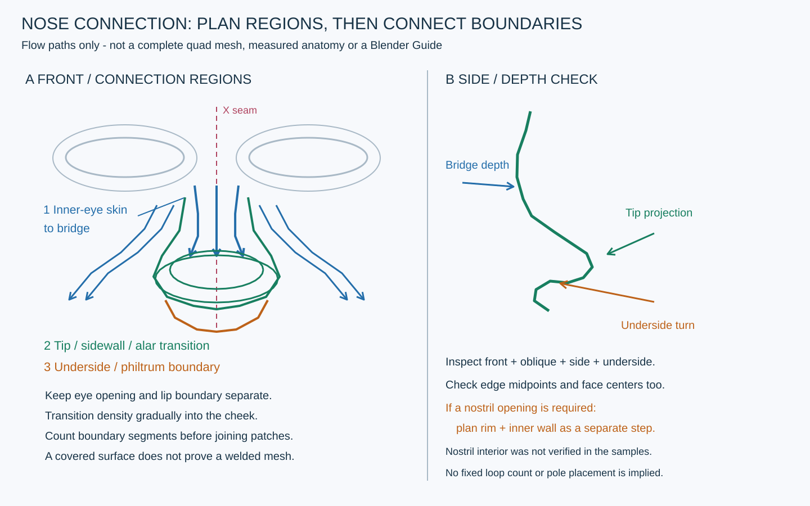

# 얼굴 기본 루프 배치 매뉴얼 — 눈에서 코·이마·볼로 연결하기

2026-10-31 · 퍼즐 아일랜드 재사용 작업 자료 · 기본 메시 제작용

**얼굴의 각 기능을 지키는 기본 루프를 먼저 만들고, 그 사이를 작은 사각형 패치로 연결한다.** 눈에서 시작한 동심 고리를 얼굴 전체로 계속 늘리는 방식이나 고정 정점 수를 정답으로 사용하지 않는다. 현재 문서는 영상 표본을 실제 열람해 정리한 제작 지침이다. 루미 v021의 원본 접속·곡률 수선 완료 보고서가 아니다.

## 1. 이 문서의 근거와 사용 범위

본문의 **화면 관찰**은 아래 실제 확인 프레임에 한정한다. 이어지는 단계·검수 기준은 그 관찰, 공식 도구 설명, 프로젝트의 보존 원칙을 결합한 **자체 작업 지침**이다. 강사의 발언을 전사하거나 전체 강좌를 시청했다고 주장하지 않는다.

| 근거 | 실제 화면에서 확인한 내용 | 확인 범위 |
|---|---|---|
| [Dikko: 계획](https://www.youtube.com/watch?v=SwM19PgSdCM&t=60s) | 얼굴 표면에 표식·색선을 그린 뒤 눈, 입, 볼·턱, 이마의 흐름을 나눠 표시 | 01:00~07:30, 30초 간격 14프레임 |
| [Dikko: 기본 루프](https://www.youtube.com/watch?v=SwM19PgSdCM&t=480s) | 평면 배치 → 눈 구멍을 둘러싼 띠 → 코 아래쪽 연결 → 안쪽 눈 사이/콧대 연결 → 볼·입 주변 면 추가 | 08:00~13:40, 20초 간격 +13:55, 19프레임; 로컬 Qwen 표본18장도 원본과 대조 |
| [Dikko: 입체 확인](https://www.youtube.com/watch?v=SwM19PgSdCM&t=840s) | 정면뿐 아니라 사선·아래쪽 시점에서 눈·입·턱 패치의 깊이를 확인하는 화면 | 14:00,15:00,16:00,17:00,18:00 |
| [Dikko: 코와 옆면](https://www.youtube.com/watch?v=SwM19PgSdCM&t=1095s) | 18:15 코 부위가 열린 단계,19:00 아래쪽 시점,20:00 코를 덮는 면 흐름. 이후 표본은 머리 옆·위 연결 | 18:15,19:00,20:00,22:00,24:00,26:00 |
| [Dikko: 눈 경계와 입 안쪽](https://www.youtube.com/watch?v=SwM19PgSdCM&t=2428s) | 40:28~41:00 눈 구멍 주변의 촘촘한 경계·안쪽 방향 면을 확인.42:00~45:00 표본은 주로 입술·구강 안쪽 작업이며 전부 눈꺼풀 설명으로 묶지 않음 | 40:28,41:00,42:00,43:00,44:00,45:00;47:00,49:00,51:00은 몸통·목 맥락 |
| [Level Pixel Level: 눈꺼풀 예시](https://www.youtube.com/watch?v=XleNIUWoydY&t=60s) | 눈 주위 고리, 닫힌 눈 형태 미리보기, 이후 키·리그 화면이 표시됨 | 01:00,01:30,02:40,03:54,08:20,10:44 여섯 표본 |
| [Dikko: 2번90분 강좌](https://www.youtube.com/watch?v=DJbU_WfR2Z0) | 입→눈의 초기 띠, 코·볼·이마 연결, 원본 위/단독 Target, 평가 스택과 후반 표정 예시 | 전체 흐름47장 + 관련 다섯 묶음90장(26중복) + AI 입력 대조16장 = 고유127장; 전체 연속·상세 시청 아님 |

첫 학습에서 직접 열람한 고유 원본 프레임은 **77장**이다. 이후 코 연결 구간18:15~21:20을5초 간격38장과 로컬 AI 대조용6장으로 보강했다. 코 학습44장 중3장은 첫 학습과 중복이므로 **코 학습까지의 누적 고유 표본은118장**이다. 눈꺼풀 추가 교육은4절의 상세 문서로 이어진다. 52분 영상 전체의 연속 재생·음성 전사는 수행하지 않았다. 후속 [2번90분 강좌 보강](FACE_RETOPOLOGY_SECOND_TUTORIAL.md)에서는 별도 영상의 실제 표본을 대조했다. [첫 학습 기록](../reports/VideoLearning/20261031_FACE_LOOP_REVIEW.md)과 [코 연결 학습·오답 교정](../reports/VideoLearning/20261031_NOSE_CONNECTION_REVIEW.md)을 구분해 보존한다.

## 2. 시작 전에 원본과 대칭 기준을 고정한다

1. 현재 열려 있는 파일·오브젝트·미저장 상태를 확인한다. 사용자 손작업이 있으면 **현재 live 상태를 새 checkpoint로 저장**한다. 오래된 파일을 다시 열어 최신 상태를 대체하지 않는다.
2. 원본 `Source`와 새 면을 만들 `Target`을 별도 오브젝트로 둔다. 원본의 좌표, UV, 가중치, 안구, 기존 보관 키·리그를 기록한다. 새 Target의 UV·가중치 제작은 별도 단계다.
3. 정면·측면·사선에서 눈 안/밖 모서리, 위/아래 최고점, 안구 표면, 콧대·코끝·콧방울, 눈썹 부근과 이마 외곽을 표시한다. **눈썹 그림과 눈꺼풀 경계선을 혼동하지 않는다.**
4. 왼쪽을 오브젝트 명칭·월드 X좌표·정면 화면 위치로 기록한다. 루미의 기존 `Lumi_Eye_L`은 +X이며 정면 화면의 오른쪽이다. 다른 모델도 같은 부호라고 가정하지 않는다.
5. 얼굴 중앙과 Target의 미러 기준을 맞춘다. Object origin 또는 Mirror Object가 기준이 될 수 있으므로 현재 설정을 읽는다. X만 켜고 Y/Z를 끈 뒤 중앙 점이 실제 평면에 있는지 본다. Clipping과 Merge는 역할이 다르며, 떨어진 중앙 점을 체크박스만으로 자동 접속하지 않는다. [Blender Mirror 설명](https://docs.blender.org/manual/en/5.0/modeling/modifiers/generate/mirror.html)
6. 원본은 비대칭일 수 있다. 미러한 반대쪽도 표면 이격과 안구 접촉을 따로 확인한다. 임의로 원본 전체를 대칭화하지 않는다.

일반 Sculpt의 X 대칭은 Target의 Mirror modifier를 대신하지 않는다. 편집용 한쪽 cage와 미러 평가 결과의 정점·면 수도 따로 기록한다.

## 3. 얼굴의 기본 루프를 설계한다

위 그림은 직접 만든 개념도다. 강좌 화면을 베끼거나 루미의 실측 좌표를 그린 것이 아니며, 그대로 실행할 수 있는 메시 설계도도 아니다. 실제 제작 전에는 Blender의 별도 Guide 컬렉션에 현재 표면으로 투영한 범위·목표·보존 경계와 **정점 수가 맞는 접속 전략**을 작성한다.

| 구역 | 먼저 지킬 것 | 면이 이어질 방향 |
|---|---|---|
| 눈 opening | 안/밖 눈꼬리, 위·아래 윤곽과 안구 위치 | 개구부를 둘러싼 닫힌 고리 |
| 눈꺼풀·접힘 | 얇은 가장자리의 두께, 안쪽으로 돌아가는 면, 위쪽 접힘 | 가장자리와 나란한 국소 지지 줄 |
| 눈 안쪽·콧대 | 안쪽 눈꼬리와 콧대 폭 | 눈의 안쪽 띠에서 콧대의 세로 흐름으로 연결 |
| 눈 위·이마 | 눈썹 부근 곡률, 이마 볼륨과 실루엣 | 위쪽 띠를 이마의 가로·세로 패치로 점진 전환 |
| 눈 아래·볼 | 아래눈꺼풀, 광대 볼륨 | 눈 아래 띠를 볼로 분산하고 입 주변 흐름과 연결 |
| 코·콧방울 | 코끝의 돌출, 콧방울과 콧구멍 경계 | 콧대에서 코끝·코 옆으로 별도 면을 배치 |
| 입·턱 | 입 opening, 입꼬리와 입술 두께 | 입을 둘러싼 루프를 별도로 두고 볼·턱으로 연결 |

이마나 볼을 채우기 쉽다는 이유로 눈꼬리를 이동하거나 입 주위 면을 긴 방사형 줄로 끌어당기지 않는다. 가장자리의 점 하나를 움직이면 바로 뒤 눈꺼풀 벽·옆 피부와의 관계도 함께 확인한다.

**정점 수는 형태를 설명하는 데 필요한 만큼 정한다.** 안구를 따라갈 수 없거나 곡선이 꺾이면 해당 구간의 밀도가 부족할 수 있다. 좁은 곳에 같은 수의 점을 몰아 넣어도 가느다란 면과 주름이 생긴다. 초반에는 큰 형태를 잡을 최소 면으로 시작하고, 필요한 위치에만 줄을 추가한다.

**시작 부위를 눈으로 고정하지 않는다.** 2번 강좌의05:00~14:00 표본은 입/하안면 띠에서 눈 띠로 진행한다. 아래 RF 절차는 눈에서 시작하는 자체 예시이며 유일한 순서가 아니다. 원본이 가리는 미제작 구역, 단독 Target의 경계 분류, 기본 cage/평가 스택과 후속 시험 상태는 [2번 강좌 보강 문서](FACE_RETOPOLOGY_SECOND_TUTORIAL.md)의 비교표·작업 절차를 함께 따른다. 이 후속 학습의 고유127장을 포함한 누적 표본은289장이다.

## 4. 눈 구멍과 눈꺼풀을 구분한다

- **A 바깥 피부:** 눈 주변 볼륨과 얼굴 실루엣이다. 정면에서 매끄러워도 측면에서 납작해지지 않았는지 본다.
- **B 접힘·지지 줄:** 위눈꺼풀이 접힐 자리와 곡률을 지지한다. 일정 간격으로 모든 부위에 계속 추가하는 장식용 고리가 아니다.
- **C 눈꺼풀 가장자리:** 안구 표면과의 간격·접촉을 지킨다. 위아래 윤곽을 유지하고 눈꼬리에 점을 뭉치지 않는다.
- **D 안쪽으로 돌아가는 면:** 구멍의 테두리를 안쪽으로 연결해 두께와 벽을 만든다. 눈 구멍 전체를 면으로 막는 작업과 다르다.

위 구분은 이 매뉴얼의 제작 설명이다. 영상 표본에서 모든 extrusion 조작·수치를 확인했다는 뜻은 아니다. 두께와 간격을 보편적인 mm값으로 정하지 말고 모델 스케일·안구 크기·승인 외형·렌더 조건에 맞춰 판단한다. 측면과 아래쪽 시점에서 안구 관통, 외부에서 보이는 틈, 뒤집힌 벽을 확인한다.

40:28~41:45 전후를 추가 대조한 [눈꺼풀 볼륨 상세 매뉴얼](FACE_EYELID_VOLUME.md)에 가장자리·안쪽 벽·위/아래 피부·두 모서리·지지 줄의 제작 단계와 완료 기준을 정리했다.41:10~41:16의 안쪽 면 띠,41:34~41:43의 음영/안구 표시 상태,41:52~41:54 이후 입 단계의 전환을 구분했다. 이번 추가 교육은 Dikko47장과 기존 보조 영상3장을 직접 확인한 고유50장(이전 중복6장 제외 신규44장)이며, 그 단계까지의 누적 고유 표본은162장이다. 자세한 [눈꺼풀 학습 기록](../reports/VideoLearning/20261031_EYELID_VOLUME_REVIEW.md)을 따른다. 실제 루미의 두께·용접·blink 통과를 뜻하지 않는다.

## 5. RetopoFlow에서 작은 패치씩 제작한다

도구 기준은 이번 프로젝트에서 실행 확인한 **RetopoFlow3.4.11 / Blender5.2.2 LTS**다. Dikko 영상에 보이는 기본 Blender 편집을 RF 작업으로 오인하지 않는다. 아래는 강좌의 루프 계획을 RF에 옮긴 자체 절차다.

### A. Source와 Target 준비

1. 원본 Source를 보존하고 Object Mode에서 선택한다. 새 작업은 RetopoFlow 메뉴의 `New/+ Active` 계열 기능으로 별도 Target을 시작한다. 기존 작업은 Target 선택 → Edit Mode → RF 도구로 이어간다.
2. RF3에서는 다른 보이는 mesh들이 Source가 된다. 안구·치아·속눈썹·작업용 메시 등에 잘못 스냅되지 않도록 불필요한 Source를 일시 숨긴다. 안구 위치는 먼저 Guide로 남기고 숨김 상태를 기록해 종료 후 복원한다.
3. Source/Target의 이름, 실제 RF 모드 진입, Target의 X Mirror/YZ off를 확인한다. 메뉴를 열었다는 사실만으로 면 제작이 된 것은 아니다. [RF Quick Start](https://docs.retopoflow.com/v3/quick_start.html)

### B. 눈 기본 고리

1. 눈 안쪽·바깥쪽·위·아래 표식을 기준으로 개구부의 한 줄을 만든다. 한쪽에서 시작하고 정확한 눈꼬리와 안구 표면을 계속 참고한다.
2. `PolyPen`은 점·엣지·면을 세밀하게 연결할 때 사용한다. 공식 기본 입력은 `5`로 도구 선택, `Ctrl+LMB`로 insert다. 선택한 점/엣지/면과 Tri/Quad 또는 Quad Only 모드에 따라 생성 결과가 다르므로 첫 면으로 동작을 확인한다. [PolyPen 도움말](https://docs.retopoflow.com/v3/polypen.html)
3. 이미 계획한 닫힌 경계는 `Strokes`로 만들거나 늘릴 수 있다. 기본 `3`으로 도구 선택, `Ctrl+LMB`로 stroke. 선택한 경계와 새 stroke의 열림/닫힘 형태를 맞춘다. 고리 전체를 잘못 선택하면 다른 방향으로 연결될 수 있다. [Strokes 도움말](https://docs.retopoflow.com/v3/strokes.html)
4. 바로 옆의 바깥 띠를 연결해 사각형 면을 만든다. 모든 고리를 한 번에 크게 늘리지 말고, 눈꼬리의 면 압축·안쪽 벽·옆 피부를 확인하며 확장한다. 루프 개수와 세그먼트 수는 설치 기본값이 아닌 현재 Guide를 따른다.

### C. 코·이마·볼로 연결

1. 눈 안쪽 띠에서 콧대 쪽으로 짧은 사각형을 연결한다. 중앙 seam과 접속할 경계의 점 수를 먼저 맞춘다.
2. 위쪽 띠를 이마 패치로 보낸다. 눈꼬리와 위눈꺼풀을 이마의 넓은 면 간격에 맞춰 끌어올리지 않는다.
3. 아래·바깥 띠를 볼로 분산한다. 입 주변은 별도의 opening 루프를 기준으로 연결한다. 코끝·콧방울에는 그 돌출과 오목함을 표현할 면을 따로 둔다.
4. 한 구역을 만들 때마다 사선·측면으로 돌려 원본 곡률을 확인한다. RF가 점을 Source에 스냅해도 긴 사각형의 중앙까지 같은 곡면이 되는 것은 아니다.
5. 폴은 보통 사각 격자의 연결 수4에서 벗어나는 정점이다. 필요한 흐름 전환에 계획해 두되 눈꺼풀 가장자리·접힘선·눈꼬리·코의 급한 곡률에 몰아 두지 않는다. 특정 볼 위치에 무조건 배치하는 공식도 없다. 위치를 바꾼 뒤 음영과 후속 변형을 확인한다.

### D. 원본 또는 기존 패치와 실제 접속

1. 붙일 양쪽 경계의 순서·점 수·방향을 기록한다. 새 패치 내부 연결, Mirror seam 연결, 원본 피부와의 용접을 각각 구분한다.
2. 점 수가 다르면 경계를 나누거나 흐름을 전환할 위치를 먼저 설계한다. 개구부 윤곽을 무조건 압축해 숫자만 맞추지 않는다.
3. 삼각형 없는 **단일 disk형 패치**에서 바깥 경계 엣지 수가 홀수라면 경계를 그대로 둔 all-quad 채움은 불가능하다. 짝수로 만드는 것은 필요조건일 뿐 충분조건이 아니다. 이웃 면을 함께 분할하거나 허용한 전환 면을 설계한다. 여러 경계가 있는 패치는 경계 전체와 위상도 함께 검토한다.
4. 경계 분할은 이웃 면과 함께 처리해 T자 접속을 남기지 않는다. 용접은 대응점과 거리 확인 후 국소적으로 한다. 의도된 피부/구강 접촉점을 전역 Merge by Distance로 지우지 않는다.
5. `Ctrl+J`는 오브젝트 묶기다. 점이 공유됐는지, 경계가 남았는지, 연결 성분과 면이 실제 이어졌는지 확인해야 접속 완료다.

### E. 코 연결을 구역별로 설계한다 — 18:15~21:20 보강

**눈 안쪽에서 콧대로 내려오는 줄, 코끝을 감싸는 면, 코 옆에서 볼로 빠지는 흐름을 나눠 계획한다.** 코를 눈 고리의 마지막 확장으로 한 번에 덮거나, 정면에서 비어 보이는 부분을 큰 면 하나로 막는 방식은 피한다.

그림은 흐름과 검수 위치를 설명하는 자체 도식이다. 영상의 메시를 복제한 것도, 루미의 승인 형태·정점 수·실행 가능한 Blender Guide도 아니다. 실제 제작에서는 현재 표면에 맞춘 별도 Guide가 먼저 필요하다.

#### 화면에서 실제로 보인 진행

| 원본 시각 | 직접 확인한 화면 | 이 화면만으로 확정하지 않을 것 |
|---|---|---|
| 18:15~18:50 | 눈 안쪽 사이와 콧대는 이미 면으로 덮여 있다. 코끝 쪽 열린 패치 안에 갈색의 촘촘한 원본 표면이 보인다 | 이 구간에서 콧대를 처음 만든다는 설명, 열린 패치를 실제 콧구멍으로 분류 |
| 18:55~19:00 | 가까운 사선·아래 시점으로 코 패치의 경계와 돌출, 입 위쪽과의 관계를 확인한다 | 아래쪽을 봤다는 이유만으로 콧구멍 안쪽 벽 완성 판정 |
| 19:05~19:20 | 코끝 중앙에 녹색 면 띠가 생기고, 보이는 원본 영역이 나뉘거나 작아진다 | 모든 연결이 공유 정점으로 용접됐다는 판정 |
| 19:25~19:40 | 코끝·측면을 덮는 면이 늘며 작은 갈색 노출 영역이 남는 단계가 보인다. 사선과 정면을 번갈아 본다 | 정확한 폴 위치·정점 수, 모든 면이 quad라는 수치 판정 |
| 19:45~20:00 | 정면에서 코끝까지 녹색 cage로 덮인 상태가 보이고 코 옆·끝의 곡률을 확인한다 | 코 내부·반대쪽·면 교차까지 모두 검증됐다는 판정 |
| 20:05~21:20 | 측면·위·아래·전체 시점으로 코 돌출과 얼굴 패치의 부착 상태를 본다. 정수리·귀 쪽 외곽은 계속 열린 마스크 형태다 | 얼굴 전체 완성, 후속 변형·리깅 검증 완료 |

이는 정지 표본 사이의 **보이는 상태 변화**다. 모든 조작·단축키·강사의 음성 설명을 복원한 순서가 아니다. 로컬 Qwen은 후반에도 코 패치가 계속 열려 있고 갈색 원본이 보인다고 반복했으나 실제 프레임과 달라 제외했다.

#### 실제 제작에 옮길 자체 절차

1. **코 연결의 입구를 정한다.** 눈 안쪽 모서리를 고정하고 그 옆 피부 띠, 콧대 좌우 경계, 코끝·콧방울, 코 밑과 인중 경계를 Guide에 표시한다. 눈 opening, 코 바깥 실루엣, 입술 경계는 서로 다른 보존선이다. 눈의 모든 줄을 코끝 한 점으로 모으지 않는다.
2. **중앙과 콧대 폭을 먼저 맞춘다.** 미러 기준이 로컬 X=0인지 Mirror Object 기준인지 읽고, 중앙점은 해당 평면에 둔다. 콧대 좌우에는 폭과 굴곡을 설명할 줄을 둔다. 중앙 seam과 코 옆 경계의 순서·개수를 기록하고, 미러 평가에서 틈·두 겹·잘못 붙은 반대쪽 점이 없는지 본다. 영상 UI의 Merge 값은 루미에 그대로 복사할 수치가 아니다.
3. **콧대에서 코끝으로 돌아가는 곡면을 만든다.** 콧대의 세로 흐름이 코끝 전면과 아래쪽으로 돌아가도록 작은 패치로 잇는다. 정면에서는 폭·좌우 균형, 측면에서는 돌출·코밑 각도, 사선에서는 둥근 전환을 확인한다. 점만 원본에 붙고 엣지·면 중앙이 떠 있으면 해당 곡률에 필요한 분할·재배치를 계획한다. 평면 투영으로 돌출을 잃지 않는다.
4. **코 옆·콧방울에서 볼로 흐름을 보낸다.** 안쪽 눈 아래의 면은 코 옆을 지나 볼로 분산시키고, 코끝·콧방울을 설명하는 국소 띠와 연결한다. 작은 면이 많은 코를 큰 볼 면과 바로 접속해 긴 바늘 모양 면을 만들지 않는다. 점 수 차이는 볼 쪽의 완만한 구간 등 허용 영역에서 이웃 면과 함께 점진적으로 전환한다. 폴은 위치·valence·곡률을 실제로 기록하며 특정 개수나 좌표를 강좌의 정답으로 고정하지 않는다.
5. **콧구멍이 필요한지 별도로 정한다.** 열린 리토포 패치, 원본의 어두운 음영, 실제 콧구멍은 다르다. 승인 형태·사용 거리에서 실제 개구부가 필요하면 외곽 rim과 코밑·콧방울의 연결을 먼저 설계하고, 안쪽으로 돌아가는 벽과 보이는 깊이를 별도 제작한다. 가장자리에 점을 몰거나 보이는 구멍을 한 면으로 막아 해결하지 않는다. 이 영상 표본에서는 안쪽 벽의 깊이·종단·정확한 위상을 확인하지 못했으므로 해당 제작법을 강사의 시연으로 인용하지 않는다.
6. **실제 접속과 표면 품질을 분리해 통과시킨다.** 새 코 패치 내부, X seam, 기존 눈·볼·인중 패치, 사용자 원본 피부와의 접속을 각각 기록한다. 같은 위치에서 겹쳐 보이는 점은 공유 정점의 증거가 아니다. 경계 수가 다르면 D절의 전환 계획을 적용하고, 용접 뒤 예상하지 않은 boundary·T자 접속·중복 면·접힘이 없는지 다시 확인한다. 연결 성분 하나라는 사실만으로 모든 면의 건전성이 증명되지는 않는다.

#### 코 연결 완료 기준

- [ ] 눈 안쪽·콧대 폭·코끝·콧방울·인중의 보존 랜드마크와 허용 범위가 현재 표면 Guide에 있다.
- [ ] 정면·사선·측면·아래 시점에서 코의 폭·돌출·하부 전환과 볼 연결이 같은 목표를 따른다.
- [ ] 코의 작은 면에서 볼의 큰 면으로 간격이 점진적으로 바뀌며, 폴·가느다란 면이 급한 곡률에 몰리지 않는다.
- [ ] 중앙 평면·Mirror 설정·공유 정점·경계 개수·국소 전환을 실제 데이터로 확인했다.
- [ ] 코 표면과 원본의 이격은 정점뿐 아니라 엣지 중간·면 중앙에서도 확인했고, 반전·교차 의심 부위를 시각 대조했다.
- [ ] 실제 콧구멍이 필요한 경우 rim·안쪽 벽·깊이와 주변 연결을 별도 검수했다. 생략한 경우 이유와 범위를 기록했다.
- [ ] Target 내부 연결과 원본 용접을 별도 판정하고 동일 조건 solid/wire 캡처로 남겼다.

이 체크리스트를 작성한 것과 루미에서 통과시킨 것은 다르다. 이번 보강은 영상 학습·문서 작업이며 v021의 원본 접속과 코 곡률은 계속 PARTIAL이다.

## 6. 표면과 밀도를 검수한다

| 확인 | 통과를 판단하는 방법 | 충분하지 않은 근거 |
|---|---|---|
| 형태 | 동일 카메라의 정면·사선·측면 solid 전후 비교. 눈 opening·눈꼬리·코 실루엣 보존 | 정점/면 수만 감소 |
| 곡면 | 정점뿐 아니라 엣지 중간·면 중앙의 표면 이격, 코 돌출과 볼륨을 확인 | 정점만 Source에 붙음 |
| 면 흐름 | wire에서 이웃 줄 간격과 quad 비율, 얇은 면·갑작스러운 밀도 변화 확인 | 전부4각형이라는 사실 |
| 법선·겹침 | 실제 triangulation의 영면적, 반전·교차 의심 구간을 확인 | smooth shading으로 부드럽게 보임 |
| 중앙 seam | 기준축·Merge 거리·중앙 정점과 미러 평가 연결 성분 확인 | X 체크가 켜짐 |
| 원본 접속 | 대응 경계·공유 정점·남은 open boundary를 재검수 | 하나의 오브젝트 이름 |
| 보존 | 현재 Source baseline 대비 좌표/UV/가중치/안구/보관 키·리그 대조 | 이전 버전과 대략 비슷함 |

허용 오차는 모델 단위·화면에서 보이는 크기·후속 용도에 맞춰 Guide에 정한다. 임시 제작값을 사용자의 영구 금지나 강좌의 규칙으로 승격하지 않는다. Subdivision/Shrinkwrap 미리보기는 큰 면의 휘어짐을 보는 보조 수단이지 잘못된 기본 루프·폴·용접을 고치는 증거가 아니다.

## 7. 흔한 실패와 다음 조치

| 증상 | 먼저 읽을 원인 | 수정 방향 |
|---|---|---|
| 안쪽 눈에 패임/날카로운 점 | rim의 국소 곡률·옆 피부·안쪽 벽이 서로 다른 방향으로 움직임 | 랜드마크를 고정하고 실제 윤곽 꺾임을 진단. 단순 X좌표 평균을 정답으로 반복하지 않음 |
| 평면의 마스크처럼 보임 | 넓은 quad가 코·눈두덩의 굴곡을 가로지름 | 코/이마/볼 흐름을 나누고 필요한 곳에 밀도 추가. 사선에서 재확인 |
| 눈꼬리에 가느다란 면 | 점이 몰렸거나 인접 고리의 대응 순서가 꼬임 | 점 간격·순서를 재배치. opening 위치는 유지 |
| 반대쪽만 뜨거나 뚫림 | 원본 비대칭, 미러 기준·Source 설정 문제 | 양쪽 거리·origin·mirror object·Source를 따로 점검 |
| 중앙이 두 겹/틈 | 축에서 떨어진 점, merge 거리, 중복 면 | seam 좌표와 평가 결과를 확인해 국소 수정 |
| 스냅이 안구에 붙음 | 안구도 RF Source로 보임 | Guide에 안구 랜드마크 보존 후 RF Source 목록 정리 |
| 원본은 완전하지만 새 target UV가 없음 | 원본 보존과 새 메시 제작 완료를 혼동 | 연결 확정 후 새 UV/전사·가중치 단계를 별도로 수행 |
| 닫힌 눈에서 꺾임 | 두께/접힘 지지 줄/면 밀도·변형 경로 부족 가능 | 기본 형태 원인을 먼저 수정하고 후속 변형 테스트에서 확인 |

## 8. 저장·인계 체크리스트

- [ ] 사용자 최신 live checkpoint와 원본을 보존했다.
- [ ] 실제 표면의 Guide·랜드마크·이동 방향과 경계 수·전환 전략을 저장했다.
- [ ] Guide 점유를 해제하고 제작 담당이 단독으로 작업했다.
- [ ] 실제 RF 사용 여부와 생성한 Target/면 수, 프로그램 입력 또는 수동 입력 방식을 기록했다.
- [ ] 눈–코–이마/볼의 연결, X seam, 원본 용접을 각각 PASS/PARTIAL로 판정했다.
- [ ] 동일 조건 solid/wire 전후와 세부 시점을 저장했다.
- [ ] Source 보존 검사와 새 Target 구조·곡면·경계 검사를 분리했다.
- [ ] 새 후보를 저장·재열기하고 파일/상태/남은 한계를 확인한 뒤 점유를 해제했다.

후속 애니메이션용 확인은 **현재 기본 메시 작업과 별도 단계**다. 이후 전용 복사본에서 중립 → 중간 닫힘 → 완전 닫힘, 시선 변화, 표정 조합을 확인해야 한다. 위·아래눈꺼풀 접촉, 안구 관통, 접힘선 압축과 코·볼의 당김을 검사한다. 이 문서 작성 과정에서는 새 리그·키·움직임을 만들거나 해당 테스트를 실행하지 않았다.

## 9. 루미 v021에서 배운 점

v021은 실제 RF Strokes에 가이드 곡선을 프로그램 입력해 생성한 별도 patch다. 기본 cage224정점/192quad, X Mirror 평가439정점/384quad이며 target 안의 눈–코–이마와 중앙 seam은 연결됐다. **32점·7고리는 그 시도의 구현값**이며 영상에서 얻은 정답이 아니다.

현재 사용자 원본7790정점/8122면, 원본 UV·가중치·안구·보관14키/13drivers는 보존됐지만, 원본 피부·기존 이마와의 실제 용접은 하지 않았다. 원본 이마41/43 경계 및 눈 안쪽49 경계와의 전환도 미완료다. 거친 cage의 면 중앙이 원본에서 최대7.237mm 떨어지는 구간이 있어 코 곡률/면 밀도 정리가 남는다. 구조 검사와 target 연결 PASS를 최종 얼굴 품질 PASS로 바꾸지 않는다.

다음 제작에서는 **피처별 기본 루프와 코·볼 전환을 먼저 설계하고 원본 접속 경계 수까지 맞춘 뒤** RF를 시작한다. 임시 눈 경계의 여유나 전체 마스크 확장을 그대로 최종 눈꺼풀로 사용하지 않는다. 영상 학습과 이 문서의 Git 게시 완료는 Blender 수선 완료와 별개다.

## 참고 자료

- Dikko, [Modeling for Animation 06 - Retopologising the Face!](https://www.youtube.com/watch?v=SwM19PgSdCM) — 위 표본 범위만 직접 확인.
- Level Pixel Level, [Eyelid Rig - Shape Keys](https://www.youtube.com/watch?v=XleNIUWoydY) — 기존 여섯 표본에 이어 [3번 영상 첫 정식 분석](FACE_EYELID_SHAPE_KEYS.md)에서 고유103장으로 단계·그룹·driver·표시 모양을 대조했다. 이전6장 재사용/신규97장, 그 교육까지 누적386장. 실제 루미 변형 검증 아님.
- Dikko, [ULTIMATE Character Modelling - Part 6](https://www.youtube.com/watch?v=DJbU_WfR2Z0) — [후속 흐름 지도·관련 구간 상세 대조](FACE_RETOPOLOGY_SECOND_TUTORIAL.md).90분 전부를 연속·상세 시청했다는 뜻은 아님.
- Animator Artist Life, [구강구조 목록1번 — Maya 치아·잇몸·혀 강좌](https://www.youtube.com/watch?v=zXQ53eA_-3U) — [구강구조 매뉴얼과 Blender 대응](FACE_ORAL_STRUCTURE.md). 고유142장 표본 학습이며 루미 구강 제작·임포트·리깅은 미실행.
- [Painter 세 강좌 연결 매뉴얼](PAINTER_CHARACTER_WORKFLOW.md) — 스타일 캐릭터·Adobe 피부 10개 수업·Blender 출력의 고유336개 시점 표본 학습. 실제 루미 텍스처 제작이나 연결 테스트 완료가 아님.
- [손·손가락 세 강좌 연결 매뉴얼](HAND_FINGER_WORKFLOW.md) — 기본형·면 흐름·리깅과 가중치의 전체 흐름 표본 분석. 실제 캐릭터의 손 수정·변형 검증은 미실행.
- 공식 [RF 시작](https://docs.retopoflow.com/v3/quick_start.html), [PolyPen](https://docs.retopoflow.com/v3/polypen.html), [Strokes](https://docs.retopoflow.com/v3/strokes.html), [Blender Mirror](https://docs.blender.org/manual/en/5.0/modeling/modifiers/generate/mirror.html).

강좌 영상·음성·화면 캡처는 로컬 검토용으로만 보존했다. Git에는 이 자체 요약, 직접 제작한 SVG와 표본/검증 기록만 게시한다.
