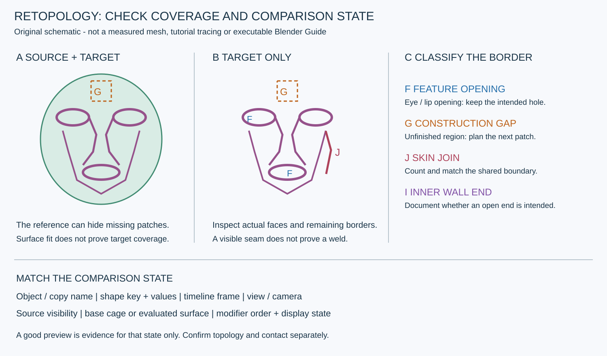

# 2번 Dikko 강좌 보강 — 제작 순서·패치 범위·평가 상태를 함께 읽기

2026-10-31 · 퍼즐 아일랜드 재사용 교육 자료

**입·눈·코의 기능별 경계를 계획한 뒤, 원본 위 배치와 새 Target 단독 모습을 번갈아 확인하며 사이를 연결한다.** 눈부터 시작하는 순서 하나를 정답으로 고정하지 않는다. 좋은 표면 음영, 닫혀 보이는 경계, 작동하는 표정 예시는 각각 다른 증거다.

주자료는 Dikko [ULTIMATE Character Modelling - Part 6. Face Retopo!](https://www.youtube.com/watch?v=DJbU_WfR2Z0),90:01이다. 기존 [기본 루프](FACE_RETOPOLOGY_BASIC_LOOPS.md)와 [눈꺼풀 볼륨](FACE_EYELID_VOLUME.md)을 보완한다. 강좌 캐릭터는 루미 승인 디자인이 아니며, 강좌 외형·표정·수치를 루미에 복사하지 않는다. 이번 작업은 영상 학습·문서 작성이며 Blender 모델 수선·리깅·변형 실행은 없다.

## 1. 전체 흐름 지도와 상세 학습은 다르다

먼저00:00~90:00을2분 간격으로 뽑고89:00을 더한 **47장**으로 흐름 지도를 만들었다. 소개 화면·마지막 검은 화면도 포함한다. 이후 필요한 다섯 구간을20~30초 간격으로 상세 대조하고, 로컬 Qwen 실제 입력16장도 원본과 비교했다. 이번 영상의 **고유127장**을 직접 읽었으며90분 전부를 연속 시청·음성 분석하거나 모든 구간을 상세 학습했다고 주장하지 않는다.

아래 구간은 표본에 붙인 자체 작업 단계명이다. 제작자의 정확한 챕터 경계·발언을 전사한 것이 아니다.

| 표본 시간대 | 화면에서 확인한 큰 흐름 | 이번 확인 수준 |
|---|---|---|
| 00:00~04:00 | 소개, 원본 캐릭터·두 뷰, 초기 평면/장면 준비 | 전체 흐름 표본 |
| 05:00~14:00 | 입 둘레 띠 → 코 옆을 지나는 연결 띠 → 눈 둘레 띠. 오른쪽에는 원본이 없는 분홍 Target 형태가 보임 | 30초 간격19장 +14:00 확대 |
| 16:00~22:00 | 눈·코 옆·입/턱 사이를 면으로 채우고 사선·아래·측면으로 확인 | 30초 간격13장 |
| 24:00~30:00 | 볼·턱 옆으로 범위를 확장하고 코 아래를 보는 시점으로 이동 | 전체 흐름 표본 |
| 32:00~38:00 | 코 옆·밑과 입/볼 주변 면 정리.34:00에 선택된 볼 띠와 `Smooth Vertices` 패널, 뒤에는 코 아래를 보는 시점 | 20초 간격19장 +34:00/36:37.5 확대 |
| 40:00~52:00 | 콧대 중앙에서 이마로 뻗는 띠, 눈 위·옆 줄과 주변 전환, 평가 상태 확인 | 41:00~52:00 30초 간격23장 +43:00/50:00 확대;40:00은 흐름 표본 |
| 54:00~56:00 | 입 주변·입 경계 작업 | 전체 흐름 표본; 구강 전체 제작의 상세 분석 아님 |
| 58:00~62:00 | 얼굴 옆과 귀 뿌리 쪽 경계 확장 | 전체 흐름 표본 |
| 64:00~76:00 | 귀 둘레와 안쪽을 잇는 작업 | 전체 흐름 표본; 귀의 완전한 제작법은 상세 학습하지 않음 |
| 78:00~84:00 | 표정이 다른 얼굴과 큰 입 벌림, wire/음영 보기와 키 목록 | 30초 간격13장 +관련 실제 AI 입력/확대 |
| 86:00,88:00,89:00 | 선택된 얼굴 구역, Sculpt 화면과 표정·복사본 비교 | 추가 세 표본;88:00 확대 |
| 90:00 | 검은 마지막 화면 | 종료 맥락 |

상세 다섯 묶음90장에는86/88/89분의 추가 세 표본이 포함된다. 이90장 중26장은 전체 흐름47장과 겹친다. AI 대조16장을 더하면47+90−26+16=127장이다. 이전 세 차례 교육까지162장과는 영상 ID가 달라 중복이 없으며 누적 고유 표본은289장이다. [검증·원본 시간 목록](../reports/VideoLearning/20261031_DIKKO2_VERIFICATION.json).

## 2. 기존 설명에서 무엇을 보강했는가

| 기존 문서에서 부족했던 부분 | 2번 영상의 직접 근거 | 보강·수정한 재사용 지침 |
|---|---|---|
| 눈에서 시작하는 예시가 중심이었음 | 06:00~09:00 입/하안면 띠가 먼저 보이고11:00~14:00 눈 띠를 만듦 | 기능별 경계 보존이 원칙이며 시작 부위는 작업 범위·연결 계획에 따라 선택 |
| 원본 위 화면만으로 패치 범위를 오인할 여지 | 08:30~14:00과43:00의 두3D뷰에서 원본 위 배치와 Target 단독 범위가 다르게 읽힘 | 원본 표시·단독 Target·평가 결과를 나눠 coverage/경계를 확인 |
| 코·볼 전환의 구체적 화면 사례가 적었음 | 16:00~22:00 연결 면,34:00 선택된 볼 띠와 smoothing 패널,36:37.5 코 아래 시점 | 각 패치 경계·면 간격·곡률을 따로 읽고 작은 구역별로 전환·완화 |
| 눈 위 고리와 이마 전체를 같은 고리 확장으로 오인할 여지 | 43:00 중앙 콧대에서 이마로 뻗는 띠,46:30~50:00 눈 위 별도 줄 | 눈 opening과 이마의 넓은 곡면을 서로 다른 경계/밀도로 계획 |
| cage와 최종 표면을 같은 것으로 판단할 여지 | 14:00 Mirror UI,50:00 `Subdivision`과 `Shrinkwrap` 스택 | 체크포인트별 스택·표시 상태와 기본/evaluated 표면을 따로 기록; 영상 숫자 복사 금지 |
| 후속 변형 검수가 추상적이었음 | 79:00 표정/키 UI,80:07.5/81:30 큰 입 벌림,88:00 `angry` 값과 Sculpt 화면 | 나중에 허용된 복사본에서 중립·시험 상태·키/프레임·동일 뷰를 명시해 비교 |
| 안쪽 벽·용접 등 미확인 항목 | 이번 표본에도 정확한 벽 종단·공유 정점·수치 검사 증거는 없음 | 기존 미확인을 유지. 보이는 면이나 표정만으로 전체 구조 PASS로 승격하지 않음 |

## 3. 원본이 가리는 빈 곳을 확인한다 — 자체 도식

직접 만든 설명용 도식이다. 강좌 tracing·루미 실측 배치·실행 가능한 메시/Blender Guide가 아니다. 도식의 경계 분류와 아래 절차는 **자체 제작·검수 지침**이다.

| 구분 | 질문 | 남길 기록 |
|---|---|---|
| 원본+Target | 표면을 따라가는가, 랜드마크가 맞는가 | Source/Target 이름, 표시·스냅 대상, 정면·사선·측면 |
| Target 단독 | 어디까지 실제 면이 있는가, 원본이 빈 곳을 가리고 있었는가 | feature opening/공사 중 빈 곳/원본 접속 경계의 구역·순서·개수 |
| 기본 cage | 줄 간격·폴·모서리·면 중앙이 어떤 형태인가 | 저밀도 기본 메시와 예상 전환 구역 |
| 평가 결과 | 현재 스택을 통과한 실제 표면은 어떤가 | modifier 순서·표시 상태·offset 등 현재 값과 표면 이격 |
| 후속 시험 상태 | 같은 후보·같은 상태를 비교하는가 | 오브젝트/복사본·키 이름/값·타임라인 프레임·카메라·평가 모드 |

영상의 두 뷰가 항상 같은 각도·평가 상태라는 뜻은 아니다. 후반에는 여러 오브젝트·복사본도 보여 원본과 Target, 중립과 표정, 서로 다른 복사본을 이름 확인 없이 같은 비교쌍으로 취급하면 안 된다.

눈·입 opening, 제작 중 채울 빈 곳, 기존 피부에 붙일 절단 경계, 안쪽 벽의 의도된 종단은 서로 다르다. Target 단독에서 구멍을 보았다는 이유만으로 전부 cap하거나 전부 결함이라고 분류하지 않는다. 실제 공유 정점·용접·경계 수는 파일 데이터로 확인해야 한다.

## 4. 작업에 옮기는 순서 — 자체 절차

1. **전체 재토폴로지와 국소 수선을 구분한다.** 강좌의 별도 Target 제작 화면을 루미 국소 패치의 원본 피부 접속 완료 근거로 쓰지 않는다. 이번 작업이 원본 전체를 대체하는 새 메시인지, 남길 기존 피부와 이어야 하는 패치인지 먼저 적는다.
2. **현재 상태와 보존선을 고정한다.** 최신 live checkpoint, Source/Target·안구·원본 UV/weight·보관 키/리그를 기록한다. 승인 루미 이미지와 현재 표면의 Guide로만 형태 목표를 정한다. 강좌 캐릭터의 눈·코·볼·표정을 가져오지 않는다.
3. **기능별 경계와 시작 구역을 계획한다.** 눈·입 opening과 코/콧방울, 볼·턱, 이마·원본 접속 경계를 표시한다. 입부터든 눈부터든, 나중에 붙일 경계의 순서·개수·허용 전환 구역을 먼저 설계한다.32점·7고리 같은 시도값을 통일 규격으로 만들지 않는다.
4. **작은 띠·패치를 만든 뒤 두 보기로 확인한다.** 원본 위에서는 위치·곡률, 단독 Target에서는 실제 면 범위·구멍·겹친 패치를 확인한다. 일시 숨김·보기 변경의 대상과 복원 상태를 기록한다. Guide 제작자는 원본을 수정하지 않고 캡처·인덱스·완료 기준을 넘기며 점유를 해제한다.
5. **코·볼·이마의 밀도를 각자 조정한다.** 눈의 작은 면을 이마·볼 전체에 같은 수로 계속 늘리지 않는다. 코 아래는 아래·사선 시점, 이마는 측면 실루엣, 볼은 입/광대 사이 줄 간격을 함께 본다. 필요 구간에만 분할·슬라이드·완화를 계획하고, 랜드마크·벽·모서리를 따로 보존한다. Smooth 도구 실행은 곡면 품질 PASS의 근거가 아니다.
6. **폴과 경계 전환을 실제 데이터로 읽는다.** 스크린샷의 교차선만으로 valence를 확정하지 않는다. 현재 mesh에서 이웃 엣지·면과 경계 수를 기록하고 급한 곡률·눈꼬리·접힘·입꼬리에 면이 몰리는지 확인한다. 기존 피부와 점 수가 다르면 허용한 이웃 면까지 포함한 전환 Guide를 만든다. 전역 용접으로 개구부·의도된 접촉점을 지우지 않는다.
7. **기본과 평가 표면을 각각 검수한다.** 50:00 영상 UI에는 Subdivision/Shrinkwrap이 보이지만 그것이 루미의 정답 순서·수치라는 뜻은 아니다. 현재 후보의 스택 상태를 기록하고 정점뿐 아니라 엣지 중간·면 중앙의 실제 이격과 법선·접힘·교차 의심을 본다. 미리보기만 부드럽고 기본 cage가 찌그러진 상태를 숨기지 않는다.
8. **중립 완료와 후속 시험을 나눈다.** 이후 승인된 복사본에서 중립·중간/완전 닫힘·입 벌림·표정 조합 등을 시험할 때 선택 키·값·프레임과 비교 오브젝트를 명시한다. 실제 열고 닫는 경로·접촉·관통·코/볼 당김은 별도 확인이다. 이번 교육에서 루미에 시험 키·리그를 만들거나 해당 동작을 실행하지 않았다.

## 5. 실패할 때 무엇부터 다시 확인하는가

| 현상 | 먼저 확인 | 다음 조치 |
|---|---|---|
| 원본 위에서는 완성처럼 보이나 단독 Target에 큰 빈 곳 | 아직 면을 만들지 않은 구역인지, feature opening인지 | coverage 지도를 고치고 미완료 패치·책임 경계를 명시 |
| 중앙에 두 겹·틈 또는 연결이 불명확 | 현재 축 기준·중앙점·Mirror 단계/평가 상태 | 실제 seam 데이터를 확인; 체크박스나 분홍 외형만으로 용접 판정하지 않음 |
| 눈 위·코 옆이 갑자기 납작하거나 뾰족함 | 전환 줄 간격, 폴/얇은 면, 원본과 면 중앙 이격 | 국소 재배치·밀도 전환 Guide를 만들고 여러 시점에서 재확인 |
| 평가 음영만 좋아 보임 | 기본 cage와 스택이 다른 문제를 가리는지 | 같은 후보의 기본/evaluated 캡처·거리 검사를 구분 |
| 표정이 좋아 보여 중립도 통과시킴 | 서로 다른 복사본·키·프레임이었는지 | 중립 상태를 다시 고정해 동일 조건으로 비교 |
| 코/눈의 안쪽 벽이 완성됐다고 착각 | 원본이 보이는 틈인지, Target 안쪽 면인지, 실제 종단인지 | Target 단독+내부 시점+파일 경계 데이터로 좁혀 확인; 미확인 유지 가능 |

## 6. 완료·인계 체크

- [ ] Source/Target·원본 교체 또는 국소 접속 목적과 최신 checkpoint를 기록했다.
- [ ] 루미 승인 형태·현재 표면 Guide·랜드마크·보존선·허용 전환과 인덱스를 저장했다.
- [ ] 기능 opening, 채울 빈 곳, 원본 접속 경계, 벽 종단을 분류했다.
- [ ] 원본 위/Target 단독/기본 cage/평가 결과를 구분하고 보기 변경을 복원했다.
- [ ] 코·볼·이마 전환과 안쪽 면을 여러 시점으로 읽고, 폴·경계 수·공유 정점은 파일 데이터로 검사했다.
- [ ] 안구·UV/weight·기존 키/리그 보존과 표면 이격·법선·겹침 의심을 검수했다.
- [ ] 실제 수정 후보와 Guide 파일, 동일 조건 전후, 미완료 항목을 구분해 저장·정상 점유 해제했다.
- [ ] 후속 변형 시험을 한 경우에만 복사본·키/값·프레임과 실제 결과를 기록했다.

이는 후속 제작의 기준이며 이번 영상 학습에서 체크를 통과시킨 것이 아니다. v021의 원본 미용접·기존 경계 전환·표면 이격 최대7.237mm의 **PARTIAL**은 유지한다.

## 7. 확인 수준을 유지한다

- **직접 관찰:** 위 시간대의 띠/패치 범위, 두3D뷰, 선택 구역과 읽히는 UI 패널, 후반 표정·큰 입 벌림·키 목록.
- **자체 해석/제안:** 두 보기의 coverage 검사, 작업 목적 구분, 파일 데이터 검사·Guide·완료 기준. 강사의 정확한 발언으로 인용하지 않는다.
- **상세 열람하지 않은 범위:** 귀64~76분, 입/구강54~56분과 나머지 흐름 표본 사이의 모든 조작. 전체 흐름 표본과 상세 학습을 혼동하지 않는다.
- **여전히 미확인:** 모든 폴 valence·경계 수·공유 정점/용접·내벽 종단/두께·안구 간격·자가교차·전체 변형 건전성·음성/모든 입력. 선정 표본에서 직접 근거를 못 찾았다는 뜻이지 강좌 전체에 없다고 확정한 것이 아니다.

[상세 학습·AI 오답 교정 기록](../reports/VideoLearning/20261031_DIKKO2_REVIEW.md). 원본 영상·음성·대량 캡처·AI 이미지 payload는 로컬에만 남기고 Git에는 이 자체 문서·도식·검증 기록만 게시한다.

후속 [3번 LPL 첫 정식 분석](FACE_EYELID_SHAPE_KEYS.md)은 셰이프키·영역 그룹·driver·조작기 표시의 교육을 따로 다룬다.2번 강좌의 표정 예시를 본 사실과 특정 리그를 완성·검증한 사실은 계속 구분하며, 루미에서의 실제 키/리깅/변형 실행은 하지 않았다.
