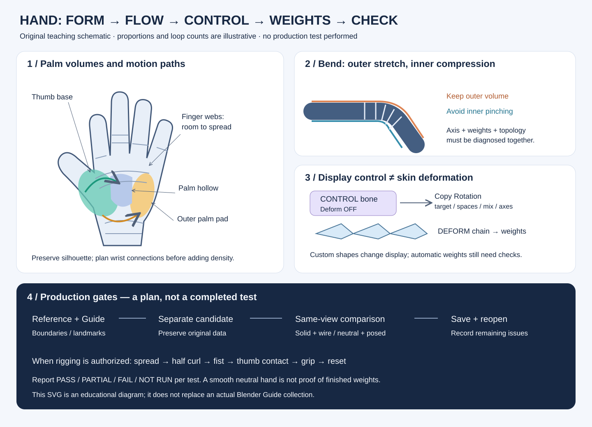

# 손·손가락 제작과 변형 교육

손을 만드는 순서, 변형을 위한 면 흐름, 손가락 컨트롤과 가중치를 세 강좌로 연결한 재사용 매뉴얼이다. **강좌 분석 완료와 실제 캐릭터 제작·리깅 검증 완료는 별개**다. 이 교육에서는 열린 Blender와 제작 파일을 조작하지 않았다.

## 읽는 순서와 출처

| 순서 | 매뉴얼 | 원 강좌와 실제 범위 |
|---|---|---|
| 1 | [손 기본형 제작](HAND_BUILDING.md) | Dikko, [Modeling for Animation 04 - Building the Hands!](https://www.youtube.com/watch?v=8R0e0qh5wiU), 약33:57. 관찰→손바닥→손가락→엄지 재작업→변형 시험→팔 접속→외부 서비스 예시 |
| 2 | [손 리토폴로지 판단](HAND_RETOPOLOGY.md) | Dikko, [Best Tips for Retopologising ANY kind of hand!](https://www.youtube.com/watch?v=zF61xM6fiDw), 약21:44. 서로 다른 세 손의 면 흐름·변형 비교. 빈 메시부터 완성하는 전체 제작 수업은 아님 |
| 3 | [손가락 리깅과 가중치](HAND_FINGER_RIGGING.md) | CG Cookie, [CGC Classic: Rigging Fingers (Blender 2.6)](https://www.youtube.com/watch?v=NR5q3zsKHew), 약38:04. Copy Rotation 기반 컨트롤→복제→바인딩 오류→가중치 보정. 마지막에도 보정할 부분이 남음 |

도식의 선과 비율은 개념 설명용이다. 승인 캐릭터의 디자인, 정점 수, 실제 Blender Guide를 대신하지 않는다.

## 확인 범위와 근거의 구분

- **직접 화면 확인:** 처음부터 마지막까지의 60초 간격 개요, 주요 제작 구간의 10~30초 간격 추가 표본, 로컬 AI 입력 표본, 핵심 UI 원해상도 재확대. 정확한 중복 제외 수와 시점은 [학습 기록](../reports/VideoLearning/20261031_HAND_COURSES_REVIEW.md)에 있다.
- **자동 자막 확인:** 공개 영어 자동 자막을 중복 표시 제거 후 시작부터 마지막 유효 문장까지 읽었다. 음성을 전 구간 연속 청취하거나 사람이 검수한 원문을 확보했다는 뜻은 아니다. 누락·오인식이 있어 각도·축·메뉴는 화면과 공식 문서로 구분한다.
- **원리 정리:** 변형 방향에 따라 면의 여유를 배분하고, 관절 축과 가중치를 따로 진단하는 설명은 위 자료를 종합한 교육적 해석이다.
- **적용 제안:** 아래 QA와 인계 기준은 후속 제작용 제안이다. 이번 교육에서 실행한 시험 결과가 아니다.
- **미확인:** 강사의 원본 메시 데이터, 모든 프레임의 편집 명령, 정확한 수치와 저장 상태, 게임 엔진 출력 품질. 유료 수업·회원 자료는 열지 않았다.

## 제작 단계별 통과 조건

| 단계 | 확인할 것 | 다음 단계로 넘기기 전 남길 것 |
|---|---|---|
| 기준·범위 | 승인 손 비율, 장갑 노출 범위, 요구 동작, 대상 기기 예산 | 기준 자료·보존할 랜드마크·수정 범위 |
| 기본형 | 손바닥 두께·오목함, 엄지 기저부, 손가락 길이·벌어짐 | 정면·사선·측면 solid 비교 |
| 면 흐름 | 관절 압축과 신장, 손가락 사이, 엄지에서 손목으로 돌아가는 경로 | wire 비교·접속 경계·문제 면 위치 |
| 시험 리그 | 실제 관절 위치, 로컬 축, 엄지의 별도 방향 | 한 손가락에서 먼저 확인한 회전 관계 |
| 가중치 | 다른 손가락·손목의 불필요한 영향, 컨트롤의 Deform 제외 | 개별 손가락과 엄지 시험 기록 |
| 통합 | 손목 접속, UV·텍스처·기존 데이터 보존 | 별도 후보 저장·재열기와 남은 문제 |

네모난 면만 있다는 이유로 변형 PASS를 주지 않는다. 자동 가중치가 생성됐다는 이유로 완성 처리하지 않는다. 멀쩡한 중립 실루엣도 주먹이나 엄지 접촉에서 무너질 수 있다.

## 변형 QA 계획 — 미실행

후속 리깅이 작업 범위에 들어왔을 때 전용 복사본에서 아래 순서로 시험한다. 현재 작업에 움직임·리깅 보류가 있다면 이 표는 설계 참고로만 사용한다.

| 시험 | 관찰 지점 | 실패 예 |
|---|---|---|
| 중립→벌림→중립 | 손가락 사이·손등, 원래 위치 복귀 | 얇은 막처럼 늘어남, 이웃 손가락 동반 이동 |
| 각 손가락 반 굽힘→완전 굽힘 | 바깥 관절 볼륨·안쪽 접힘 | 뾰족한 점, 납작한 관절, 면 역전 |
| 네 손가락 함께 주먹 | 손바닥·손끝 접촉·손가락 간격 | 깊은 관통, 벌어지는 손목, 부자연스러운 주먹 폭 |
| 엄지→검지·중지·새끼 쪽 접촉 | 엄지 기저부·검지 사이·손바닥의 말림 | 평면 회전만 가능, 엄지 밑이 찢어짐 |
| 크기가 다른 물체 잡기 | 끝마디 개별 제어·접촉·장갑 | 모든 마디가 같은 각도로만 움직임 |
| 조합 후 초기화 | 컨트롤과 변형 뼈, 중립 실루엣 | 잔류 회전, 제약 순환, 재현 안 되는 포즈 |

동일한 카메라·표시 방식·Subdivision 수준·포즈에서 전후 solid/wire를 남긴다. 시험별 PASS/PARTIAL/FAIL/NOT RUN을 적고, 미실행을 PASS에 포함하지 않는다. 모바일 엔진의 실제 스키닝·본 영향 수·내보내기는 별도 검증 대상이다.

## 실제 수정 인계에 적용할 방식

1. [프로젝트 참고자료](PROJECT_REFERENCE_GUIDE.md)에 따라 승인 기준 원본과 최신 저장 파일을 확인하고 원본을 보존한다. 강좌 예제의 손 비율을 캐릭터에 그대로 복제하지 않는다.
2. Blender의 별도 Guide 컬렉션에 수정 범위, 보존 경계, 관절 랜드마크, 원하는 면 흐름과 연결 위치를 실제로 표시한다. 형태 변경이면 목표 실루엣·이동 방향·범위도 정면·사선·측면에 남긴다.
3. 가이드 파일과 실제 수정 후보를 구분한다. 담당에게 오브젝트·영역·정점/면 인덱스, 접속 경계 수, 완료 기준과 제외 항목을 전달한다. 이 문서의 SVG만 전달하고 위치 지정을 끝냈다고 하지 않는다.
4. 가이드 제작자의 정상 점유 해제 후 담당이 단독 작업한다. 가이드 제작만으로 피부 메시를 바꾸지 않는다.
5. 결과는 같은 조건의 실제 전후 화면과 파일 상태로 확인한다. 파일 저장·통계 통과와 시각 개선을 각각 기록한다. 루프 수를 맞추기 위해 지정 밖의 손·팔 전체를 재설계하지 않는다.

## 현재 Blender로 옮길 때

구강·얼굴 문서와 마찬가지로 **버전 차이를 먼저 확인**한다. 특히 CGC는 제목이2.6, 설명이2.5이고 실제 UI도 오래된 계열이다. 단축키와 Offset 체크박스를 현재 설정에 그대로 복사하지 않는다. [리깅 매뉴얼의 5.2 대응](HAND_FINGER_RIGGING.md#현재-blender-52-대응)을 따른다. 이번 교육에서 Blender5.2 실습은 실행하지 않았다.

학습 방식·로컬 AI 오답·원본 해시·미실행 목록은 [검토 보고서](../reports/VideoLearning/20261031_HAND_COURSES_REVIEW.md)와 [검증 기록](../reports/VideoLearning/20261031_HAND_COURSES_VERIFICATION.json)에 있다. 기존 [얼굴 기본 루프 교육](FACE_RETOPOLOGY_BASIC_LOOPS.md)의 실습 상태를 이 교육의 성과로 바꾸지 않는다.
