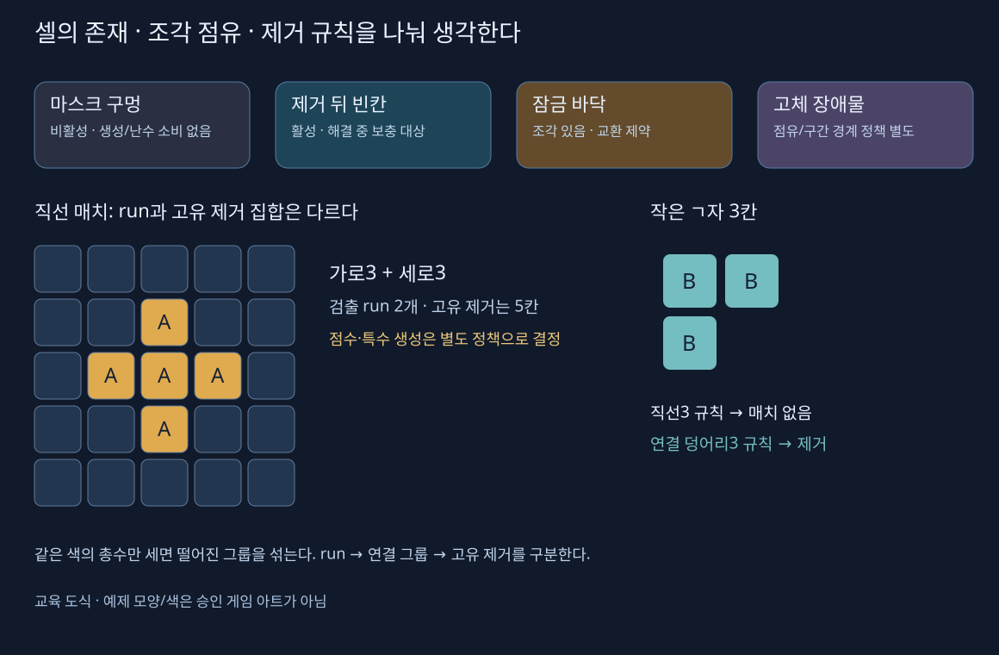

# 매치3 · 보드 데이터, 좌표와 입력

[전체 흐름](MATCH3_WORKFLOW.md) · [해결 루프](MATCH3_RESOLUTION_SPECIALS.md). 원 자료별 근거는 [비교 문서](MATCH3_SOURCE_COMPARISON.md)와 [65편 색인](MATCH3_TAFT_EPISODES.md)에 있다. 아래 의사코드는 개념을 설명하기 위해 새로 쓴 것이며 게임에 적용한 변경이 아니다.

## 판정 데이터와 화면의 책임

보드 데이터는 셀의 존재 여부, 조각 ID/종류/특수 상태, 장애물 상태를 가진다. 화면 객체는 위치·sprite·애니메이션·소리를 가진다. ‘조각이 화면에서 목표 위치에 도착했다’와 ‘보드 배열의 조각을 이동했다’는 서로 다른 완료 시점이다.

| 계층 | 입력/출력 | 피할 결합 |
|---|---|---|
| 규칙 | 셀 좌표 명령 → 수락 여부·상태·이벤트 | Transform 근접도, `Update` 횟수, 음향 난수 |
| 세션 | Busy·종료·화면 완료·저장 흐름 | 화면에서 보상을 직접 증가시키기 |
| 표현 | 판정 이벤트 → 이동·제거·카운터 표시 | 애니 콜백에서 다시 피해·매치 판정 |
| 레벨 정의 | 시드·마스크·목표·제한·종류 목록 | 재플레이 중 수집 수를 원본 SO에 저장 |
| 저장 | 검증된 진행 스냅샷·고유 거래 | 현재 씬 객체/프리팹 참조 직렬화 |

Catlike는 game/skin 경계를 가르치지만 `Match3Game`도 MonoBehaviour와 Unity Random을 쓴다. git-amend의 generic grid도 Vector3 등 Unity 형식이 있다. 이름이 ‘논리’·‘generic’이라고 엔진 독립이나 결정성이 자동으로 생기지는 않는다.

## 좌표 계약을 먼저 고정한다

정수 `(x,y)`를 논리 좌표로 사용하고 화면의 pixel/world/RectTransform 좌표와 구별한다. 좌하 원점에서는 y가 위로 증가하지만 Winterbolt의 행 목록은 위에서 아래로 배열되어 top이 y−1이다. 행 데이터를 가져올 때 딱 한 경계에서 변환한다.

예를 들어 좌하 원점 보드의 1차원 배열은 `index = y * width + x`, 역변환은 `x = index % width`, `y = index / width`다. 마지막 셀은 `(width−1,height−1)`이다. `width`와 `height`를 바꿔 써도 7×7에서는 숨어 있으므로 4×7·7×4 검증이 필요하다.

월드 XY 격자에서 셀 모서리는 `origin + (x,y)*cellSize`, 셀 중심은 여기에 `(0.5,0.5)*cellSize`를 더한다. 중심을 모서리로 해석하면 반 칸 오차가 난다. 역변환은 원점·셀 크기를 되돌린 뒤 floor를 적용한다. 음수 −0.1을 정수 절삭하면 0이 되어 보드 밖 입력을 첫 셀로 오인할 수 있다.

git-amend의 Vertical converter는 XY, Horizontal converter는 XZ 평면이다. **Android 세로/가로 화면 선택이 아니다.** XZ에서 터치를 받으려면 카메라 ray와 보드 평면의 교차가 필요하다. `ScreenToWorldPoint`에 깊이 0을 무조건 넣는 방식은 모든 카메라·평면에 맞지 않는다.

UGUI에서는 보드의 실제 Rect 안에서 local 좌표를 계산한다. Canvas scaler, pivot, 부모 transform, 카메라, Safe Area, 보드 padding을 함께 고려한다. 배경 이미지 전체가 아니라 조각이 배치되는 영역을 변환 기준으로 삼는다. 현재 프로젝트의 좌하 원점·top-to-bottom 마스크 변환은 기존 계약을 유지한다.

## ‘없음’을 한 값으로 뭉치지 않는다



| 상태 | 셀 존재 | 조각 | 예시와 주의 |
|---|---|---|---|
| 보드 밖 | 없음 | 없음 | 어떤 규칙도 배열 조회 전에 경계 검사 |
| 마스크 구멍 | 비활성 | 없음 | 생성·난수·ID를 소비하지 않음, 구간 중력 경계 |
| 제거 후 빈칸 | 활성 | 일시 없음 | 해결 중 상태이며 보충 대상 |
| 잠금 바닥 | 활성 | 보통 있음 | 출발/목적 교환 제한, 매치·피해 정책 별도 |
| 고체 장애물 | 활성/차단 속성 | 없음 또는 별도 점유 | 낙하 경계·사방 피해·관통 효과 정책 명시 |
| 바닥 젤리 | 활성 | 있음 | 조각 제거와 바닥 HP/목표 진행을 구별 |

Taft는 blank/lock/concrete/slime 배열을 점차 추가한다. 최초 생성만 제외하고 낙하·리필·셔플에서 제외하지 않으면 장애물 자리에 조각이 들어간다. 자료구조가 여러 배열이면 그 조합 불변식을 검사해야 한다. 실제 프로젝트가 이 장애물을 모두 구현했다는 뜻은 아니다.

## 초기판 생성

직선3을 피하는 순차 생성은 왼쪽 두 칸과 아래 두 칸이 각각 같은 종류일 때 그 종류를 금지하는 방식으로 설명할 수 있다. 활성 셀인지 먼저 검사하고 마스크 구멍을 건너 같은 run으로 잇지 않는다. 사용 가능한 종류가 없으면 실패를 명시하며 무제한 재시도하지 않는다.

‘초기 매치 없음’과 ‘가능한 수 최소 하나’는 별개다. 생성 후 실제 합법 교환 검사로 가능한 수를 확인한다. 재시도 상한·실패 처리·시드 소비 순서를 정한다. 특수 탭/조합이 있는 규칙에서는 직선 매치만 보고 교착이라고 판정하면 안 된다.

```text
정의 검증: 크기, 활성 셀, 종류, 목표, 제한
정해진 순서로 활성 셀 방문
  현재 규칙에 맞는 금지 종류 계산
  허용 종류에서 주입된 PRNG로 선택
초기 불변식 검사
공통 합법성으로 가능한 명령 탐색
실패하면 정해진 재생성 정책 또는 명시 오류
```

외부 사운드·UI·힌트가 같은 전역 Random을 소비하면 판이 달라질 수 있다. 게임 PRNG는 명령 흐름에만 사용하고, 무효 입력은 상태와 PRNG 상태를 모두 보존한다. 재현에는 seed뿐 아니라 규칙 버전·레벨 정의·마스크·입력 순서도 필요하다.

## 입력을 명령으로 바꾸기

Taft는 `OnMouseDown/Up`과 `Atan2` 각도로 네 방향을 선택한다. Catlike는 drag 길이 임계와 보드 평면 교차를 쓴다. git-amend는 Input System의 pointer 위치와 Fire 이벤트를 InputReader로 분리한다. Winterbolt는 UI Button의 두 칸 선택이다. 서로 다른 방식이므로 콜백 이름만 바꿔 합치지 않는다.

새 입력 어댑터를 만들 때의 순서는 다음과 같다.

1. 세션이 입력 가능한 안정 상태인지 확인한다. 결과 화면·저장 중·해결 중 명령은 거부한다.
2. pointer ID, 시작 위치, UI 위에서 시작했는지 기록한다. 화면 밖 해제·취소·초점 상실 시 선택을 정리한다.
3. 같은 pointer의 이동/해제만 처리한다. 임계값은 화면 크기와 입력 의도를 고려해 정한다.
4. 화면→보드 변환을 하고 경계·활성 셀·점유를 검사한다.
5. 방향 교환 또는 두 셀 선택을 하나의 명령으로 만든다. 명령 수락 전에 또 다른 해결 루프를 시작하지 않는다.
6. 수락/거부 결과에 따라 선택 표시를 지운다. 빈칸/패널 전환 후 오래된 선택을 재사용하지 않는다.

투명한 UGUI panel의 Raycast Target만으로 물리 `OnMouseDown`까지 반드시 차단되지는 않는다. UI event와 월드 입력을 같은 게이트에서 조정한다. `await`·coroutine·Button transition도 자동 Busy 잠금이 아니다.

## 교환·힌트·교착의 공통 합법성

기본 교환은 양끝이 유효하고 서로 다르며 Manhattan 거리 `|dx|+|dy|=1`이어야 한다. 여기에 잠금·점유·승인 특수 예외를 적용한다. 힌트와 교착 검사도 같은 조건을 쓴다.

```text
TryCommand(A,B):
  안정/입력허용 상태가 아니면 거부
  CanAttempt(A,B,규칙)이 아니면 거부
  상태를 시험 교환
  명령이 만든 매치/승인 예외를 평가
  없으면 데이터와 난수 상태를 복원하고 거부 결과
  있으면 한 턴으로 수락하고 해결 시작
```

시험 교환을 원복하지 않거나 `return` 경로 하나에서 복원을 놓치면 힌트를 보기만 해도 판이 바뀐다. 순수 사본 또는 예외를 포함해 복원을 보장하는 구조가 필요하다. 기존의 무관한 매치가 있는 판에서는 전체 보드 ‘매치 있음’만으로 그 교환이 유효했다고 할 수 없다.

힌트는 가능한 명령의 목록 또는 첫 수를 제공할 수 있다. 첫 수는 최적 수·목표 달성 AI가 아니다. 방향 중복 제거, 표시 시작점/목적지, 무입력 타이머 리셋, 해결 중 숨김을 따로 다룬다. 교착 해결에서 같은 조각 집합을 섞는 셔플과 새 조각을 만드는 재생성은 서로 다른 정책이다.

## 확인할 작은 판

| 입력 | 기대 |
|---|---|
| 같은 칸 두 번 | 명시된 선택 해제 또는 거부, 이동 수·난수 불변 |
| 대각선/두 칸 건너 | 일반 교환 거부 |
| 목적지 빈칸/구멍/잠금 | 승인 규칙에 따라 거부, 힌트도 같은 결과 |
| 임계 직전/직후 drag | 방향·중복 명령 발생 여부 확인 |
| 이동 애니 중 다른 손가락 | 새 턴 시작 안 함 |
| UI 위에서 시작 후 보드에서 해제 | 보드 교환 안 함 |
| 첫·마지막 행/열의 가능한 수 | 누락 없이 찾고 검사 뒤 판이 같음 |
| 같은 seed에서 소리/힌트 켜고 끄기 | 판정 결과와 PRNG 진행 같음 |

이 표는 구현 검증 계획이며 이번 문서 작업에서는 Unity/Android로 실행하지 않았다.
