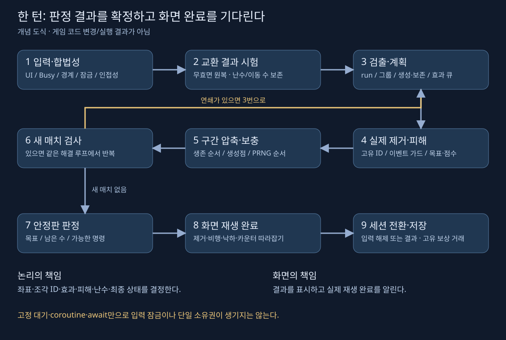

# 매치3 제작 · 강좌 통합 매뉴얼

2026-11-01 · 한국어 교육 자료. **69편 영상과 Catlike Coding의 본문·FAQ를 학습해 작성했다.** 영상은 전체 정제 자동자막, 시작부터 끝까지의 개요 표본, 주요 코드·UI 상세 화면을 대조했다. 연속 전 구간 음성 청취·모든 프레임 확인·Unity 재현 시험은 하지 않았다. [실제 확인 범위](../reports/VideoLearning/20261101_MATCH3_REVIEW.md)와 [검증 기록](../reports/VideoLearning/20261101_MATCH3_VERIFICATION.json)을 함께 읽는다.

## 읽는 순서

| 순서 | 문서 | 목적 |
|---|---|---|
| 1 | [보드·좌표·입력](MATCH3_BOARD_INPUT.md) | 판정 데이터와 화면을 분리하고 유효한 입력 한 건을 만든다 |
| 2 | [해결 루프·특수·장애물](MATCH3_RESOLUTION_SPECIALS.md) | 제거·낙하·보충·연쇄를 안정 상태까지 완료한다 |
| 3 | [레벨·저장·검증](MATCH3_LEVEL_SAVE_QA.md) | 턴 종료, 진행도, 복구와 실제 시험 범위를 정한다 |
| 4 | [자료별 구현 비교](MATCH3_SOURCE_COMPARISON.md) | 원 강좌의 규칙·누락·오류와 보완안을 구별한다 |
| 5 | [Taft 65편 회차별 색인](MATCH3_TAFT_EPISODES.md) | 각 편의 주제·시간·관찰·후속 정정을 찾는다 |
| 6 | [Unity 6 호환 대조](MATCH3_UNITY6_COMPATIBILITY.md) | 예전 API·설치·저장을 현재 프로젝트에 옮기기 전 확인한다 |

이 교육은 게임 코드 변경이나 새 특수 규칙 승인을 뜻하지 않는다. 적용할 프로젝트의 승인 화면 방향·Safe Area·보드 크기·엔진/패키지·특수 규칙을 먼저 고정한다. 강좌의 5×5·8×8·세로 UI를 그대로 적용하지 않는다. [프로젝트 기준 안내](PROJECT_REFERENCE_GUIDE.md)를 함께 읽는다.

## 원 자료와 역할

| 자료 | 실제 학습 범위 | 주로 배울 것 | 그대로 완제품으로 취급할 수 없는 이유 |
|---|---|---|---|
| [Mister Taft Creates · Unity/C#](https://www.youtube.com/playlist?list=PL4vbr3u7UKWrxEz75MqmTDd899cYAvQ_B) | 실제 목록 65편, 메타데이터 합 20:59:05. Part 0~58에 소수 번호·Android 편 포함 | 입력부터 폭탄·빈칸·목표·저장·장애물·메뉴까지 점진 제작과 디버깅 | 여러 편에 걸친 정정, 전역 플래그·고정 대기·연결 그룹/경계 문제 |
| [Catlike Coding · Match 3](https://catlikecoding.com/unity/tutorials/prototypes/match-3/) | 전체 본문과 접힌 FAQ 답변·라이선스 | 논리/skin 분리, run 검출, 압축 낙하, pool, 애니 완료와 입력 잠금 | 특수·장애물·레벨·저장 없음. 교착은 게임 종료. 자동 플레이는 첫 가능한 수 |
| [Winterbolt Games](https://www.youtube.com/watch?v=9i_sktmLg30) | 80:41 영상 전체 흐름·자막과 단계별 상세 화면 | UGUI 배치, Item SO, DOTween 순서·비동기 완료 | 직선3이 아닌 같은 종류 연결 덩어리 규칙. 낙하 없이 제자리 교체 |
| [git-amend Part 1](https://www.youtube.com/watch?v=ErHEZ5YGQ5M) · [2](https://www.youtube.com/watch?v=s6lqTI8dOQ4) · [3](https://www.youtube.com/watch?v=SThzZ_5-erM) | 공개 3편과 [제작자 저장소](https://github.com/adammyhre/Match3)의 C# 7개 전체 | 좌표 converter, InputReader, HashSet 중복 제거, 시각·음향 분리 | 인접 교환·busy·무효 반환·리필 후 연쇄·목표/저장 미구현 |

Taft의 Godot 강좌와 이 Unity 목록은 다른 자료다. 번호 마지막이 58이라고 59개로 세거나, 다른 목록의 76개를 이 학습 수로 쓰지 않는다. git-amend는 확인한 공개 3편을 범위로 삼으며 후속편이 영원히 없다는 뜻은 아니다.

## 한 턴을 설계하는 순서

1. 고정한 레벨 정의·시드·규칙 버전·마스크를 읽어 초기판을 만든다. 유효한 셀, 비어 있는 셀, 장애물을 분리한다.
2. 입력을 화면 좌표에서 보드 셀로 변환한다. UI 위 입력·취소·여러 손가락과 Busy/종료 상태를 먼저 처리한다.
3. 동일한 합법성 함수로 교환·힌트·교착 검사를 수행한다. 무효 명령은 데이터·난수·이동 수를 소비하지 않는다.
4. 교환 결과를 시험하고, 매치가 없으면 원상복구 결과를 화면에 전달한다. 특수 조합/탭 등 승인된 예외도 같은 계약에 명시한다.
5. 검출 결과를 그룹과 고유 좌표로 정리한다. 특수 생성 위치와 보존할 조각을 먼저 확정한다.
6. 특수 연쇄·장애물 피해·실제 제거를 정해진 순서로 확정한다. 같은 이벤트가 다시 적용되지 않도록 식별한다.
7. 각 중력 구간을 아래로 압축하고 위에서 보충한다. 난수와 조각 ID 소비 순서를 고정한다.
8. 새 매치를 검사하고 안정될 때까지 반복한다. 한 명의 해결 담당만 보드를 변경한다.
9. 최종 목표·이동 소진·가능 수를 판정한다. 목표 달성의 우선순위를 명시하고 안정된 최종 상태를 전달한다.
10. 화면이 제거·비행·낙하·카운터를 모두 표시한 뒤 입력을 해제하거나 결과 화면으로 간다. 보상은 고유 거래로 저장한다.

각 단계의 대기 시간은 연출을 위한 값이다. 프레임 수와 애니메이션 콜백이 점수·난수·목표를 결정하면 재현과 중단 복구가 어려워진다. Core 결과를 기록하고 화면은 그 결과를 재생하도록 한다.

## 최소 완료 기준

| 영역 | 완료로 부를 조건 | 실패를 드러내는 작은 사례 |
|---|---|---|
| 좌표 | 셀 중심 왕복 변환, 경계 안팎, 마스크 해석이 일치 | 우측 끝 바로 바깥·원점 왼쪽 음수 좌표 |
| 교환 | 인접성·잠금·특수 예외·무효 반환이 공통 계약 | 대각선·같은 칸·빈칸·잠긴 목적지 |
| 매치 | 끝까지 이어진 run과 교차점을 놓치지 않음 | 오른쪽 끝 5개, T/L, 떨어진 동일 색 두 그룹 |
| 해결 | 한 번의 수락으로 안정 상태까지, 동시 해결 없음 | 제거 중 연타·2차 연쇄·씬 종료 |
| 특수·장애물 | 고유 이벤트·피해·보존·생성 위치가 결정적 | 상호 폭탄 호출·한 장애물에 여러 경로 타격 |
| 진행 | 마지막 수의 승리·패배, 저장 중복을 구분 | 목표 달성과 이동0이 같은 턴에 발생 |
| 재현 | 동일 정의·시드·입력에서 같은 상태·이벤트 | 사운드 pitch/힌트 켬 여부를 바꿔도 같은 판정 |
| 기기 | 실제 터치·Safe Area·성능과 재접속을 시험 | 긴 가로 화면·백그라운드 복귀·저장 실패 |

이 문서의 시험표는 **실행 계획**이다. 기존 프로젝트의 과거 PASS를 이번 교육의 Unity 실행 결과로 재사용하지 않는다.

## 제작 인계에 남길 것

레벨/규칙 버전, 입력 순서, 시드와 마스크, 교환 전후·연쇄별 상태, 좌표·조각 ID·이벤트 ID, 기대/실제 결과를 남긴다. 재현 가능한 최소판을 먼저 만든 뒤 수정 범위를 정한다. 새 기능을 붙일 때는 최초 생성·입력·매치·특수·낙하·보충·힌트·교착·저장 중 영향을 받는 경로를 함께 갱신한다.

자료에서 실제 본 내용은 ‘관찰’, 코드 흐름으로 예상한 위험은 ‘추론’, 새 구조/정책은 ‘보완 제안’, 아직 시험하지 않은 항목은 ‘미검증’으로 구별한다. 원문 코드·영상·텍스처의 공개 열람을 재배포 허가로 취급하지 않는다.
