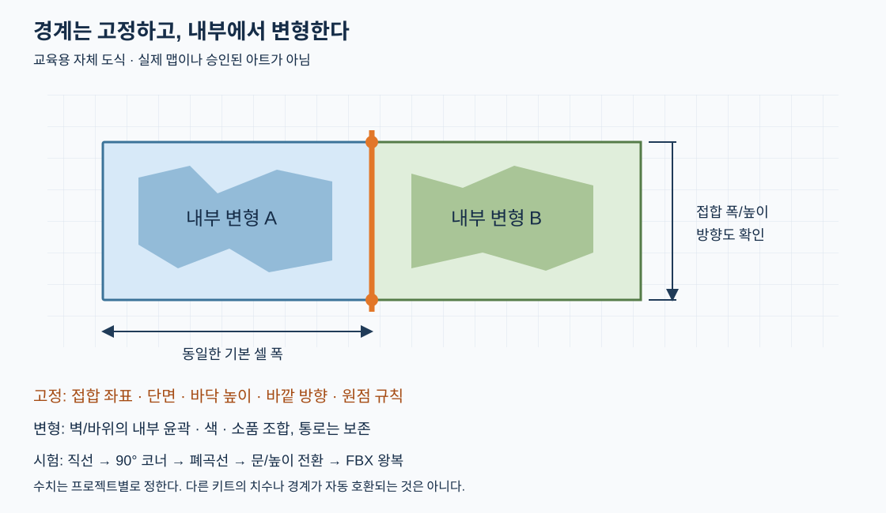

# 그리드·원점·접합 규격

[전체 순서](MODULAR_MAP_WORKFLOW.md) · [출처 시간 색인](MODULAR_MAP_COURSE_INDEX.md)

모듈은 보이는 모양보다 **이웃과 만나는 위치·방향·폭·높이**가 같아야 재사용할 수 있다. 표면을 자연스럽게 찌그러뜨려도 접합 랜드마크까지 임의 이동시키지 않는다.

## 원본에서 확인한 규칙

- [Curtis 00:28–03:23](https://www.youtube.com/watch?v=SgEbUgA7jVo&t=28s): 2×2×2m 예시, 정해진 증분과 서로 맞는 연결, 중첩 부품. 2m가 모든 맵의 필수 단위라는 주장은 아니다.
- [던전 18:57–34:05](https://www.youtube.com/watch?v=DCEvFtrQCNw&t=1137s): 바닥·직선 벽·내외 코너·출입구 템플릿을 만들고 수동 조립. 약 36분에는 변형 중에도 스냅 경계를 정확히 남겨야 한다고 설명한다.
- [Christina 07:34–08:52](https://www.youtube.com/watch?v=0o-QnNs-stc&t=454s): 원본 팩의 벽 폭 2.5m·반폭 1.25m·높이 3m, 바닥 2.5m 예시와 설계된 피벗의 조립. 던전이나 설원 집 치수와 섞어 쓰지 않는다.
- [LMHPOLY 01:00–04:00](https://www.youtube.com/watch?v=SiEPhqd6rtI&t=60s): 100m 지형 배치 예시와 V를 누른 정점 스냅. 호환되는 팩 경계가 전제다.

## 새 키트를 정할 때의 계약표 — 적용 제안

| 항목 | 기록할 값/조건 | 실패 징후 |
|---|---|---|
| 단위 | Blender 표시 단위·실제 크기·Unity 결과 크기 | 임포트 후 100배 확대/축소 |
| 기본 셀 | 수평 폭/깊이, 반 칸 허용 여부, 층 높이 | 코너를 돌고 나면 어긋남 |
| 원점 | 바닥 코너 또는 중앙 등 선택 규칙 | 복제·90° 회전 시 이동 |
| 접합 | 로컬 위치·바깥 방향·폭·단면·바닥 높이 | 위치는 맞지만 길/벽이 끊김 |
| 축 | Blender와 엔진 사이의 축 변환 정책 | 눕거나 거울처럼 뒤집힘 |
| 변형 | 내부만 자유로운 범위와 고정 경계 | 깨진 벽 변형이 이웃까지 이동 |
| 허용 오차 | 프로젝트 축척과 충돌 검사에 맞춰 결정 | 화면상 무틈인데 콜라이더에 걸림 |

숫자는 예제에서 복사하지 말고 승인된 배우·카메라·최소 통로 시험으로 정한다. 단위 표시만 바꿔서는 실제 메시 크기가 수정되지 않는다. 원점을 바꾸는 작업은 메시 월드 위치, 자식 좌표와 기존 조립체에 미치는 영향까지 확인한다.

## 최소 키트와 연결 시험

| 부품 | 접합 시험 | 제작 상태 해석 |
|---|---|---|
| 바닥·직선 벽 | 2장 나란히, 0/90/180/270° | 던전 원본 실습 |
| 안/밖 코너 | 양쪽 직선과 맞춰 작은 방 닫기 | 던전 원본 실습 |
| 문구멍·끝막음 | 개구 폭, 문틀/벽 두께, 막힌 경로 | 문구멍은 원본, 끝막음 규격표는 보완 |
| 경사·계단 | 위/아래 바닥 높이, 정상면, 배우 여유 | 던전은 향후 아이디어; 여기서는 검수 계획 |
| 절벽·해안 | 위/옆/아래 단면, 수면과 경계 | 별도 지형 보완 계획 |

검수 조립: `직선→코너→직선→코너`를 반복해 폐곡선으로 닫고, 문과 반폭 부품을 끼워도 끝점이 유지되는지 확인한다. 그 다음 서로 다른 높이와 지형 조합을 늘린다. 모듈 바운딩박스가 같다는 이유만으로 접합이 호환된다고 판정하지 않는다.

## 이름과 복제

적용 제안 이름은 `KIT_Wall_Straight_A`, `KIT_Wall_CornerIn_A`, `KIT_Wall_CornerOut_A`, `KIT_Doorway_A`, `KIT_Floor_A`처럼 역할을 명확히 한다. 원본 던전의 짧은 G/W/ST/OC/IC/TMP 등은 현장에서 바뀌는 임시 이름이며 그대로 표준화하지 않는다.

원본 던전의 Alt+D는 연결된 메시 복제, Shift+D는 독립 복제다. 화면에는 의도치 않은 독립 복제도 섞인다. 전체 복제본이 연동된다고 가정하지 말고 실제 메시 데이터 공유 여부를 확인한다. 변형을 만들기 전에 원본과 데이터 공유를 끊어야 할지 판단한다. Ctrl+J는 오브젝트 결합이며 모든 떨어진 면이 용접되었다는 증거가 아니다.

## 고장 찾기

1. 원본 쌍과 회전된 쌍을 Solid/Wire로 본다. 경계 정점·면 노멀·겹친 면·숨은 중복을 확인한다.
2. 오브젝트 변환과 실제 메시 치수를 함께 확인한다. 눈대중으로 틈을 늘려 막는 조치를 먼저 하지 않는다.
3. 비평면 n-gon은 삼각 분할 방향에 따라 깨질 수 있다. 던전에서도 이런 면을 정리한다. 정적 로우폴리 예제의 느슨한 면 구성 발언을 Subdivision·변형 메시의 일반 규칙으로 확대하지 않는다.
4. 단순 폐곡선·T자·높이 전환을 다시 조립한 뒤 FBX 왕복 시험으로 넘긴다. 이번 문서에서 실제 시험은 미실행이다.
