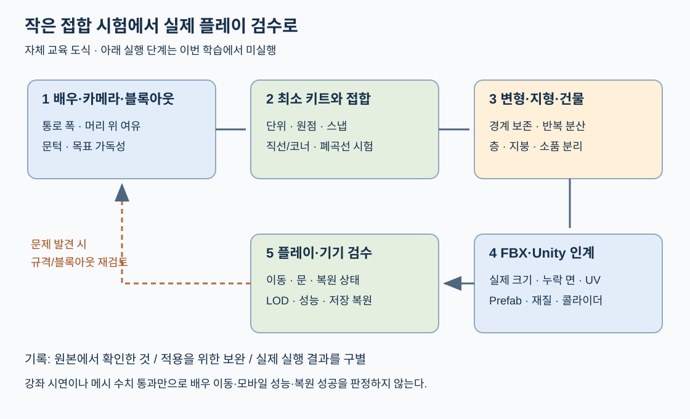

# 모듈러 맵 제작과 검수

재사용 부품으로 맵을 만들 때는 **접합 규격과 실제 플레이 공간을 먼저 정하고, 작은 조립 시험이 통과한 뒤 변형과 장식을 늘린다.** 이 문서는 지정된 공개 강좌 5개의 학습 결과다. 4시간 43분 11초 분량을 시작부터 끝까지 표본으로 확인하고 제공되는 자동 자막 4개 전체를 읽었다. 전 음성 연속 청취·모든 프레임 검사·직접 엔진 재현을 뜻하지 않는다.

| 읽을 순서 | 결정할 내용 | 다음 단계로 넘길 결과 |
|---|---|---|
| 1. 이 문서 | 플레이 목적·허용 경로·기준 캐릭터·카메라 | 블록아웃 시험 조건 |
| 2. [그리드와 키트](MODULAR_MAP_GRID_KIT.md) | 단위·피벗·접합 경계·회전 | 최소 키트와 연결표 |
| 3. [지형](MODULAR_MAP_TERRAIN.md) | 바닥·경사·절벽·해안 경계 | 연결 가능한 지형 조합 |
| 4. [건물](MODULAR_MAP_BUILDINGS.md) | 벽·문·층·지붕·장식 | 교체 가능한 조립체 |
| 5. [Blender→Unity](MODULAR_MAP_BLENDER_UNITY.md) | FBX·재질·UV·Prefab·콜라이더 | 왕복 검사 기록 |
| 6. [플레이 검수](MODULAR_MAP_PLAYABILITY_QA.md) | 이동·시야·복원 상태·성능 | 실제 실행 근거와 남은 문제 |
| 7. [강좌 시간 색인](MODULAR_MAP_COURSE_INDEX.md) | 원본 시점·주장·한계 | 출처를 다시 찾을 수 있는 기록 |

## 학습 근거와 적용 제안

각 문서의 `원본 확인`은 강좌 화면·설명에서 확인한 내용, `적용 제안`은 그 원리를 실제 제작에 쓰기 위한 보완이다. `미실행`은 이번 교육 중 앱에서 검증하지 않은 항목이다. 원본의 치수·키·미술 스타일을 특정 게임의 승인 규격으로 바꾸지 않는다.

- Curtis Holt: 호환되는 그리드, 중첩 모듈, 디테일 배분, 비대칭과 스토리 강조. 게임용 타일 키트를 처음부터 만드는 실습은 아니다.
- Imphenzia 던전: Blender에서 기본 부품·변형·팔레트 UV를 만들고 수동 조립. 절차적 던전 생성·Unity 이동 시스템은 구현하지 않는다.
- Imphenzia 설원 집: 빔·문·지붕·발코니를 제작하고 FBX와 Unity Prefab으로 조립. 맞춤 눈 셰이더 작업에는 오류와 미해결 간섭이 남는다.
- LMHPOLY: 제공된 지형 팩의 서로 다른 메시/LOD/Terrain 계열을 사용. 지형 팩 자체를 모델링하는 강좌는 아니다.
- Christina Creates Games: 에셋 분류·그리드·집 계층·Prefab·소품·NavMesh 예제. 문 제외 베이크는 한계를 인정한 편의 절차다.

전체 확인 범위와 파일 검증은 [학습 기록](../reports/VideoLearning/20261101_MODULAR_MAP_REVIEW.md), [검증 JSON](../reports/VideoLearning/20261101_MODULAR_MAP_VERIFICATION.json)에 있다.

## 블록아웃 시작 조건 — 적용 제안

1. 승인된 캐릭터 크기, 이동 방식, 카메라 투영·거리와 목표 기기를 받아 적는다. 모자가 포함된 높이, 몸통 폭, 실제 이동 판정 폭, 문을 지날 때의 여유를 구별한다.
2. 바닥 한 장, 직선 두 장, 안/밖 코너, 끝막음, 문구멍, 높이 전환 하나만 만든다. 작은 방 또는 짧은 길에서 한 바퀴 돌아 시작점에 정확히 닫히는지 시험한다.
3. 통로의 폭·머리 위 여유·문턱·단차를 정면/측면/위쪽에서 확인한다. 장식은 통로 확보 이후에 추가한다.
4. 카메라에서 배우와 목적지가 함께 보이는지 확인한다. 벽·지붕·전경 식생이 길과 상호작용 지점을 가리지 않는지 별도 검사한다.
5. 직선·코너·문·경사의 연결이 확인되면 같은 접합 규격을 유지한 변형을 만든다. 배경 실루엣을 바꾸는 작업과 플레이 영역을 바꾸는 작업은 따로 기록한다.

실제 프로젝트에서는 기존 이동 구현과 지도 승인 상태를 먼저 따른다. NavMesh 강좌를 읽었다는 이유로 기존 경로 탐색을 교체하거나 새 지역·건물·복원 거래를 추가하지 않는다.

## 적은 부품으로 반복을 줄이기

원본 확인: 던전은 바위·판자·폐허 벽을 조합하고, 집은 층·지붕·굴뚝을 교체한다. Curtis는 여러 칸을 가로지르는 긴 배관과 비대칭 디테일로 그리드의 반복을 끊는다.

적용 제안: 먼저 큰 형태(지형/건물), 다음 중간 형태(벽 변형/지붕), 마지막 작은 장식(간판/수풀)을 배치한다. 같은 변형이 같은 방향으로 연속되면 회전·조합을 바꾸되 접합부는 보존한다. 모든 틈을 소품으로 숨기기 전에 실제 틈의 원인을 해결한다. 읽기 어려운 잡동사니와 수많은 재질을 추가하는 것을 품질 향상으로 계산하지 않는다.

## 다음 담당에게 넘길 묶음

최소 키트 목록, 단위/피벗/회전 규칙, 접합 랜드마크, 사용 가능한 조합표, 원본과 후보 구분, 동일 조건 정면/사선/측면 비교, FBX 재임포트 차이, 오류 목록과 검수 결과를 함께 넘긴다. 모양을 바꿀 때는 실제 가이드에 목표 윤곽·이동 범위·보존 경계를 표시한 뒤 수정한다. 교육 자료만으로 장면 변경을 승인받았다고 해석하지 않는다.

이번 작업은 교육 문서와 자체 도식 작성까지다. Blender·Unity·Android 실행, 캐릭터·지도·텍스처 변경, 유료 팩 구매와 도구 설치는 수행하지 않았다.
