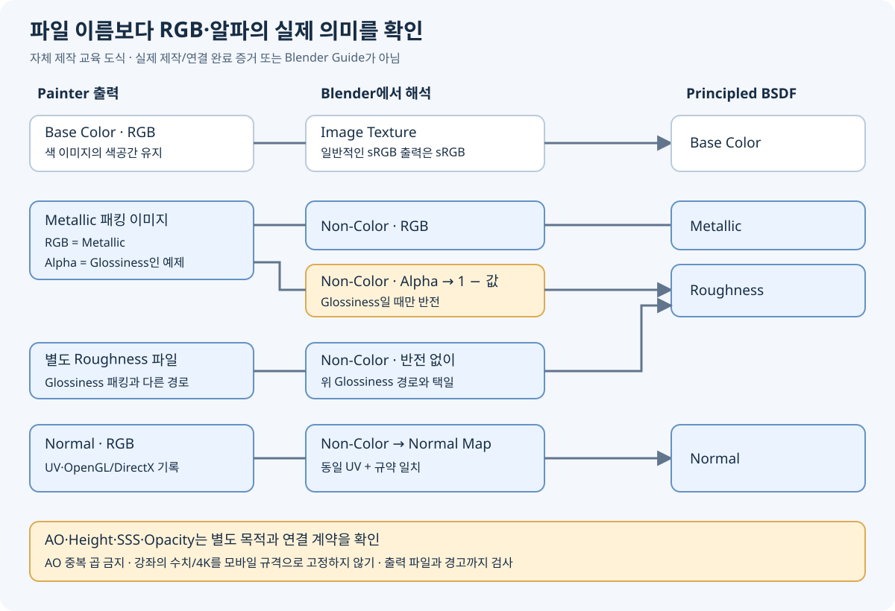

# 캐릭터 텍스처 작업 매뉴얼 · 세 강좌 연결

2026-10-31 · 교육 자료. 세 강좌의 전체 흐름을 표본 화면으로 읽고 주요 구간을 촘촘히 확인했다. 전 구간 연속 시청·음성 전사 학습이나 실제 앱 제작 완료를 뜻하지 않는다. [검토 범위와 한계](../reports/VideoLearning/20261031_PAINTER_COURSES_REVIEW.md), [수치·출처 기록](../reports/VideoLearning/20261031_PAINTER_COURSES_VERIFICATION.json).

## 읽는 순서

| 매뉴얼 | 배울 내용 | 원본 |
|---|---|---|
| [1. 스타일 캐릭터](PAINTER_STYLIZED_CHARACTER.md) | 색 블록 → 마스크 → 얼굴 색 변화 → 재질 분리 → 출력 | Khatri3D, [33:12 강좌](https://www.youtube.com/watch?v=L6vsR64BbXA) |
| [2. 피부 레이어](PAINTER_SKIN_LAYERS.md) | 준비·미세 요철·피부색·국소 디테일·SSS·거칠기, 공식 10개 수업 | Adobe/Magdalena Dadela, [74분 강좌](https://www.adobe.com/learn/substance-3d-painter/web/texturing-characters-in-substance-3d-painter) |
| [3. Blender 연결](PAINTER_TO_BLENDER.md) | 출력 템플릿·채널 패킹·색공간·노멀·거칠기 반전·AO | Art of Pilgrim, [약 3:30 강좌](https://www.youtube.com/watch?v=Ze88TvD2ku0) |

스타일 캐릭터 작업 순서를 먼저 익힌 뒤 피부 레이어의 역할을 이해하고 마지막에 출력 계약을 확인한다. 세 강좌의 캐릭터·로고·사진·유료 소재를 퍼즐 아일랜드 자산으로 가져오지 않는다.

## 루미에 적용하기 전 고정할 것

1. `AGENTS.md`, [아트 지침](PROJECT_REFERENCE_GUIDE.md), [승인 이미지 목록](PROJECT_REFERENCE_GUIDE.md)을 읽고 해당 의상의 승인 원본을 실제로 본다. 강좌 예제를 승인 디자인으로 대체하지 않는다.
2. 실제 수정은 원본 복사와 가이드가 먼저다. Blender의 별도 Guide 컬렉션에 대상, 보존 경계, 연결 위치를 표시하고 가이드 파일·캡처·영역/인덱스를 함께 인계한다. 이 문서의 도식은 그 가이드를 대체하지 않는다.
3. 메시/UV가 확정되지 않았으면 텍스처 완성을 선언하지 않는다. 소스 메시 버전, UV 이름, 재질 슬롯, Texture Set, 이미지 규격을 기록한다. UV를 바꾸면 기존 페인트와 베이크를 다시 확인해야 한다.
4. 머리 피부·안구·구강·의상은 필요한 셰이더 특성이 다르다. 분리할 재질과 맵, 사용할 UV를 먼저 합의한다. 별도 눈 제작·움직임·리깅은 이번 교육 문서의 실행 범위에 포함되지 않는다.

현재 루미 v021의 **PARTIAL 상태는 유지**한다. 이번에는 Blender·Painter·Claude의 실제 파일이나 연결을 검사하거나 수정하지 않았다.

## 제작 순서와 통과 기준

| 단계 | 작업 | 다음 단계로 넘어갈 기준 |
|---|---|---|
| 입력 고정 | 소스 메시/UV/재질 이름과 버전 기록, UV 체크무늬 확인 | 늘어짐·중복·방향이 의도대로이고 눈·입 경계가 식별됨 |
| 베이크 | 필요한 Normal/AO/Curvature/Position/Thickness만 생성·검토 | 투영 누출, 검은 얼룩, 반전, 다른 부품 간 오염을 직접 확인 |
| 색 블록 | Fill Layer로 승인 기본색, 마스크로 부위 분리 | 단색 보기에서 색 영역과 경계가 맞음 |
| 얼굴 색 | 홍조·입술·색 변화 각각 별도 레이어 | 승인 인상 유지, 큰 명암이나 노화 디테일이 새로 생기지 않음 |
| 표면 | 피부/눈/입/천의 Roughness·Normal·필요한 SSS 분리 | 고정 조명에서 재질 차이가 읽히고 플라스틱·젖은 피부처럼 보이지 않음 |
| 출력 | 맵별 의미·RGB/알파·색공간·노멀 규약 기록 | 파일을 실제 열어 해상도/채널/누락을 확인 |
| Blender 확인 | 정확한 UV·맵 연결, 동일 조명·카메라로 전후 비교 | 정면·사선·측면과 눈/입 확대에서 경계·솔기·재질 개선 확인 |
| 게임 확인 | Unity URP용 별도 출력/셰이더 계약 확인 | Android 가로 화면의 실제 크기·압축·성능 검증 |

마지막 게임 검증은 이 강좌들의 Blender 미리보기만으로 대신할 수 없다. 강좌의 4K, 소재 수, SSS 값은 모바일 최종 사양으로 채택하지 않는다.

## 전달물

원본을 보존한 `.spp` 후보, 정확히 대응하는 메시 버전, 출력 맵, 채널 표, 작업 전후 캡처, 경고/미완료 목록을 함께 남긴다. 외부 텍스처 경로가 유효한지 확인하고 이름·확장자만으로 성공 처리하지 않는다. 실제 제작을 맡길 때는 이 문서 링크와 함께 **대상 파일·Guide·변경 영역·보존 항목·완료 기준**을 전달한다.

## 버전 차이

직접 읽은 강좌 화면은 Khatri3D의 Painter **8.3.0**, Adobe의 Painter **2019.1.2**, Pilgrim의 Blender **3.0.1**이다. 현행 메뉴 위치·프리셋 구성은 다를 수 있다. Blender 5.2 공식 문서에서 Normal Map의 Convention 설정과 Principled 입력을 대조했지만 로컬 앱에서 재현하지 않았다. 창 색과 미리보기의 밝기만 보고 채널 연결이나 저장 성공을 추정하지 않는다.
