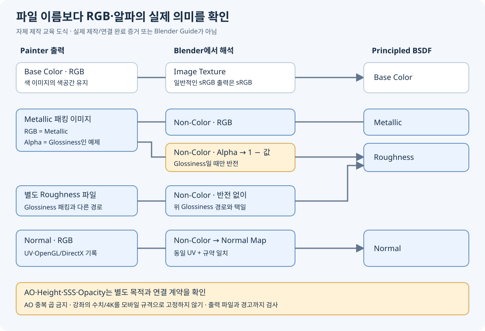

# Painter → Blender · 출력과 채널 연결 매뉴얼

[세 강좌 안내](PAINTER_CHARACTER_WORKFLOW.md) · [Art of Pilgrim 원본](https://www.youtube.com/watch?v=Ze88TvD2ku0), 약 3:30. 고유 시점 47개와 원본 크기 UI 7장 확인. 예제 Blender는 **3.0.1**이며 아래 5.2 설명은 공식 문서 대조다. 로컬 앱을 실행해 옮긴 결과는 아니다.

## 영상의 실제 출력 구조

00:50에서 `Unity Universal Render Pipeline (Metallic Standard)` 프리셋을 복제하고 `Substance to Blender`로 이름을 바꾼다. 파일명도 바꾸지만 채널 의미는 그대로 남는다. 01:25 전후에는 AO 출력을 추가한다.

| 출력 | 영상에 보이는 데이터 | Blender 연결 시 확인할 점 |
|---|---|---|
| Albedo | RGB Base Color, 원래 프리셋의 알파 Opacity | 색은 Base Color, 알파는 투명도가 필요한 재질에만 사용 |
| Metallic | RGB Metallic, **알파 Glossiness** | RGB는 Metallic, 알파는 **1−값**으로 바꿔 Roughness |
| Normal | 변환된 Normal OpenGL | Non-Color → Normal Map → Principled Normal |
| Emission | 발광용 출력 | 실제 발광이 필요한 경우만 연결, 영상의 자동 연결 선택에서는 제외 |
| AO | Mesh maps의 Ambient occlusion | 별도 베이크 차폐 데이터, 색과 같은 의미가 아님 |

01:50에는 targa, 8 bits + dithering, 해상도 메뉴가 보인다. 커서가 4096 위에 있는 화면만으로 실제 최종 해상도 선택을 확정하지 않는다. 영상의 파일 확장자·4K 선택 가능성을 프로젝트 필수 규격으로 만들지 않는다.

현재 [Adobe Output templates 문서](https://experienceleague.adobe.com/en/docs/substance-3d-painter/using/export/export-window/output-templates)는 출력 구성과 이름을 별도로 관리하며, Glossiness가 Roughness의 반전임을 설명한다. 따라서 파일을 `Metallic`으로 개명해도 알파 데이터가 Roughness로 바뀌지는 않는다.

## 두 가지 연결 방식

### A. 영상의 패킹을 유지하는 경우

1. 각 이미지의 실제 RGB/알파 내용을 확인한다. 알파가 없어지면 Smoothness 정보도 사라지므로 출력 형식과 저장 채널을 함께 검사한다.
2. Albedo는 해당 파일의 색공간에 맞춰 읽고 Base Color에 연결한다. 예제 화면은 sRGB다.
3. Metallic 패킹 이미지는 Non-Color로 읽는다. Color를 Metallic에, Alpha를 `1−Alpha`에 넣고 그 결과를 Roughness에 연결한다. 영상 02:45에는 Invert, Fac=1로 이 반전이 추가된다. 새 구성에서는 Math Subtract(1, Alpha)도 의도가 명확하다.
4. Normal은 Non-Color로 읽고 Normal Map 노드에 넣는다. 이미지에 사용한 UV와 Normal Map이 사용하는 UV를 일치시킨다.
5. 출력 BSDF를 Material Output의 Surface에 연결하고 고정 조명에서 확인한다. 투명도·발광·높이 맵은 별도 필요성이 있을 때 연결한다.

### B. 분리된 Roughness를 출력하는 경우

Base Color, Roughness, Metallic, Normal OpenGL을 명확한 별도 파일로 출력하면 각 맵을 해당 입력에 직접 연결할 수 있다. 이때 **Roughness를 다시 반전하지 않는다**. 피부처럼 금속이 아닌 재질에는 Metallic 상수 0을 사용할 수 있으며, 금속 부품과 섞인 세트는 해당 마스크/맵이 필요하다. 이 방식은 현재 작업용 제안이며 영상이 분리 Roughness를 출력했다는 주장이 아니다.

## 노멀·색공간·AO에서 자주 생기는 문제

| 증상 | 먼저 확인할 것 |
|---|---|
| 들어가야 할 홈이 튀어나옴 | Normal 규약과 Y 방향, 중복 반전 여부 |
| 피부가 유리처럼 번쩍임 | Roughness인지 Glossiness인지, 알파 유실 여부 |
| 표면 음영이 찌그러짐 | Normal을 색 이미지로 읽는지, UV/탠전트 기준이 맞는지 |
| 전체가 어두워짐 | AO를 Base Color에 중복 곱했는지, 조명/색 관리가 달라졌는지 |
| 기본색은 맞지만 재질이 다름 | Roughness/Normal 연결, 환경·노출·색 변환·셰이더 차이 |
| 분홍색 또는 누락 | 이미지 경로/파일 존재, 재질과 Texture Set/UDIM 대응 |

Blender 5.2 [Normal Map 공식 문서](https://docs.blender.org/manual/en/5.2/render/shader_nodes/displacement/normal_map.html)는 기본 OpenGL 규약과 DirectX용 Convention 설정을 설명한다. OpenGL 맵이면 OpenGL, DirectX 맵이면 지원되는 Convention을 맞춘다. 이미 맞춘 맵에 녹색 채널 반전을 추가로 적용하지 않는다. 구버전 UI와 현재 설정을 혼용하지 않는다.

영상의 03:20 그래프에는 AO로 사용하는 추가 이미지와 Multiply, Fac **0.500**이 보이며 그 이미지의 Color Space는 **sRGB**로 남아 있다. 이것을 데이터 맵의 정답 설정으로 복사하지 않는다. 스칼라 AO는 데이터로 읽고, 실제 목적이 있을 때만 강도를 조절해 곱한다. 영상의 Multiply 0.5는 완전한 AO 곱과도 다르다. 최종 게임 셰이더가 AO를 별도로 받는다면 해당 경로를 사용하고 Base Color에 중복으로 구워 넣지 않는다.

[Image Texture 문서](https://docs.blender.org/manual/en/5.2/render/shader_nodes/textures/image.html)의 Color와 Alpha 출력은 별개다. [Principled 문서](https://docs.blender.org/manual/en/5.2/render/shader_nodes/shader/principled.html)의 입력 이름/역할에 따라 연결한다. Node Wrangler의 자동 연결은 편의 기능이며 패킹 의미를 검사하는 기능은 아니다. 영상 02:05의 환경설정 체크박스가 현재 로컬 앱에 설치·활성화돼 있다는 근거도 아니다. 추가 기능이 없어도 위 연결을 수동으로 구성할 수 있다.

## 출력 인수 체크

출력 폴더의 파일을 실제 열어 해상도·비트 깊이·RGB/알파·노멀 규약을 확인한다. 같은 메시 버전/UV로 연결하고 피부·눈·입·의상을 각각 검사한다. 정면·사선·측면, 가까운 화면과 실제 게임 크기에서 비교한다. 오류가 남으면 파일 생성과 별개로 PARTIAL로 기록한다.

Blender 미리보기 완료를 Unity URP/Android 적용 완료로 표시하지 않는다. 이번 교육 작업에는 파일 임포트·노드 제작·렌더·게임 적용이 포함되지 않았다.
