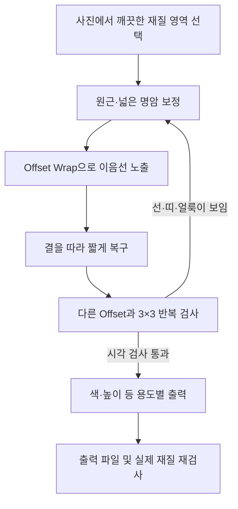

# 사진으로 심리스 텍스처 만들기 · 다섯 강좌 통합 매뉴얼

상하·좌우의 연결선과 반복되는 밝기 얼룩을 함께 줄이는 제작 절차다. **이음선이 안 보이는 것과 반복감이 적은 것은 별도 조건**이다. 가죽·목재·돌처럼 방향과 밀도가 있는 재질에 적용한다.

[높이 맵과 Blender 연결](SEAMLESS_TEXTURE_HEIGHT_MAPS.md) · [검수 및 실패 해결](SEAMLESS_TEXTURE_QA.md) · [학습 범위와 도구 오류 교정](../reports/VideoLearning/20261101_SEAMLESS_TEXTURE_REVIEW.md)

## 강좌와 확인한 핵심 구간

2026-11-01 원본 영상 5편의 전체 구간에서 168개 시점을 표본 확인하고, 한국어 자동 자막 1편·영어 자동 자막 4편을 대조했다. 연속 재생으로 모든 동작을 관찰하거나 모델 가중치를 재학습한 작업은 아니다. 아래 시각은 원본 영상 기준이며 자막의 발화 경계에는 오차가 있다.

| 강좌 | 길이 | 다시 볼 구간 | 배울 점 |
|---|---:|---|---|
| [hogual · 패턴없는 맵핑 만들기](https://www.youtube.com/watch?v=9yN97W9vEBI) | 43:30 | 08:00–19:30, 24:00–32:00, 33:00–42:00 | 사진 정렬, 잘라 옮기기, 무늬를 따르는 마스크, 축소 반복 검수 |
| [PiXimperfect · Turn Any Texture Into Seamless Pattern](https://www.youtube.com/watch?v=9_36YihB8I4) | 12:17 | 01:12–06:19, 06:19–08:15 | Offset, 채우기 실패 비교, 재검사, 명암·색의 반복 제거 |
| [What Make Art · Create Seamless, Tileable Textures](https://www.youtube.com/watch?v=lY1LjXYrSZ4) | 04:44 | 01:03–03:44, 03:44–04:44 | 짧은 전체 절차, 복구 후 다시 Offset, 패턴 등록 |
| [Photoshop Training Channel · 3 Seamless Pattern Techniques](https://www.youtube.com/watch?v=74We8IgMW0c) | 29:59 | 06:41–15:47, 15:47–23:00 | 밝기 얼룩, 원근, 눈에 띄는 흠집과 반복감 처리 |
| [TriMech Group · How to Create Seamless Textures](https://www.youtube.com/watch?v=lP3y5gIQ2mU) | 05:47 | 01:53–03:25, 03:25–05:30 | 2000px 예제, 복구·패치, 색/노멀의 매핑 동기화 |

## 강좌별로 가져올 원리

**hogual:** 약 09:00–16:00의 벽돌 예제는 사진 일부를 반대편으로 옮겨 외곽을 이어 놓고, 내부의 겹침을 무늬에 맞춰 정리한다. 13:30의 겹친 벽돌 줄과 15:00의 선택 범위를 함께 보면 직선 삭제보다 줄눈을 따르는 절단이 자연스러운 이유를 알 수 있다. 돌은 돌의 외곽, 나무는 결을 따른다. 17분 이후에는 복제한 큰 화면에서 어두운 영역과 유독 진한 벽돌을 보정한다. 픽셀만 확대하는 것과 더 넓은 실제 재질 영역을 촬영하는 것은 다르다.

**PiXimperfect:** 초반 Content-Aware Fill이 돌의 연결을 잘 맞추지 못하는 경우와 생성형 채우기의 해상도 저하를 비교한다. 03:30의 생성 레이어는 성공적인 연결처럼 보여도 확대하면 주변과 선명도가 다를 수 있다. 05:00–06:19에는 합성 결과를 다시 옮겨 새 이음선을 찾는다. 07:00의 `Soft Light` 레이어와 브러시 `Flow 1%`는 넓은 명암 반복을 천천히 보정하는 예다. 이 수치를 모든 재질의 정답으로 고정하지 않는다.

**What Make Art:** 세차 거품 사진을 정사각형으로 자르고 경계를 중앙으로 옮긴다. 03:06.5 화면은 2160×2160 문서에 Offset +1080/+1080, Wrap Around를 보여 준다. 앞선 복구·클론·생성형 채우기 후에도 재검사를 거친다. 마지막 Curves와 흑백 보정은 패턴을 다루기 쉽게 만드는 예이며, 거품 사진의 밝기를 실제 물리 높이로 측정한 과정은 아니다.

**Photoshop Training Channel:** 돌 예제에서는 가장자리의 어둠을 Levels/Screen과 마스크로, 중앙의 밝은 띠를 Curves/Multiply와 마스크로 따로 조절한다. 09:34.5에는 이 레이어와 흑백 관찰 화면이 보인다. 울타리 예제는 원근을 먼저 고치고, 독특한 흠집이 반복 표식이 되는 문제를 다룬다. 울타리는 최종 합성에 필요한 좌우 연결을 중심으로 작업한다. 이를 상하까지 완전한 재질 타일이라는 근거로 쓰지 않는다.

**TriMech:** 02:20 화면의 2000×2000 문서와 Offset +1000/+1000, Wrap Around를 확인했다. 복구와 패치 도구로 안쪽 접합을 정리하며 바깥 테두리를 다시 손상시키지 않도록 설명한다. 03:50.5에는 옛 Photoshop `Generate Normal Map` 대화상자, 05:00–05:20에는 Visualize의 `Type: Normal` 및 `Sync Textures`가 보인다. 강좌의 노멀 맵은 흑백 디스플레이스먼트 맵과 다르다.

## 실제 제작 순서

### 1. 원본과 재질 영역 준비

1. 원본을 보존하고 복사 문서에서 작업한다. 가능하면 반사 핫스폿·깊은 그림자·압축 손상이 적고 재질이 넓게 담긴 사진을 고른다.
2. 가죽만 있는 영역을 자른다. 봉제선·구멍·포켓 경계·배경·손가락을 타일에 넣지 않는다. 이들은 별도 형상이나 마스크의 대상이다.
3. 원근과 왜곡을 먼저 바로잡는다. 결 방향과 실제 무늬 크기를 확인한다. 정사각형은 작업 편의일 뿐이며 직사각형도 반복할 수 있다.
4. 원본 해상도와 표본의 실제 넓이를 기록한다. 확대 저장만으로 새 가죽 결이 생겼다고 판단하지 않는다.

### 2. 넓은 명암 차이부터 줄이기

`View > Pattern Preview`로 축소한 반복 화면을 본다. 어두운 모서리·밝은 중앙·튀는 색 덩어리를 찾아 마스크가 있는 Levels/Curves 등으로 보정한다. 한꺼번에 대비를 높이면 얼룩도 강조된다. 색 작업은 임시 흑백 관찰로 명암을 확인한 뒤 색 상태를 다시 본다.

### 3. 경계를 중앙으로 옮기기

`Filter > Other > Offset`에서 `Wrap Around`를 선택한다. 예를 들어 2048×2048이면 가로·세로 1024px을 시작값으로 쓸 수 있다. 가로·세로 절반은 **검사하기 편한 배치**이며 심리스를 자동 완성하는 값은 아니다. 임의의 Offset으로도 경계를 검사할 수 있다.

Wrap은 반대쪽으로 픽셀을 순환 이동한다. 좌우 반전인 Mirror나 끝 픽셀 늘이기인 Repeat Edge Pixels와 다르다. Offset 후에는 원래의 바깥 이음선이 문서 안쪽에 나타난다.

### 4. 무늬를 살리며 내부 접합 복구

- 작은 불규칙 결에는 복구 브러시·패치를 먼저 시도한다.
- 방향성 있는 결에는 연결할 능선과 골을 정하고 클론·레이어 마스크로 짧게 이어 준다. 동일한 표본을 길게 도장 찍어 새 반복 표식을 만들지 않는다.
- 마스크 경계는 자연스러운 골을 따라 조금 불규칙하게 잡는다. 전체 십자선을 넓게 흐리는 방식은 결이 사라진 띠를 만들 수 있다.
- 생성형 채우기를 쓰면 결과의 결 크기·방향·선명도와 새 흠집을 비교한다. 넓은 선택 한 번으로 원본 해상도가 유지된다고 가정하지 않는다. 사용할 앱·계정·비용은 실제 환경에서 확인한다.
- 외곽까지 수정했다면 좌우·상하 연속성을 다시 검사한다. 문서 안에서만 자연스러워 보이는 것으로 끝내지 않는다.

### 5. 다시 옮기고, 멀리서 검사

현재 보이는 레이어를 합친 검사 사본을 만들고 다른 가로·세로 Offset으로 검사한다. 원본 레이어는 보존한다. 합성 경계나 채우기 결과가 반대쪽 가장자리를 손상시킬 수 있기 때문이다.

100% 확대에서는 끊긴 결·복구 흔적·선명도 차이를 찾는다. 축소한 3×3 이상의 반복 화면에서는 사각 얼룩·십자 띠·독특한 흠집의 주기성을 찾는다. 결이 지나치게 촘촘한 영역도 반복 표식이다. 양쪽 검사를 모두 거친다.

### 6. 저장과 출력

레이어가 있는 PSD 등 편집본과 실제 재질에 넣을 이미지 파일을 구분한다. `Edit > Define Pattern`은 앱 안의 패턴 등록이며, Blender에서 읽을 이미지 파일 저장을 대신하지 않는다. 높이 맵 변환 후에는 반복 검수를 다시 한다.

## Photoshop과 PhotoCraft 구분

강좌의 Photoshop 메뉴가 ArtCraft의 PhotoCraft에서 같은 품질·비트 깊이·동작으로 제공된다고 가정하지 않는다. 현재 앱에서 선택 영역·복구 결과·History·저장된 픽셀 변화를 실제 확인한다. 입력했는데 History와 이미지가 바뀌지 않았다면 실행 완료가 아니다. 반복 미리보기 안에서 도구가 작동하지 않으면 이를 끄고 단일 타일에서 편집한 뒤 반복 화면을 다시 확인한다.

[Adobe의 현재 Pattern Preview 안내](https://helpx.adobe.com/photoshop/desktop/apply-painting-techniques/create-fill-with-patterns/create-a-new-pattern.html)는 미리보기와 패턴 등록을 설명한다. 자동 경계 복구 기능으로 설명하지 않는다. TriMech에 보이는 옛 3D 노멀 생성 메뉴는 설치한 버전에서 별도 확인한다. 현재 앱에서 재현하지 않은 메뉴를 지원 완료로 표시하지 않는다.
