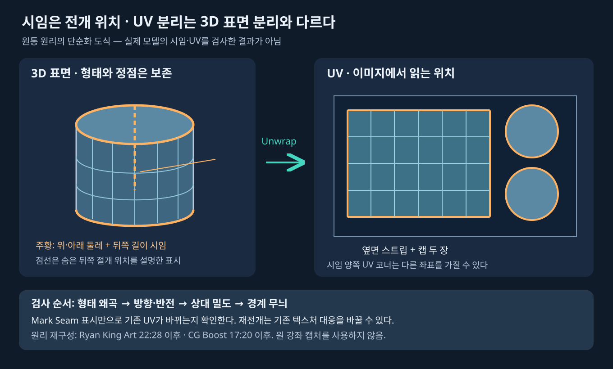

# 시임·펼치기·체커·핀과 Relax

[UV 시작점](UV_WORKFLOW.md) · [캐릭터](UV_CHARACTER.md) · [밀도·패킹](UV_TEXEL_DENSITY_PACKING.md)

주요 근거는 [Ryan 17:12 이후](https://www.youtube.com/watch?v=qa_1LjeWsJg&t=1032s), [CG Boost 11:34 이후](https://www.youtube.com/watch?v=JwkgVckqGw4&t=694s), [Dikko 02:00 이후](https://www.youtube.com/watch?v=ZyRtd8iYBOg&t=120s)다. 아래 절차는 강좌를 재구성한 교육용 작업법이며 현재 앱에서 실행한 결과가 아니다.

## UV가 분리되어도 표면은 붙어 있을 수 있다

한 3D 정점에 여러 면이 만날 때, 시임 양쪽의 면 코너는 UV에서 서로 다른 좌표를 가질 수 있다. 이때 UV 섬은 갈라지지만 피부 메시의 정점·면을 삭제하거나 분리한 것은 아니다. Mark Seam은 전개 알고리즘에 절개 위치를 알려주고, 실제 섬 배치는 Unwrap 이후에 바뀐다. UV 편집기의 Rip도 UV 연결을 나누는 동작으로 다룬다. 3D 뷰에서 메시를 찢는 동작과 혼동하지 않는다.

UV 섬을 크게 하면 같은 표면이 이미지의 더 넓은 부분을 읽는다. 반복 재질에서는 패턴 반복 횟수가 늘고 무늬가 작아질 수 있다. 섬을 작게 하면 반대다. 원본 이미지 해상도, 셰이더 Mapping 스케일, Repeat/Clip 같은 확장 방식도 함께 확인한다. 섬 크기만으로 월드 크기나 재질의 실제 의미가 바뀌지는 않는다.

## 형태별 첫 시임

| 형태 | 전개를 시작할 절개 예 | 확인할 점 |
|---|---|---|
| 닫힌 상자 | 전개도를 만들 수 있도록 이어진 절개, 필요하면 면 그룹 분리 | 한두 모서리만 끊고 전체가 잘 펴질 것으로 기대하지 않음 |
| 원통 | 위·아래 캡 둘레와 뒤쪽 길이 방향 절개 | 옆면 스트립, 캡 두 장의 왜곡과 밀도, 경계 무늬 |
| 도넛·고리 | 관 둘레를 여는 횡단 절개와 안쪽을 잇는 길이 절개 | 안/바깥 둘레 길이가 달라 모든 위치를 무왜곡 직사각형으로 만들 수 없음 |
| 구·머리 | 적도 분리 또는 숨은 세로 절개와 극점 완화 | 눈에 보이는 중심에 극점 쏠림·시임이 오는지 |
| 구멍 있는 단추 | 앞뒤·테두리 분리와 구멍 벽을 여는 절개 | 구멍을 둘러싼 면이 앞뒤를 계속 연결하는지 |
| 조합 형태 | 상자·원통·구의 접합부를 나눠 각 원리 적용 | 겉에서 안 보이는 연결 때문에 전체가 비틀리는지 |

이는 시작 가설이다. Dikko는 다른 캐릭터에서 귀를 따로 떼지 않는 예도 보여준다. 시임 수를 같게 맞추는 것이 목표가 아니다. 잘 보이는 부위의 연속성, 왜곡, 페인팅 편의, 베이크 경계를 비교해 선택한다.

## 펼치기 방법을 선택하는 조건

| 방법 | 적합성을 먼저 시험할 대상 | 제한 |
|---|---|---|
| Angle Based | 얼굴 등 굽은 유기 표면 | 내부 연결이나 부족한 시임을 자동 해결하지 않음 |
| Conformal | 각진 부품·규칙적인 형태 | CG Boost의 Suzanne 예에서는 불리하지만 Josh의 하드서피스 예는 실제 사용함 |
| Minimum Stretch | 지원되는 환경에서 기존 왜곡을 줄이는 후보 | CG Boost 원본 메뉴에서 확인한 기능. 이번 작업에서 현행 5.2 동작/옵션을 시험하지 않음 |
| Smart UV Project | 각도에 따라 나누는 기계형·간단 소품의 빠른 출발 | 많은 섬, 연속 무늬 단절, 작은 조각. 얼굴 전체의 완성 전개로 바로 쓰지 않음 |
| Project from View | 특정 시점의 평면 장식·데칼 또는 제한된 표면 | 앞뒤가 겹치고 시선에 평행한 면은 좁아짐. Bounds도 이 문제를 해결하지 않음 |
| Follow Active Quads | 규칙적인 쿼드 스트립·띠 | 활성 쿼드의 잘못된 비율이 전파될 수 있음. 삼각 극점/불규칙 유기 면 전체에 강제하지 않음 |

같은 사본·선택·시임·이미지에서 비교한다. 전개 방법을 바꿀 때마다 핀·시임·이미지 해상도가 함께 바뀌면 원인을 분리할 수 없다. 메뉴 단축키는 에디터 포커스와 키맵에 따라 달라질 수 있으므로 작업 이름을 기준으로 찾는다.

## Apply Scale의 정확한 범위

Ryan 29:15 이후는 Object Mode에서 비균일하게 늘린 원통을 보여주고 Scale 적용 후 **다시 전개**해서 체커 비율을 고친다. Apply Scale 자체가 이미 만들어진 UV를 자동 복구한다는 뜻이 아니다.

모델링 초기 사본에서 단위와 모양을 확정하고 비균일 Object Scale을 처리한 뒤 전개하는 흐름이 단순하다. 이미 리그·셰이프키·부모·모디파이어·애니메이션이 연결된 파일에서는 평가 결과와 데이터 의존성을 먼저 확인한다. 변환을 일괄 적용하거나 모디파이어를 전부 확정하는 것을 이 교육의 필수 단계로 만들지 않는다. 회전 적용도 Scale 문제와 따로 판단한다.

## 체커로 분리해 보는 네 가지 문제

1. **형태 왜곡:** 작은 정사각이 길게 늘거나 사선으로 기울어지는가. UV Stretch의 Angle/Area 표시와 3D 체커를 함께 본다. 파란색이라고 절대 왜곡 0을 보장하지 않는다.
2. **방향:** 글자와 화살표가 돌아가거나 반전되는가. 좌우 대칭이 필요한 패턴과 문자를 구별한다.
3. **밀도:** 월드에서 같은 길이의 부품에 체커 칸 수가 다른가. 이미지 크기·Mapping·세트가 같은 조건인지 먼저 확인한다.
4. **연결:** 시임 양쪽의 색·선이 끊기는가. 반복 이미지여도 경계 위상과 스케일이 맞지 않으면 이음새가 드러난다.

Material Preview에서 표시하거나, 원본 CG Boost처럼 Solid의 Texture 색 표시를 적절히 구성할 수도 있다. UV 에디터에 이미지를 열어놓았다는 사실만으로 재질에 연결된 것은 아니다. Dikko의 절차에서는 UV 좌표 → Mapping → Checker Texture를 사용하며 Node Wrangler는 편의 기능이다. 추가 기능을 설치하지 않아도 좌표 연결을 직접 만들 수 있다.

## 핀과 국소 완화

남길 윤곽·랜드마크를 먼저 고르고 해당 UV 코너를 Pin으로 고정한다. 바꾸려는 중간 루프는 Unpin한 뒤 작은 범위만 움직이거나 Relax한다. 전후 체커를 비교해 핀 사이가 접히거나 뒤집히지 않았는지 본다. Live Unwrap을 켜면 경계 이동이 주변 계산을 다시 바꿀 수 있으므로 안정된 기존 섬까지 선택하지 않는다.

Dikko 18:30~19:10의 UV Sculpt Relax는 **Lock Borders**를 켠 경계 보존 예다. CG Boost 30~31분은 구의 쿼드 부분을 핀으로 유지하고 극점 삼각 면을 다시 푸는 예다. Relax는 왜곡을 주변으로 분산시키며, 목표 디테일에 줄 UV 면적을 자동 결정하지 않는다. 유기 표면을 보기 좋은 직사각형으로 만들기 위해 과도하게 당기면 3D에서 오히려 늘어날 수 있다.

## 통과 기준

가시부에 의도하지 않은 겹침·뒤집힘·0에 가까운 UV 면적이 없어야 한다. 시임 양쪽을 정면·사선·측면에서 보고, 내부 면과 극점도 별도로 확인한다. 경계·선택·활성 UV가 명확하고 다른 섬이 움직이지 않았는지 확인한다. 화면에 좋아 보이는 것과 출력 베이크·mip·게임 렌더에서 통과하는 것은 별개다. 후자는 [인수 매뉴얼](UV_TEXTURE_SETS_HANDOFF.md)의 후속 검사다.
