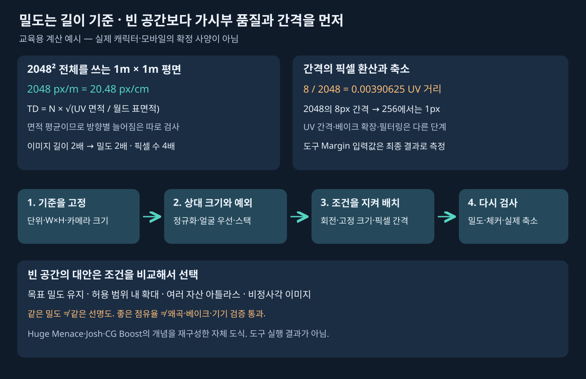

# 텍셀 밀도·면적·패킹과 간격

[UV 시작점](UV_WORKFLOW.md) · [재질/아틀라스 인계](UV_TEXTURE_SETS_HANDOFF.md)

주요 근거는 [Huge Menace/Tristan 전체 강좌](https://www.youtube.com/watch?v=sR1sAWWT2x8), [Josh 12분 이후](https://www.youtube.com/watch?v=j9uEqZxJMbY&t=720s), [CG Boost 25:32 도구](https://www.youtube.com/watch?v=JwkgVckqGw4&t=1532s)다. 수식과 간격 예시는 원리 설명을 보강한 것이며 실제 적용 캐릭터 사양이나 측정값이 아니다.

## 밀도와 선명도는 같은 말이 아니다

텍셀 밀도는 표면의 월드 길이에 할당되는 이미지 픽셀 수다. `px/m` 또는 `px/cm`처럼 단위를 붙인다. **10.24 px/cm = 1024 px/m**이다. 카메라를 멀리 옮겨도 월드 밀도는 그대로지만 화면에서 보이는 픽셀 수는 줄어든다. 흐린 원본 사진과 선명한 원본 사진은 같은 밀도로 배치해도 다르게 보인다.

정사각 이미지의 한 변을 N픽셀, UV 면적을 Auv(0~1 타일 면적 단위), 대응하는 실제 표면적을 Aw(m²)라 하면 면적 기반 평균 밀도는 다음과 같다.

`TD(px/m) = N × sqrt(Auv / Aw)`

이는 평균이며 방향별 늘어짐을 숨길 수 있다. 한 방향으로 늘어난 섬도 평균 면적만 같을 수 있으므로 체커와 각도 왜곡을 함께 검사한다. 서로 겹친 섬의 고유 이미지 점유율과 각 표면의 UV 면적을 섞어 계산하지 않는다.

| 변화 | 평균 밀도 | 이미지/표면 면적 변화 |
|---|---|---|
| 이미지 한 변 1024→2048, UV·표면 동일 | 2배 | 이미지 픽셀 수 4배 |
| UV 선형 스케일 2배, 이미지·표면 동일 | 2배 | UV 면적 4배, 타일 범위 초과 가능 |
| 물체의 실제 선형 크기 2배, UV·이미지 동일 | 1/2 | 표면적 4배 |
| 실제 표면적만 2배, UV·이미지 동일 | 1/√2 | 길이 2배와 다른 조건 |

1m×1m 평면이 2048² 이미지 전체를 쓰면 2048px/m = **20.48px/cm**다. Huge Menace 14:00 화면의 필기는 이 예다. 자동자막의 `248`/`2.48` 오인식을 그대로 계산에 쓰지 않았다. 면적 식은 픽셀 수/면적을 그대로 길이 밀도로 부르는 것이 아니라 제곱근 관계로 해석한다.

비정사각 이미지 W×H는 UV를 `(W·u, H·v)`의 픽셀 공간으로 환산해 방향별 크기를 검사한다. 면적 평균은 `sqrt(W·H·Auv/Aw)`로 쓸 수 있지만 가로/세로 비율 오류를 따로 확인해야 한다. 정사각 체커가 직사각형으로 보이면 이미지 종횡비와 Correct Aspect, Mapping을 먼저 본다.

## 상대 정규화와 목표 밀도 설정

Average Island Scale은 3D 표면 대비 섬 크기의 상대 차이를 줄이는 출발점이다. 목표 이미지 해상도와 단위를 모르면 `1024px/m로 맞췄다`고 말할 수 없다. 얼굴을 더 크게 쓰거나 숨은 면을 작게 쓰려면 기본 정규화 뒤에 예외를 적용하고 별도로 기록한다.

목표 밀도 d에 필요한 총 UV 면적의 근사는 `Auv = Aw × (d/N)²`다. 예를 들어 2048²에서 표면적 2m²를 1024px/m로 쓰면 0.5타일 면적이 필요하다. 이는 간격·섬 형태·회전 제한을 고려하기 전의 이론값이며 50% 점유만으로 패킹 가능을 보장하지 않는다. 목표가 두 배면 필요한 면적은 네 배다.

Josh는 여러 재질 세트의 밀도를 가장 낮은 세트에 맞춘다. 원본 13:45의 Zen UV 표시는 **1108.22 px/m**이고 일부 세트에 빈 공간이 남는다. 이 값과 4096² 여러 장을 게임 캐릭터의 필수 사양으로 복사하지 않는다. 한 세트만 더 크게 확대하면 세트 간 체커 크기가 다시 달라진다.

## 패킹에서 지켜야 할 조건

1. 같은 이미지에 들어갈 세트만 선택한다. 서로 다른 이미지를 쓰는 UV는 타일 내 좌표가 같아도 반드시 충돌은 아니다.
2. 상대 밀도·우선 영역·겹침 그룹을 먼저 고정한다. 패커가 모든 섬을 개별 확대해 밀도 관계를 바꾸는지 확인한다.
3. 글자·섬유·목재 결처럼 방향이 있는 텍스처는 회전 허용 각도를 제한한다. 고유 페인팅 전에는 자유 회전이 가능해도 재페인팅 없이 기존 텍스처를 돌릴 수는 없다.
4. 의도된 스택은 하나의 그룹으로 다룰지, 베이크용 분리 후보를 쓸지 명시한다. 겹침 검사 결과에서 허용 목록과 실수를 구분한다.
5. 간격·타일 테두리·작은 조각을 실제 픽셀 기준으로 확인하고, 패킹 뒤 목표 밀도를 다시 측정한다.

Josh는 UVPackmaster2, Zen UV 등을 사용한다. CG Boost는 기본 Average Island Scale/Pack Islands도 보여준다. 기본 기능으로 개념을 수행할 수 있다는 것과 추가 패커의 최적화 성능·세부 옵션이 동일하다는 것은 다르다. 이번 학습 때문에 추가 기능을 설치하거나 구매하지 않았다.

## 빈 공간을 다루는 선택

| 선택 | 이점 | 대가/검사 |
|---|---|---|
| 목표 밀도 엄수, 빈 공간 허용 | 세트 간 기준 유지 | 이미지 크기를 줄일 수 있는지 별도 검토 |
| 허용 범위 안에서 밀도 소폭 증가 | 일부 빈 공간 활용 | 기준 편차·메모리 증가·원본 선명도 확인 |
| 여러 소품을 아틀라스로 묶음 | 고유 영역의 빈 공간 공유 | 재질/셰이더·로드 수명·수정 동기화가 묶임 |
| 비정사각 이미지 | 형태에 맞는 배치 가능 | 출력 도구·압축·셰이더·종횡비 검증 필요 |
| 모델 크기 변경 | 배경 소품은 예술적 선택이 될 수 있음 | 승인된 캐릭터 크기를 UV 효율 때문에 바꾸지 않음 |

Huge Menace의 말미 예는 soft TD 11.20px/cm·60%, 두 모델 아틀라스 10.24px/cm·71%, 비정사각 10.24px/cm·63%처럼 서로 다른 조건을 보여준다. 특정 점유율을 모든 제작사의 합격선으로 삼지 않는다. 체커가 반듯해도 점유율만으로 형태 왜곡·원본 품질·카메라 품질을 평가할 수 없다.

## 섬 간격·베이크 확장·mip 번짐

다음은 강좌의 완성 베이크 시연이 아니라 **출력 전 보강 점검**이다. UV Margin, 베이크 Dilation/Padding, 런타임 필터링은 서로 다른 단계다. 패커가 남긴 공간을 베이커가 자동으로 적절히 채운다고 가정하지 않는다.

정사각 R픽셀 이미지에서 UV상 거리 g는 한 축 기준 약 `g×R`픽셀이다. 2048에서 8픽셀은 `8/2048 = 0.00390625`다. 이는 거리 환산 예시이며 모든 도구의 Margin 입력값이 이 비율을 직접 뜻한다는 말이 아니다. 옵션의 Scaled/Add/Fraction 등 방식에 따라 최종 결과를 측정해야 한다. 두 섬 각각 바깥으로 p픽셀의 확장 띠를 보존해야 한다면 둘 사이에는 적어도 2p와 필터 여유가 필요하다. 경계 확장의 충돌 처리도 베이커마다 확인한다.

2048의 8픽셀 간격은 256으로 축소하면 1픽셀에 해당한다. 원본에서 깨끗해도 작은 mip·블록 압축·사선 필터에서 다른 섬의 색이 섞일 수 있다. 고대비 진단색, 실제 최저 사용 해상도, 타일 가장자리, 피부/의상 경계에서 검사한다. `항상 8px`나 `항상 0.001` 같은 전역 정답은 두지 않는다. 이번에는 실제 베이크·mip·Android 압축 시험을 하지 않았다.
